# Database Design Interview Workbook: 48 Systems

**Baseline:** PostgreSQL 16+, relational OLTP unless stated otherwise. Optional PostgreSQL extensions used by specific examples include `citext`, `btree_gist`, and PostGIS (`postgis`); enable only those required by the chosen design. UUIDs suit externally visible entities; `bigint`/time-sortable keys often suit append-only high-volume records. Store money as integer minor units, not floating point; store instants in UTC `timestamptz`, and retain IANA time zones for local-time rules. These are interview designs: adapt them after clarifying the actual invariants, traffic, compliance obligations, retention rules, and service boundaries.

## How to practise

For every exercise, follow the same six steps: (1) write business requirements and access patterns; (2) draw the ER diagram and state cardinalities; (3) define tables, primary/foreign keys, constraints and indexes; (4) write the important SQL; (5) defend transaction boundaries, isolation and concurrency; (6) explain what changes at 100× scale. Every chapter follows this structure. The 36 added chapters contain five representative queries each; the 12 previously developed designs retain their deeper examples and notes.

## Cross-system design habits

- **Model the grain:** state exactly what one row represents.
- **Make invariants enforceable:** prefer `UNIQUE`, foreign keys, `CHECK`, exclusion constraints, conditional writes and short transactions over application-only checks.
- **Separate current state from history:** mutable projections support fast reads; immutable events and ledger rows support audit/reconstruction.
- **Assume retries:** use scoped idempotency keys and durable outcomes. External provider calls do not belong inside a DB transaction.
- **Index access patterns:** equality predicates first, then range/order columns; each index costs storage and write throughput.
- **Use distributed workflow patterns:** outbox/inbox, idempotent consumers, retries, reconciliation and sagas when work crosses services.
- **Scale from measurements:** inspect query plans, lock waits, skew and retention before sharding.
- **Treat SQL as illustrative until verified:** a production implementation may need more audit columns, tenant keys, retention, RLS, triggers/procedures, and migration logic.

## Contents

1. [E-commerce Orders](#e-commerce-orders)
2. [Banking Ledger](#banking-ledger)
3. [Hotel and General Reservation Booking](#hotel-and-general-reservation-booking)
4. [Social Network](#social-network)
5. [URL Shortener](#url-shortener)
6. [Notification Service](#notification-service)
7. [Ride-sharing: Trip and Location Core](#ride-sharing-trip-and-location-core)
8. [Multi-tenant SaaS](#multi-tenant-saas)
9. [Payment Gateway](#payment-gateway)
10. [Digital Wallet](#digital-wallet)
11. [Warehouse Inventory Management](#warehouse-inventory-management)
12. [Coupon and Promotion Engine](#coupon-and-promotion-engine)
13. [Subscription Billing](#subscription-billing)
14. [Expense Reimbursement](#expense-reimbursement)
15. [Loan Origination and Repayment](#loan-origination-and-repayment)
16. [Fraud Detection Case Management](#fraud-detection-case-management)
17. [Identity and Access Management (IAM / RBAC)](#identity-and-access-management-iam-rbac)
18. [Calendar and Meeting Scheduling](#calendar-and-meeting-scheduling)
19. [Team Chat Application](#team-chat-application)
20. [Document Collaboration and Versioning](#document-collaboration-and-versioning)
21. [Workflow and Approval Engine](#workflow-and-approval-engine)
22. [API Key and Developer Portal](#api-key-and-developer-portal)
23. [Feature Flag and Experimentation Platform](#feature-flag-and-experimentation-platform)
24. [Shipment Tracking](#shipment-tracking)
25. [Ride-hailing Dispatch](#ride-hailing-dispatch)
26. [Food Delivery Platform](#food-delivery-platform)
27. [Airline Reservation and Seat Allocation](#airline-reservation-and-seat-allocation)
28. [Vehicle Fleet Management](#vehicle-fleet-management)
29. [Hospital Appointment Scheduling](#hospital-appointment-scheduling)
30. [Metrics and Time-series Platform](#metrics-and-time-series-platform)
31. [Centralized Audit Log Service](#centralized-audit-log-service)
32. [Event Store and CQRS Read Models](#event-store-and-cqrs-read-models)
33. [Search Indexing Platform](#search-indexing-platform)
34. [Distributed Job Scheduler](#distributed-job-scheduler)
35. [Webhook Delivery Platform](#webhook-delivery-platform)
36. [Data Synchronization and Conflict Resolution](#data-synchronization-and-conflict-resolution)
37. [Multi-region Configuration Service](#multi-region-configuration-service)
38. [Analytics and Reporting Warehouse](#analytics-and-reporting-warehouse)
39. [Git Hosting Platform](#git-hosting-platform)
40. [AI Agent Execution Platform](#ai-agent-execution-platform)
41. [CI/CD Pipeline Orchestration](#ci-cd-pipeline-orchestration)
42. [Content Management System](#content-management-system)
43. [Learning Management System](#learning-management-system)
44. [Integration Platform](#integration-platform)
45. [API Usage Metering and Billing](#api-usage-metering-and-billing)
46. [Dependency and Service Catalog](#dependency-and-service-catalog)
47. [Object Storage Metadata Service](#object-storage-metadata-service)
48. [Schema Registry and Event Compatibility](#schema-registry-and-event-compatibility)

---

# 1. E-commerce Orders

## 1. Business requirements and access patterns
Customers place orders with one or more product lines. Preserve the purchased title, SKU, unit price, discount, tax, and currency even if the catalog changes. Inventory reservations and payment are separate workflows. Hot paths: create/retrieve order idempotently; customer order history; order detail; fulfillment queue; sales by product.

## 2. ER diagram and cardinalities
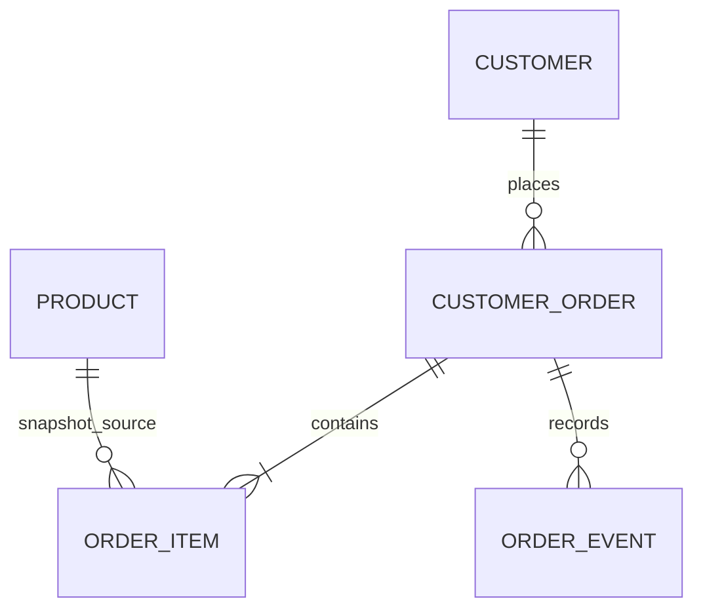
One customer has many orders; an order has one or more lines; each line refers to a catalog product but stores a price/title snapshot.

## 3. Tables, keys, constraints, indexes
```sql
CREATE TABLE customer (id uuid PRIMARY KEY, email citext NOT NULL UNIQUE);
CREATE TABLE product (id uuid PRIMARY KEY, sku text NOT NULL UNIQUE, title text NOT NULL, price_minor bigint NOT NULL CHECK(price_minor>=0), currency char(3) NOT NULL, active boolean NOT NULL DEFAULT true);
CREATE TABLE customer_order (id uuid PRIMARY KEY, customer_id uuid NOT NULL REFERENCES customer(id), idempotency_key text NOT NULL, status text NOT NULL CHECK(status IN ('pending_payment','paid','fulfilling','shipped','cancelled','refunded')), currency char(3) NOT NULL, subtotal_minor bigint NOT NULL CHECK(subtotal_minor>=0), tax_minor bigint NOT NULL CHECK(tax_minor>=0), total_minor bigint NOT NULL CHECK(total_minor>=0), created_at timestamptz NOT NULL DEFAULT now(), UNIQUE(customer_id,idempotency_key));
CREATE TABLE order_item (order_id uuid NOT NULL REFERENCES customer_order(id), line_no int NOT NULL, product_id uuid NOT NULL REFERENCES product(id), sku_snapshot text NOT NULL, title_snapshot text NOT NULL, unit_price_minor bigint NOT NULL CHECK(unit_price_minor>=0), quantity int NOT NULL CHECK(quantity>0), tax_minor bigint NOT NULL DEFAULT 0 CHECK(tax_minor>=0), PRIMARY KEY(order_id,line_no));
CREATE INDEX order_customer_recent_idx ON customer_order(customer_id,created_at DESC,id DESC);
CREATE INDEX order_fulfil_idx ON customer_order(status,created_at) WHERE status IN ('paid','fulfilling');
```

## 4. Five important SQL queries
```sql
-- Recent orders
SELECT id,status,total_minor,currency,created_at FROM customer_order WHERE customer_id=:customer ORDER BY created_at DESC,id DESC LIMIT 20;
-- Immutable order-line snapshot
SELECT line_no,sku_snapshot,title_snapshot,unit_price_minor,quantity FROM order_item WHERE order_id=:order ORDER BY line_no;
-- Idempotent order creation; fetch existing row if conflict
INSERT INTO customer_order(id,customer_id,idempotency_key,status,currency,subtotal_minor,tax_minor,total_minor) VALUES (:id,:customer,:key,'pending_payment',:currency,:subtotal,:tax,:total) ON CONFLICT(customer_id,idempotency_key) DO NOTHING;
-- Claim work without two workers selecting the same orders
SELECT id FROM customer_order WHERE status='paid' ORDER BY created_at FOR UPDATE SKIP LOCKED LIMIT 50;
-- Top sellers
SELECT oi.product_id,SUM(oi.quantity) units FROM order_item oi JOIN customer_order o ON o.id=oi.order_id WHERE o.status IN ('paid','fulfilling','shipped') AND o.created_at>=:from GROUP BY oi.product_id ORDER BY units DESC LIMIT 20;
```

## 5. Transactions, isolation, concurrency
Create order, lines, reservation intent, and outbox record in one transaction. Reserve inventory with a conditional update (`available >= requested`), not a read-then-write check. Do not hold DB locks while calling a payment provider; use idempotent saga steps and reconcile uncertain provider outcomes. Cancellation must release inventory exactly once.

## 6. What changes at 100× scale
Partition order/event history by creation date, keep customer-leading indexes for history, cache catalog reads, and move fulfillment to a durable queue. Keep order-line snapshots in OLTP for audit; analytics belongs in a warehouse. Do not shard by product if customer order history is a dominant access pattern.

---

---

# 2. Banking Ledger

## 1. Business requirements and access patterns
Post immutable balanced debit/credit entries. Balances are projections, not the sole source of truth. A business operation must post once, be balanced per currency, and be reversible through compensating entries. Main reads: account statement, journal detail, current balance, reconciliation, and posting lookup by business reference.

## 2. ER diagram and cardinalities
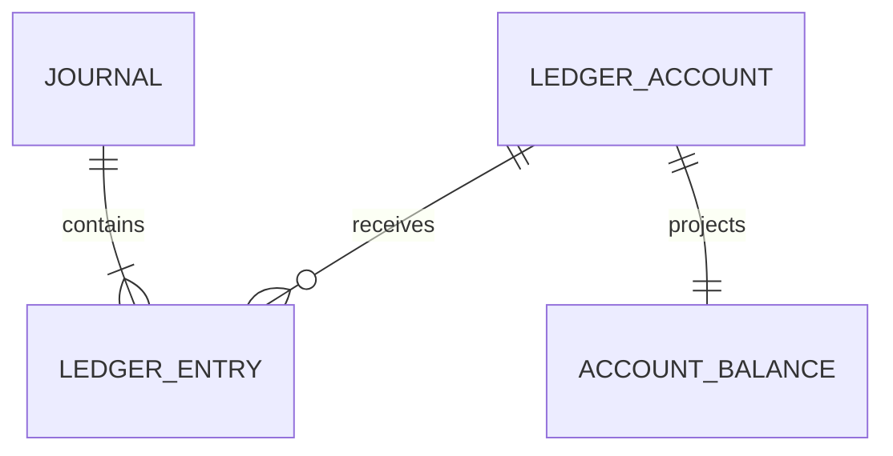
A journal has multiple entries; each entry belongs to one account and journal. The sum of signed entries must equal zero per currency for a posted journal.

## 3. Tables, keys, constraints, indexes
```sql
CREATE TABLE ledger_account(id uuid PRIMARY KEY, owner_id uuid NOT NULL, currency char(3) NOT NULL, status text NOT NULL CHECK(status IN ('open','frozen','closed')), UNIQUE(id,currency));
CREATE TABLE journal(id uuid PRIMARY KEY, business_ref text NOT NULL UNIQUE, kind text NOT NULL, status text NOT NULL CHECK(status IN ('draft','posted','reversed')), created_at timestamptz NOT NULL DEFAULT now(), posted_at timestamptz);
CREATE TABLE ledger_entry(id bigint GENERATED ALWAYS AS IDENTITY PRIMARY KEY, journal_id uuid NOT NULL REFERENCES journal(id), account_id uuid NOT NULL, currency char(3) NOT NULL, amount_minor bigint NOT NULL CHECK(amount_minor<>0), created_at timestamptz NOT NULL DEFAULT now(), FOREIGN KEY(account_id,currency) REFERENCES ledger_account(id,currency));
CREATE TABLE account_balance(account_id uuid PRIMARY KEY REFERENCES ledger_account(id), posted_minor bigint NOT NULL DEFAULT 0, version bigint NOT NULL DEFAULT 0);
CREATE INDEX ledger_account_time_idx ON ledger_entry(account_id,created_at DESC,id DESC);
CREATE INDEX ledger_journal_idx ON ledger_entry(journal_id);
-- Add a deferred constraint trigger/posting procedure to enforce zero-sum per journal/currency.
```

## 4. Five important SQL queries
```sql
-- Account statement
SELECT created_at,journal_id,amount_minor FROM ledger_entry WHERE account_id=:account ORDER BY created_at DESC,id DESC LIMIT 100;
-- Verify a journal balances by currency
SELECT currency,SUM(amount_minor) FROM ledger_entry WHERE journal_id=:journal GROUP BY currency;
-- Fast current balance projection
SELECT posted_minor,version FROM account_balance WHERE account_id=:account;
-- Reconstruct account balance from immutable entries
SELECT COALESCE(SUM(amount_minor),0) FROM ledger_entry WHERE account_id=:account;
-- Create journal idempotently
INSERT INTO journal(id,business_ref,kind,status) VALUES (:id,:business_ref,:kind,'draft') ON CONFLICT(business_ref) DO NOTHING;
```

## 5. Transactions, isolation, concurrency
Insert journal, all entries, and balance-projection updates atomically. Lock affected balance rows in deterministic account-ID order, then check sufficient funds and post. Use integer minor units; don't mix currencies in a balancing sum. Never edit posted entries—reverse with a compensating journal. A cross-row sum cannot be enforced by a normal `CHECK`, so restrict table writes to a posting procedure/deferred trigger.

## 6. What changes at 100× scale
Partition ledger entries by posting time or account hash, retain account balance projections/checkpoints, and run regular reconciliation from immutable entries. A single hot account is inherently serialized; use account command queues if needed rather than weakening correctness. Push portfolio analytics to a warehouse.

---

---

# 3. Hotel and General Reservation Booking

## 1. Business requirements and access patterns
Search rooms/resources over a date interval, place an expiring hold, confirm after payment, and release on cancellation or expiry. No two active reservations may overlap on the same physical unit. If inventory is pooled by room type, model nightly capacity separately and assign a physical unit later.

## 2. ER diagram and cardinalities
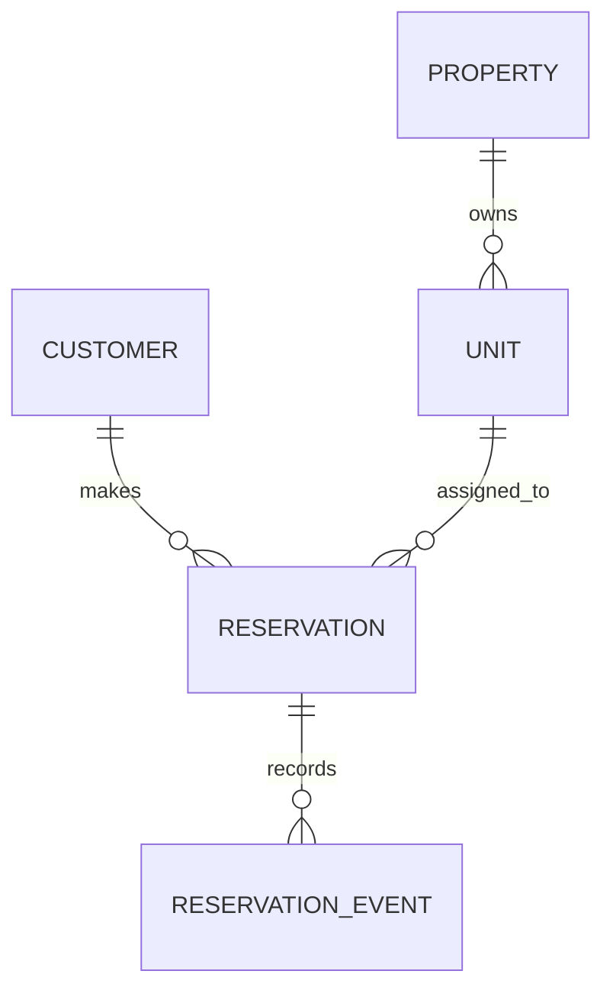
A property owns many units; a customer makes many reservations; each assigned reservation references one unit.

## 3. Tables, keys, constraints, indexes
```sql
CREATE EXTENSION IF NOT EXISTS btree_gist;
CREATE TABLE property(id uuid PRIMARY KEY,name text NOT NULL,timezone text NOT NULL);
CREATE TABLE unit(id uuid PRIMARY KEY,property_id uuid NOT NULL REFERENCES property(id),unit_type text NOT NULL,active boolean NOT NULL DEFAULT true);
CREATE TABLE reservation(id uuid PRIMARY KEY,customer_id uuid NOT NULL,unit_id uuid NOT NULL REFERENCES unit(id),stay daterange NOT NULL,status text NOT NULL CHECK(status IN ('held','confirmed','checked_in','completed','cancelled','expired')),hold_expires_at timestamptz,created_at timestamptz NOT NULL DEFAULT now(),CHECK(NOT isempty(stay)));
ALTER TABLE reservation ADD CONSTRAINT no_unit_overlap EXCLUDE USING gist(unit_id WITH =,stay WITH &&) WHERE(status IN ('held','confirmed','checked_in'));
CREATE INDEX reservation_customer_recent_idx ON reservation(customer_id,created_at DESC);
CREATE INDEX reservation_expiry_idx ON reservation(hold_expires_at) WHERE status='held';
```

## 4. Five important SQL queries
```sql
-- Candidate availability (final safety is the exclusion constraint)
SELECT u.id FROM unit u WHERE u.property_id=:property AND u.active AND NOT EXISTS (SELECT 1 FROM reservation r WHERE r.unit_id=u.id AND r.status IN ('held','confirmed','checked_in') AND r.stay && daterange(:check_in,:check_out,'[)')) LIMIT 20;
-- Customer itinerary
SELECT * FROM reservation WHERE customer_id=:customer ORDER BY created_at DESC LIMIT 50;
-- Confirm a live hold
UPDATE reservation SET status='confirmed' WHERE id=:reservation AND status='held' AND hold_expires_at>now() RETURNING id;
-- Find expired holds
SELECT id FROM reservation WHERE status='held' AND hold_expires_at<now() ORDER BY hold_expires_at FOR UPDATE SKIP LOCKED LIMIT 100;
-- Arrivals
SELECT id,customer_id,unit_id FROM reservation WHERE status='confirmed' AND lower(stay)=:arrival_date ORDER BY id;
```

## 5. Transactions, isolation, concurrency
Create holds in short transactions and let an exclusion constraint prevent check-then-insert races. Confirm with a conditional state transition and expiry check. Payment is external; use an outbox/saga and reconcile the case where payment succeeds as a hold expires. Use `[check_in, check_out)` semantics so same-day turnover doesn't overlap.

## 6. What changes at 100× scale
For pooled inventory, atomically decrement capacity per property/type/night and assign physical units later. Partition reservation history by creation time; cache availability only as a hint. The transaction that creates/extends a hold remains the authority.

---

---

# 4. Social Network

## 1. Business requirements and access patterns
Users follow each other, publish posts, like posts, and browse a home feed. Support privacy/block checks and uniqueness of follows/likes. Decide between fan-out-on-read, fan-out-on-write, or a hybrid feed model.

## 2. ER diagram and cardinalities
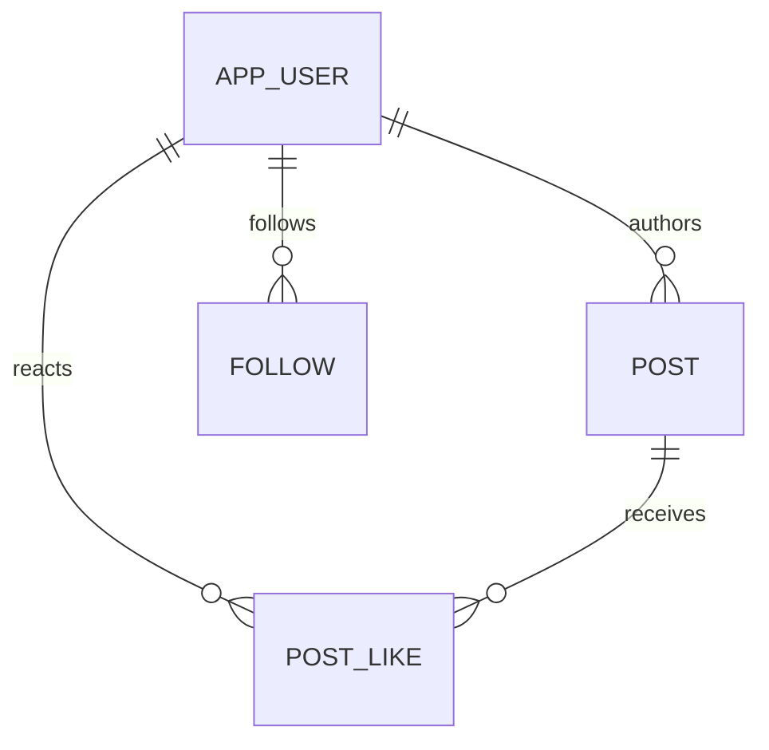
Follow and like are many-to-many join tables; posts are one-to-many from their author.

## 3. Tables, keys, constraints, indexes
```sql
CREATE TABLE app_user(id uuid PRIMARY KEY,handle citext NOT NULL UNIQUE,state text NOT NULL CHECK(state IN ('active','suspended','deleted')));
CREATE TABLE post(id bigint GENERATED ALWAYS AS IDENTITY PRIMARY KEY,author_id uuid NOT NULL REFERENCES app_user(id),body text NOT NULL,visibility text NOT NULL CHECK(visibility IN ('public','followers','private')),created_at timestamptz NOT NULL DEFAULT now(),deleted_at timestamptz);
CREATE TABLE follow(follower_id uuid NOT NULL REFERENCES app_user(id),followed_id uuid NOT NULL REFERENCES app_user(id),created_at timestamptz NOT NULL DEFAULT now(),PRIMARY KEY(follower_id,followed_id),CHECK(follower_id<>followed_id));
CREATE INDEX follow_reverse_idx ON follow(followed_id,follower_id);
CREATE INDEX post_author_recent_idx ON post(author_id,created_at DESC,id DESC) WHERE deleted_at IS NULL;
CREATE TABLE post_like(user_id uuid NOT NULL REFERENCES app_user(id),post_id bigint NOT NULL REFERENCES post(id),created_at timestamptz NOT NULL DEFAULT now(),PRIMARY KEY(user_id,post_id));
CREATE INDEX post_like_post_idx ON post_like(post_id,created_at DESC);
```

## 4. Five important SQL queries
```sql
-- User's recent posts
SELECT id,body,created_at FROM post WHERE author_id=:user AND deleted_at IS NULL ORDER BY created_at DESC,id DESC LIMIT 20;
-- Follow idempotently
INSERT INTO follow(follower_id,followed_id) VALUES (:me,:them) ON CONFLICT DO NOTHING;
-- Followers
SELECT follower_id,created_at FROM follow WHERE followed_id=:user ORDER BY created_at DESC LIMIT 50;
-- Keyset feed from followed authors
SELECT p.id,p.author_id,p.body,p.created_at FROM post p JOIN follow f ON f.followed_id=p.author_id WHERE f.follower_id=:me AND p.deleted_at IS NULL AND (p.created_at,p.id)<(:cursor_time,:cursor_id) ORDER BY p.created_at DESC,p.id DESC LIMIT 30;
-- Like once; unlike is a DELETE by (user_id, post_id)
INSERT INTO post_like(user_id,post_id) VALUES (:me,:post) ON CONFLICT DO NOTHING;
```

## 5. Transactions, isolation, concurrency
Unique composite keys prevent duplicate relationships under concurrent requests. Feed materialization is a performance aid, not the authorization source; enforce visibility, blocks, and deletion at read time or with a versioned, invalidated access projection. Publish post + outbox event atomically; do not synchronously fan out to millions of followers.

## 6. What changes at 100× scale
Start fan-out-on-read; use hybrid fan-out-on-write for ordinary users and read-time expansion for high-follower accounts. Partition posts by time/author, cache profile data, asynchronously maintain engagement counters, and keep canonical relationships separate from feed materializations.

---

---

# 5. URL Shortener

## 1. Business requirements and access patterns
Create a short identifier for a destination URL, resolve redirects at very high read volume, support disable/expiry/vanity codes, and collect click analytics asynchronously. Redirect latency should not depend on analytics writes.

## 2. ER diagram and cardinalities
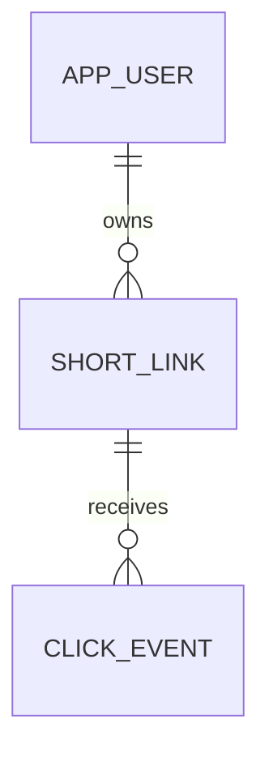
One link can generate many click events. Click records are append-only and may be stored outside the primary relational database at scale.

## 3. Tables, keys, constraints, indexes
```sql
CREATE TABLE short_link(id bigint GENERATED ALWAYS AS IDENTITY PRIMARY KEY,code varchar(16) NOT NULL UNIQUE,owner_id uuid,destination_url text NOT NULL,created_at timestamptz NOT NULL DEFAULT now(),expires_at timestamptz,disabled_at timestamptz,CHECK(destination_url ~ '^https?://'));
CREATE INDEX short_link_owner_recent_idx ON short_link(owner_id,created_at DESC,id DESC);
CREATE INDEX short_link_expiry_idx ON short_link(expires_at) WHERE expires_at IS NOT NULL AND disabled_at IS NULL;
CREATE TABLE click_event(id bigint GENERATED ALWAYS AS IDENTITY PRIMARY KEY,link_id bigint NOT NULL REFERENCES short_link(id),occurred_at timestamptz NOT NULL DEFAULT now(),country_code char(2),referrer_host text);
CREATE INDEX click_event_link_time_idx ON click_event(link_id,occurred_at DESC);
```

## 4. Five important SQL queries
```sql
-- Redirect lookup (cache safely; expiry bounds cache TTL)
SELECT destination_url FROM short_link WHERE code=:code AND disabled_at IS NULL AND (expires_at IS NULL OR expires_at>now());
-- Create code; retry with another code on unique conflict
INSERT INTO short_link(id,code,owner_id,destination_url,expires_at) VALUES (:id,:code,:owner,:url,:expiry) ON CONFLICT(code) DO NOTHING;
-- User's links
SELECT code,destination_url,created_at,expires_at FROM short_link WHERE owner_id=:owner ORDER BY created_at DESC LIMIT 50;
-- Clicks by day
SELECT date_trunc('day',occurred_at) day,count(*) FROM click_event WHERE link_id=:link AND occurred_at>=:from GROUP BY 1 ORDER BY 1;
-- Expiring soon
SELECT id,code FROM short_link WHERE expires_at>=now() AND expires_at<now()+interval '24 hours' AND disabled_at IS NULL;
```

## 5. Transactions, isolation, concurrency
Code uniqueness belongs in a unique constraint, not a pre-insert availability check. A cached redirect should never outlive expiry or invalidation policy. Buffer click events asynchronously; protect against open-redirect/abuse scenarios and validate schemes. Code allocation can use base-N sequence IDs or random codes with conflict retry.

## 6. What changes at 100× scale
Put redirect resolution behind edge/cache layers and keep the backing store replicated read-heavy. Send click analytics to a stream/columnar store; partition event history by time and define privacy/retention for derived client signals. Keep link metadata small and cache invalidation reliable.

---

---

# 6. Notification Service

## 1. Business requirements and access patterns
Enqueue logical notifications, fan them out to email/SMS/push/in-app deliveries, track attempts/provider responses, and retry transient failures. Deduplicate incoming business events and respect recipient channel preferences.

## 2. ER diagram and cardinalities
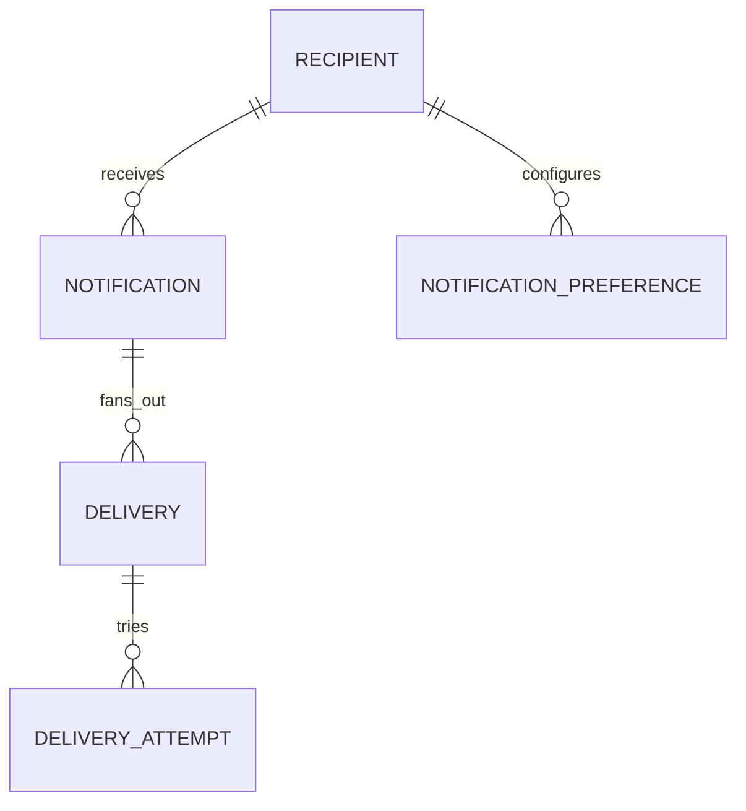
A notification may have multiple channel deliveries; each delivery may have many attempts.

## 3. Tables, keys, constraints, indexes
```sql
CREATE TABLE notification(id uuid PRIMARY KEY,recipient_id uuid NOT NULL,source_event_id text NOT NULL,template_key text NOT NULL,payload jsonb NOT NULL,created_at timestamptz NOT NULL DEFAULT now(),UNIQUE(recipient_id,source_event_id));
CREATE TABLE delivery(id uuid PRIMARY KEY,notification_id uuid NOT NULL REFERENCES notification(id),channel text NOT NULL CHECK(channel IN ('email','sms','push','in_app')),destination_ref text NOT NULL,status text NOT NULL CHECK(status IN ('pending','sending','sent','retry','failed','suppressed')),attempt_count int NOT NULL DEFAULT 0 CHECK(attempt_count>=0),next_attempt_at timestamptz,provider_message_id text,created_at timestamptz NOT NULL DEFAULT now(),UNIQUE(notification_id,channel,destination_ref));
CREATE INDEX delivery_due_idx ON delivery(next_attempt_at,id) WHERE status IN ('pending','retry');
CREATE TABLE notification_preference(recipient_id uuid NOT NULL,channel text NOT NULL,enabled boolean NOT NULL DEFAULT true,updated_at timestamptz NOT NULL DEFAULT now(),PRIMARY KEY(recipient_id,channel));
CREATE TABLE delivery_attempt(id bigint GENERATED ALWAYS AS IDENTITY PRIMARY KEY,delivery_id uuid NOT NULL REFERENCES delivery(id),attempt_no int NOT NULL,started_at timestamptz NOT NULL DEFAULT now(),finished_at timestamptz,outcome text,provider_code text,response_excerpt text,UNIQUE(delivery_id,attempt_no));
```

## 4. Five important SQL queries
```sql
-- Claim due deliveries atomically
WITH due AS (SELECT id FROM delivery WHERE status IN ('pending','retry') AND COALESCE(next_attempt_at,'-infinity')<=now() ORDER BY COALESCE(next_attempt_at,'-infinity'),id FOR UPDATE SKIP LOCKED LIMIT 100) UPDATE delivery d SET status='sending',attempt_count=attempt_count+1 FROM due WHERE d.id=due.id RETURNING d.*;
-- Delivery attempt history
SELECT * FROM delivery_attempt WHERE delivery_id=:delivery ORDER BY attempt_no;
-- Schedule retry after a transient failure
UPDATE delivery SET status='retry',next_attempt_at=:retry_at WHERE id=:delivery AND status='sending';
-- Preference check (normally part of the eligibility query)
SELECT enabled FROM notification_preference WHERE recipient_id=:recipient AND channel=:channel;
-- Delivery funnel
SELECT status,count(*) FROM delivery WHERE created_at>=:from GROUP BY status;
```

## 5. Transactions, isolation, concurrency
Claim with `FOR UPDATE SKIP LOCKED`, commit the claim/lease, then call the provider outside the transaction. Persist the result in another short transaction. Provider timeout after acceptance is ambiguous; use provider idempotency where available and reconcile using provider message IDs. Attempts and status transitions must be durable; user opt-out must be checked at dispatch time.

## 6. What changes at 100× scale
Use a durable queue for fan-out, provider-specific rate limits, partitioned attempt history, and external analytics. Keep delivery state indexed narrowly; archive old attempts and store large payloads in object storage. Apply backpressure so a provider outage doesn't create unlimited work in the hot database.

---

---

# 7. Ride-sharing: Trip and Location Core

## 1. Business requirements and access patterns
Riders request trips, drivers stream locations, and dispatch finds eligible nearby drivers. Durable trip state is separate from high-frequency, short-lived GPS updates. Required paths: fresh nearby drivers, rider trip history, trip timeline, assignment, completion.

## 2. ER diagram and cardinalities
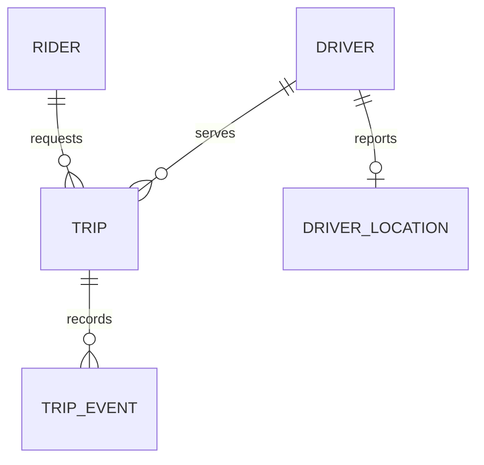
One driver may serve many trips over time but at most one active trip under the business invariant; each driver has one latest location projection.

## 3. Tables, keys, constraints, indexes
```sql
CREATE EXTENSION IF NOT EXISTS postgis;
CREATE TABLE rider(id uuid PRIMARY KEY,status text NOT NULL);
CREATE TABLE driver(id uuid PRIMARY KEY,status text NOT NULL CHECK(status IN ('offline','available','offered','on_trip','suspended')));
CREATE TABLE trip(id uuid PRIMARY KEY,rider_id uuid NOT NULL REFERENCES rider(id),driver_id uuid REFERENCES driver(id),status text NOT NULL CHECK(status IN ('requested','offered','accepted','arrived','in_progress','completed','cancelled')),pickup geography(Point,4326) NOT NULL,dropoff geography(Point,4326) NOT NULL,quote_minor bigint NOT NULL CHECK(quote_minor>=0),created_at timestamptz NOT NULL DEFAULT now(),accepted_at timestamptz);
CREATE INDEX trip_rider_recent_idx ON trip(rider_id,created_at DESC);
CREATE TABLE driver_location(driver_id uuid PRIMARY KEY REFERENCES driver(id),point geography(Point,4326) NOT NULL,observed_at timestamptz NOT NULL,heading real,accuracy_m real);
CREATE INDEX driver_location_gix ON driver_location USING gist(point);
CREATE TABLE trip_event(id bigint GENERATED ALWAYS AS IDENTITY PRIMARY KEY,trip_id uuid NOT NULL REFERENCES trip(id),event_type text NOT NULL,occurred_at timestamptz NOT NULL DEFAULT now(),payload jsonb NOT NULL DEFAULT '{}');
```

## 4. Five important SQL queries
```sql
-- Nearby, fresh drivers (distance/radius in meters)
SELECT driver_id,ST_Distance(point,ST_SetSRID(ST_MakePoint(:lon,:lat),4326)::geography) meters FROM driver_location l JOIN driver d ON d.id=l.driver_id WHERE d.status='available' AND l.observed_at>now()-interval '20 seconds' AND ST_DWithin(point,ST_SetSRID(ST_MakePoint(:lon,:lat),4326)::geography,:radius_m) ORDER BY point <-> ST_SetSRID(ST_MakePoint(:lon,:lat),4326)::geography LIMIT 30;
-- Rider history
SELECT id,status,driver_id,created_at FROM trip WHERE rider_id=:rider ORDER BY created_at DESC LIMIT 20;
-- Assign once
UPDATE trip SET driver_id=:driver,status='accepted',accepted_at=now() WHERE id=:trip AND status='offered' AND driver_id IS NULL RETURNING id;
-- Trip timeline
SELECT event_type,occurred_at,payload FROM trip_event WHERE trip_id=:trip ORDER BY occurred_at,id;
-- Complete only from active trip state
UPDATE trip SET status='completed' WHERE id=:trip AND status='in_progress' RETURNING id;
```

## 5. Transactions, isolation, concurrency
Use conditional state transitions to prevent two drivers accepting one trip. Final assignment must atomically claim both trip and driver availability, locking in deterministic order. Location is advisory and may be stale. GPS samples should be written asynchronously to a separate telemetry path, not in the trip lifecycle transaction.

## 6. What changes at 100× scale
Use Redis GEO or H3/S2 cells for coarse dispatch and PostGIS when accurate spatial querying is required. Expire stale locations and stream route samples to time-series/object storage. Shard dispatch by city/geocell; retain a durable trip timeline for disputes and financial reconciliation.

---

---

# 8. Multi-tenant SaaS

## 1. Business requirements and access patterns
Organizations share infrastructure but must not read or mutate one another's records. Tenant identity must be present in keys, foreign keys, indexes, cache keys, and background jobs. Main paths: membership authorization, tenant-scoped resource list/detail, invitations/revocations, and usage reporting.

## 2. ER diagram and cardinalities
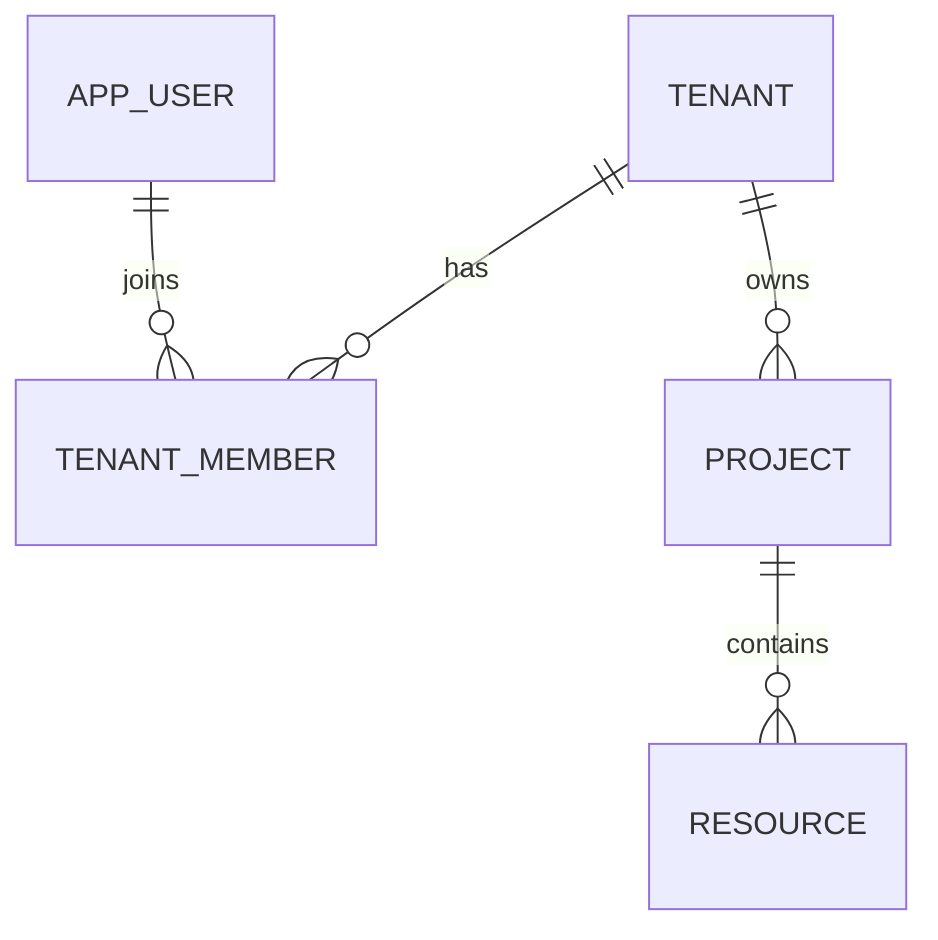
Users may belong to many tenants; a tenant owns many projects/resources.

## 3. Tables, keys, constraints, indexes
```sql
CREATE TABLE tenant(id uuid PRIMARY KEY,slug text NOT NULL UNIQUE,status text NOT NULL CHECK(status IN ('active','suspended','closed')));
CREATE TABLE app_user(id uuid PRIMARY KEY,email citext NOT NULL UNIQUE);
CREATE TABLE tenant_member(tenant_id uuid NOT NULL REFERENCES tenant(id),user_id uuid NOT NULL REFERENCES app_user(id),role text NOT NULL,status text NOT NULL CHECK(status IN ('invited','active','revoked')),PRIMARY KEY(tenant_id,user_id));
CREATE TABLE project(tenant_id uuid NOT NULL REFERENCES tenant(id),id uuid NOT NULL,name text NOT NULL,status text NOT NULL,created_at timestamptz NOT NULL DEFAULT now(),PRIMARY KEY(tenant_id,id),UNIQUE(tenant_id,name));
CREATE TABLE resource(tenant_id uuid NOT NULL,id uuid NOT NULL,project_id uuid NOT NULL,payload jsonb NOT NULL,created_at timestamptz NOT NULL DEFAULT now(),PRIMARY KEY(tenant_id,id),FOREIGN KEY(tenant_id,project_id) REFERENCES project(tenant_id,id));
CREATE INDEX resource_tenant_recent_idx ON resource(tenant_id,created_at DESC,id DESC);
-- Add PostgreSQL RLS as defense in depth, with careful session-variable reset in pools.
```

## 4. Five important SQL queries
```sql
-- Tenant resource listing
SELECT id,payload FROM resource WHERE tenant_id=:tenant ORDER BY created_at DESC,id DESC LIMIT 50;
-- Membership authorization
SELECT role FROM tenant_member WHERE tenant_id=:tenant AND user_id=:user AND status='active';
-- Tenant-safe relationship join
SELECT r.id FROM resource r JOIN project p ON p.tenant_id=r.tenant_id AND p.id=r.project_id WHERE r.tenant_id=:tenant;
-- Tenant usage count
SELECT count(*) FROM resource WHERE tenant_id=:tenant;
-- Revoke a member
UPDATE tenant_member SET status='revoked' WHERE tenant_id=:tenant AND user_id=:user AND status='active';
```

## 5. Transactions, isolation, concurrency
Derive tenant ID from trusted auth context, never from unvalidated request data. Include tenant ID in composite foreign keys to make cross-tenant references impossible. RLS is defense in depth, not an excuse to omit tenant predicates. Safely set/reset tenant context on pooled connections and include tenant in cache keys, idempotency scopes and job payloads.

## 6. What changes at 100× scale
Index most tenant-owned queries with tenant ID first. Share small tenants, but isolate very large tenants into dedicated partitions/databases if measurements justify it. Add per-tenant quotas and noisy-neighbor controls. Test isolation adversarially and verify all background workers carry the tenant context.

---

---

# 9. Payment Gateway

## 1. Business requirements and access patterns

**Requirements:** accept a merchant payment request; safely retry API calls; attempt authorization/capture with an external processor; record state transitions; support partial/multiple refunds if the product allows them; reconcile processor statements; preserve an audit trail. A payment is not the same thing as a processor attempt.

**Hot access patterns:**
1. Create or retrieve a payment using `(merchant_id, idempotency_key)`.
2. Read payment status by payment ID or merchant order reference.
3. Append a processor attempt/event and inspect attempts in time order.
4. Capture/refund only when the current state allows it.
5. Find payments needing retry/reconciliation.

## 2. ER diagram and cardinalities

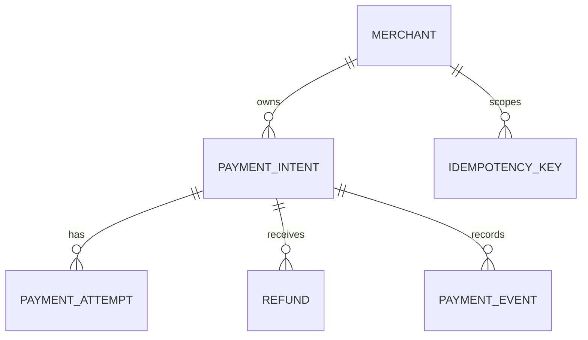

- One merchant has many payment intents.
- One payment intent can have many processor attempts, events, and refunds.
- An idempotency key is unique within a merchant and operation scope.

## 3. Core schema, keys, constraints, indexes

```sql
CREATE TABLE merchant (
  id uuid PRIMARY KEY,
  name text NOT NULL,
  status text NOT NULL CHECK (status IN ('active','suspended','closed'))
);

CREATE TABLE payment_intent (
  id uuid PRIMARY KEY,
  merchant_id uuid NOT NULL REFERENCES merchant(id),
  merchant_order_ref text NOT NULL,
  amount_minor bigint NOT NULL CHECK (amount_minor > 0),
  currency char(3) NOT NULL,
  status text NOT NULL CHECK (status IN
    ('created','requires_action','authorized','captured','partially_refunded','refunded','failed','cancelled')),
  idempotency_key text NOT NULL,
  created_at timestamptz NOT NULL DEFAULT now(),
  updated_at timestamptz NOT NULL DEFAULT now(),
  UNIQUE (merchant_id, idempotency_key),
  UNIQUE (merchant_id, merchant_order_ref)
);
CREATE INDEX payment_merchant_recent_idx ON payment_intent (merchant_id, created_at DESC, id DESC);
CREATE INDEX payment_reconcile_idx ON payment_intent (updated_at) WHERE status IN ('authorized','captured','partially_refunded');

CREATE TABLE payment_attempt (
  id uuid PRIMARY KEY,
  payment_id uuid NOT NULL REFERENCES payment_intent(id),
  attempt_no integer NOT NULL CHECK (attempt_no > 0),
  processor text NOT NULL,
  processor_reference text,
  status text NOT NULL CHECK (status IN ('started','authorized','captured','declined','unknown','failed')),
  error_code text,
  requested_at timestamptz NOT NULL DEFAULT now(),
  completed_at timestamptz,
  UNIQUE (payment_id, attempt_no),
  UNIQUE (processor, processor_reference)
);
CREATE INDEX attempt_payment_history_idx ON payment_attempt (payment_id, requested_at DESC);

CREATE TABLE refund (
  id uuid PRIMARY KEY,
  payment_id uuid NOT NULL REFERENCES payment_intent(id),
  amount_minor bigint NOT NULL CHECK (amount_minor > 0),
  status text NOT NULL CHECK (status IN ('requested','processing','succeeded','failed')),
  processor_reference text UNIQUE,
  idempotency_key text NOT NULL,
  created_at timestamptz NOT NULL DEFAULT now(),
  UNIQUE (payment_id, idempotency_key)
);
CREATE INDEX refund_payment_idx ON refund (payment_id, created_at DESC);

CREATE TABLE payment_event (
  id bigint GENERATED ALWAYS AS IDENTITY PRIMARY KEY,
  payment_id uuid NOT NULL REFERENCES payment_intent(id),
  event_type text NOT NULL,
  payload jsonb NOT NULL DEFAULT '{}',
  occurred_at timestamptz NOT NULL DEFAULT now()
);
CREATE INDEX payment_event_timeline_idx ON payment_event (payment_id, occurred_at, id);
```

**Important invariants:** successful plus reserved/in-flight refunds must not exceed the captured amount; enforce this in a transaction by locking the payment row and reserving refund capacity before sending the request (or with a carefully designed ledger/constraint mechanism). Processor references may be nullable, so a unique constraint permits multiple nulls in PostgreSQL. Never store raw card data/CVV; use a PCI-compliant tokenization provider.

## 4. Five important SQL queries

```sql
-- Q1: Idempotent payment creation (application checks returned row/result).
INSERT INTO payment_intent
  (id, merchant_id, merchant_order_ref, amount_minor, currency, status, idempotency_key)
VALUES (:id, :merchant_id, :order_ref, :amount_minor, :currency, 'created', :key)
ON CONFLICT (merchant_id, idempotency_key) DO NOTHING;

-- Q2: Fetch a merchant's latest payments (stable cursor pagination).
SELECT id, merchant_order_ref, amount_minor, currency, status, created_at
FROM payment_intent
WHERE merchant_id = :merchant_id
  AND (created_at, id) < (:cursor_created_at, :cursor_id)
ORDER BY created_at DESC, id DESC
LIMIT 50;

-- Q3: Claim a state transition only if it is still valid.
UPDATE payment_intent
SET status = 'captured', updated_at = now()
WHERE id = :payment_id AND status = 'authorized'
RETURNING id, amount_minor, currency;

-- Q4: Show processor attempts for a payment.
SELECT attempt_no, processor, status, processor_reference, error_code, requested_at, completed_at
FROM payment_attempt WHERE payment_id = :payment_id ORDER BY attempt_no;

-- Q5: Find stale payments for reconciliation.
SELECT id, merchant_id, updated_at, status
FROM payment_intent
WHERE status IN ('authorized','captured','partially_refunded')
  AND updated_at < now() - interval '15 minutes'
ORDER BY updated_at LIMIT 500;

-- Q6: Detect over-refunds (monitor/reconciliation query).
SELECT p.id, p.amount_minor,
       COALESCE(sum(r.amount_minor) FILTER (WHERE r.status = 'succeeded'), 0) AS refunded_minor
FROM payment_intent p LEFT JOIN refund r ON r.payment_id = p.id
WHERE p.id = :payment_id
GROUP BY p.id, p.amount_minor
HAVING COALESCE(sum(r.amount_minor) FILTER (WHERE r.status = 'succeeded'), 0) > p.amount_minor;
```

## 5. Transaction boundaries, isolation, concurrency risks

- **Create intent:** one short transaction; unique `(merchant_id, idempotency_key)` is the race arbiter.
- **Call processor:** do not hold a database transaction open over network I/O. Persist an attempt, call the processor, then persist the result; an `unknown` outcome must be reconciled, not blindly retried as a fresh charge.
- **Capture/refund:** lock the payment row (`SELECT ... FOR UPDATE`) or use conditional writes; verify captured amount minus successful/in-flight refunds before inserting a refund reservation. `READ COMMITTED` is usually adequate if every writer locks/conditionally updates the same payment row. `SERIALIZABLE` is an option but requires retry handling.
- **Risks:** duplicate API retries, processor timeouts after a successful charge, races between two refunds, out-of-order webhooks, and webhook replay. Deduplicate processor events and keep state transitions monotonic/validated.

## 6. What changes at 100× scale?

Partition high-volume `payment_event` by time and possibly hash by payment/merchant. Archive event payloads to object storage after retention requirements permit. Keep transactional payment state in PostgreSQL; send analytics/reconciliation feeds to a warehouse. Add an outbox for downstream publishing, idempotent consumers, read replicas for merchant history, and a dedicated reconciliation work queue. Do not shard the core payment state before measuring bottlenecks and deciding the required consistency boundaries.

---

---

# 10. Digital Wallet

## 1. Business requirements and access patterns

**Requirements:** hold funds by owner and currency; support top-ups, payments, withdrawals, and transfers; prevent overspending; make transfers idempotent; provide an immutable audit trail. Wallet balance is an invariant, not merely a cached number.

**Hot access patterns:** balance by wallet; transaction history; transfer between two wallets; resolve a transfer by idempotency key; reconcile balance snapshots against ledger entries.

## 2. ER diagram and cardinalities

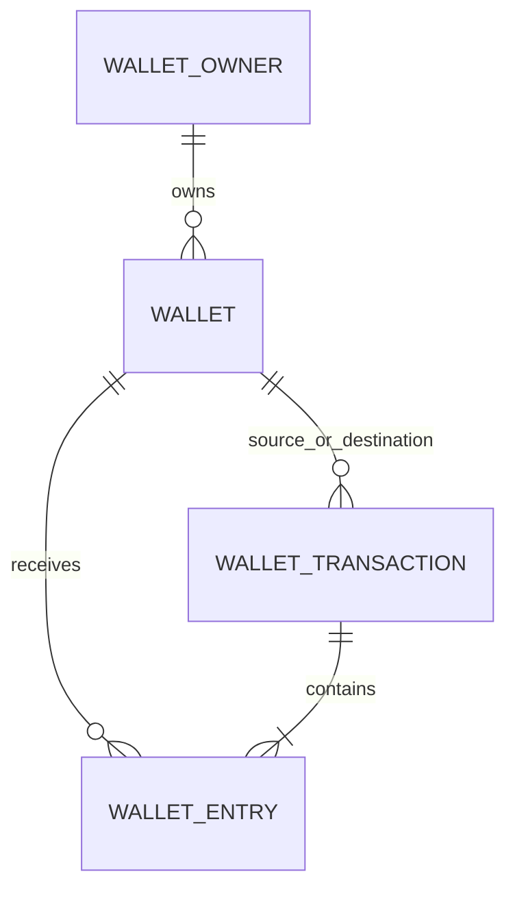

A transfer has one transaction header and at least two ledger entries. Each transaction's entries must sum to zero within the same currency; FX transfers need explicit conversion/clearing accounts or paired currency legs.

## 3. Core schema

```sql
CREATE TABLE wallet_owner (
  id uuid PRIMARY KEY,
  owner_type text NOT NULL CHECK (owner_type IN ('person','business')),
  status text NOT NULL CHECK (status IN ('active','frozen','closed'))
);
CREATE TABLE wallet (
  id uuid PRIMARY KEY,
  owner_id uuid NOT NULL REFERENCES wallet_owner(id),
  currency char(3) NOT NULL,
  balance_minor bigint NOT NULL DEFAULT 0 CHECK (balance_minor >= 0),
  version bigint NOT NULL DEFAULT 0,
  created_at timestamptz NOT NULL DEFAULT now(),
  UNIQUE (owner_id, currency)
);
CREATE TABLE wallet_transaction (
  id uuid PRIMARY KEY,
  idempotency_key text NOT NULL UNIQUE,
  transaction_type text NOT NULL CHECK (transaction_type IN ('transfer','topup','withdrawal','purchase','refund','adjustment')),
  status text NOT NULL CHECK (status IN ('pending','posted','failed','reversed')),
  reference text,
  created_at timestamptz NOT NULL DEFAULT now()
);
CREATE TABLE wallet_entry (
  id bigint GENERATED ALWAYS AS IDENTITY PRIMARY KEY,
  transaction_id uuid NOT NULL REFERENCES wallet_transaction(id),
  wallet_id uuid NOT NULL REFERENCES wallet(id),
  amount_minor bigint NOT NULL CHECK (amount_minor <> 0),
  currency char(3) NOT NULL,
  created_at timestamptz NOT NULL DEFAULT now()
);
CREATE INDEX wallet_entry_history_idx ON wallet_entry (wallet_id, created_at DESC, id DESC);
CREATE INDEX wallet_txn_status_idx ON wallet_transaction (status, created_at) WHERE status = 'pending';
```

Convention: positive entry credits a wallet, negative entry debits it. The wallet balance is a fast snapshot updated in the same transaction as the entries. Use app logic or a deferred constraint trigger to verify entries balance to zero per posted transaction; a normal row-level `CHECK` cannot enforce a cross-row sum.

## 4. Five important SQL queries

```sql
-- Q1: Read current balance.
SELECT id, currency, balance_minor, version FROM wallet WHERE id = :wallet_id;

-- Q2: Idempotent transfer header.
INSERT INTO wallet_transaction (id, idempotency_key, transaction_type, status, reference)
VALUES (:tx_id, :key, 'transfer', 'pending', :reference)
ON CONFLICT (idempotency_key) DO NOTHING;

-- Q3: Debit only if sufficient funds; use in a transaction after locking both wallets
-- in deterministic UUID order (or execute guarded updates in the same order).
UPDATE wallet
SET balance_minor = balance_minor - :amount, version = version + 1
WHERE id = :from_wallet AND currency = :currency AND balance_minor >= :amount
RETURNING balance_minor;

-- Q4: Credit destination in the same transaction.
UPDATE wallet
SET balance_minor = balance_minor + :amount, version = version + 1
WHERE id = :to_wallet AND currency = :currency
RETURNING balance_minor;

-- Q5: Transaction history for a wallet.
SELECT t.id, t.transaction_type, t.status, e.amount_minor, e.currency, e.created_at
FROM wallet_entry e JOIN wallet_transaction t ON t.id = e.transaction_id
WHERE e.wallet_id = :wallet_id
ORDER BY e.created_at DESC, e.id DESC LIMIT 50;

-- Q6: Reconcile snapshot against posted ledger.
SELECT w.id, w.balance_minor AS snapshot_balance,
       COALESCE(sum(e.amount_minor) FILTER (WHERE t.status = 'posted'), 0) AS ledger_balance
FROM wallet w
LEFT JOIN wallet_entry e ON e.wallet_id = w.id
LEFT JOIN wallet_transaction t ON t.id = e.transaction_id
WHERE w.id = :wallet_id
GROUP BY w.id, w.balance_minor;
```

## 5. Transaction boundaries and risks

A transfer is one DB transaction: claim idempotency key; lock source/destination wallets in a deterministic order; check both are active and currency-compatible; debit source conditionally; credit destination; insert two entries; mark header posted; commit. If any step fails, roll back all. Use `READ COMMITTED` with row locks and guarded updates or `SERIALIZABLE` plus retry. Do not call external payment rails inside this transaction. For withdrawals/top-ups, use a pending transaction plus external state machine/outbox and reconciliation.

Main risks: deadlocks from locking in different orders; double-spend from read-then-write; duplicate transfer submissions; snapshot drift; and treating a pending external transfer as posted funds. Posted ledger entries should be immutable; correct mistakes with reversal transactions, never edits.

## 6. At 100× scale

Partition ledger entries by time; maintain per-wallet balance snapshots and periodic checkpoints; asynchronously build statements/analytics from a CDC stream. Keep each wallet's writes strongly consistent, and shard by wallet/owner if required so one transfer's transaction semantics remain tractable. Cross-shard transfers may need a saga/reservation model rather than pretending they are a single local ACID transaction.

---

---

# 11. Warehouse Inventory Management

## 1. Business requirements and access patterns

**Requirements:** track stock by SKU and warehouse/bin; reserve stock for orders; receive and ship stock; transfer stock between locations; preserve movement history; prevent negative available stock; support cycle counts and low-stock alerts.

**Hot access patterns:** availability by SKU/location; reserve/release; find an order reservation; receive stock; audit quantity changes; list replenishment candidates.

## 2. ER diagram and cardinalities

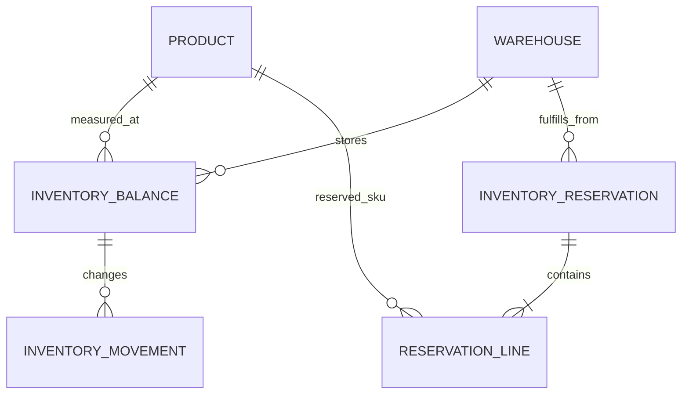

One balance row per `(product, warehouse, bin)`; a reservation can contain multiple SKU lines. Movements are append-only deltas.

## 3. Core schema

```sql
CREATE TABLE product (
  id uuid PRIMARY KEY,
  sku text NOT NULL UNIQUE,
  name text NOT NULL,
  active boolean NOT NULL DEFAULT true
);
CREATE TABLE warehouse (
  id uuid PRIMARY KEY,
  code text NOT NULL UNIQUE,
  name text NOT NULL
);
CREATE TABLE inventory_balance (
  product_id uuid NOT NULL REFERENCES product(id),
  warehouse_id uuid NOT NULL REFERENCES warehouse(id),
  bin_code text NOT NULL DEFAULT 'DEFAULT',
  on_hand bigint NOT NULL DEFAULT 0 CHECK (on_hand >= 0),
  reserved bigint NOT NULL DEFAULT 0 CHECK (reserved >= 0 AND reserved <= on_hand),
  version bigint NOT NULL DEFAULT 0,
  PRIMARY KEY (product_id, warehouse_id, bin_code)
);
CREATE INDEX inventory_available_idx ON inventory_balance (warehouse_id, product_id)
  WHERE on_hand > reserved;
CREATE TABLE inventory_reservation (
  id uuid PRIMARY KEY,
  order_ref text NOT NULL,
  warehouse_id uuid NOT NULL REFERENCES warehouse(id),
  status text NOT NULL CHECK (status IN ('active','released','fulfilled','expired')),
  expires_at timestamptz,
  created_at timestamptz NOT NULL DEFAULT now(),
  UNIQUE (order_ref, warehouse_id)
);
CREATE TABLE reservation_line (
  reservation_id uuid NOT NULL REFERENCES inventory_reservation(id),
  product_id uuid NOT NULL REFERENCES product(id),
  bin_code text NOT NULL DEFAULT 'DEFAULT',
  quantity bigint NOT NULL CHECK (quantity > 0),
  PRIMARY KEY (reservation_id, product_id, bin_code)
);
CREATE TABLE inventory_movement (
  id bigint GENERATED ALWAYS AS IDENTITY PRIMARY KEY,
  product_id uuid NOT NULL REFERENCES product(id),
  warehouse_id uuid NOT NULL REFERENCES warehouse(id),
  bin_code text NOT NULL DEFAULT 'DEFAULT',
  movement_type text NOT NULL CHECK (movement_type IN ('receipt','ship','adjustment','transfer_in','transfer_out','reservation_release')),
  quantity_delta bigint NOT NULL CHECK (quantity_delta <> 0),
  reference_type text,
  reference_id text,
  created_at timestamptz NOT NULL DEFAULT now()
);
CREATE INDEX inventory_movement_audit_idx ON inventory_movement (product_id, warehouse_id, created_at DESC, id DESC);
```

## 4. Five important SQL queries

```sql
-- Q1: Available stock.
SELECT product_id, warehouse_id, bin_code, on_hand - reserved AS available
FROM inventory_balance WHERE product_id = :product_id AND warehouse_id = :warehouse_id;

-- Q2: Reserve stock safely; fail if zero rows are returned.
UPDATE inventory_balance
SET reserved = reserved + :qty, version = version + 1
WHERE product_id = :product_id AND warehouse_id = :warehouse_id AND bin_code = :bin
  AND on_hand - reserved >= :qty
RETURNING on_hand, reserved;

-- Q3: Start a release exactly once. In the same transaction, decrement each matching
-- inventory_balance.reserved by reservation_line.quantity; verify every row count,
-- then commit. Roll the entire transaction back if any guard fails.
UPDATE inventory_reservation SET status = 'released'
WHERE id = :reservation_id AND status = 'active' RETURNING id;

-- Q4: Receive stock (balance plus movement must commit atomically).
UPDATE inventory_balance
SET on_hand = on_hand + :qty, version = version + 1
WHERE product_id = :product_id AND warehouse_id = :warehouse_id AND bin_code = :bin
RETURNING on_hand;

-- Q5: Low-stock list.
SELECT p.sku, p.name, b.warehouse_id, b.bin_code, b.on_hand - b.reserved AS available
FROM inventory_balance b JOIN product p ON p.id = b.product_id
WHERE p.active AND b.on_hand - b.reserved <= :reorder_threshold
ORDER BY available ASC LIMIT 500;

-- Q6: Audit movements over a period.
SELECT movement_type, quantity_delta, reference_type, reference_id, created_at
FROM inventory_movement
WHERE product_id = :product_id AND warehouse_id = :warehouse_id
  AND created_at >= :from_ts AND created_at < :to_ts
ORDER BY created_at, id;
```

## 5. Transaction boundaries and risks

Reserve all required lines in one transaction, in deterministic `(warehouse_id, product_id, bin_code)` order. Use conditional updates (`on_hand - reserved >= qty`) rather than checking availability and updating later. Insert reservation/header/lines and movements in the same transaction. Release and fulfill must be idempotent state transitions. At `READ COMMITTED`, guarded row updates are usually sufficient for a row-level stock invariant. For complex multi-bin allocation, lock candidate balances or use serializable transactions with retries.

Risks: overselling under concurrent orders, releasing twice, partial reservation across multi-SKU orders, stale stock counts, and inventory transfers that debit one warehouse but fail to credit another. Transfers should be one transaction when both balances live in one database; otherwise model in-transit stock explicitly.

## 6. At 100× scale

Partition movement history by time; retain balance rows in a compact operational store. Add reservation-expiry workers, an event stream for fulfillment/analytics, and a materialized replenishment view. If splitting by warehouse, route each reservation to a single fulfillment domain and model cross-warehouse transfers asynchronously with explicit in-transit states.

---

---

# 12. Coupon and Promotion Engine

## 1. Business requirements and access patterns
Campaigns define eligibility windows and discount rules; codes can be global or targeted, with hard campaign-wide and per-customer usage caps. Access patterns: validate a code/cart/user; redeem it once per order; enforce caps under concurrent requests; report campaign use/cost; pause or expire campaigns.

## 2. ER diagram and cardinalities
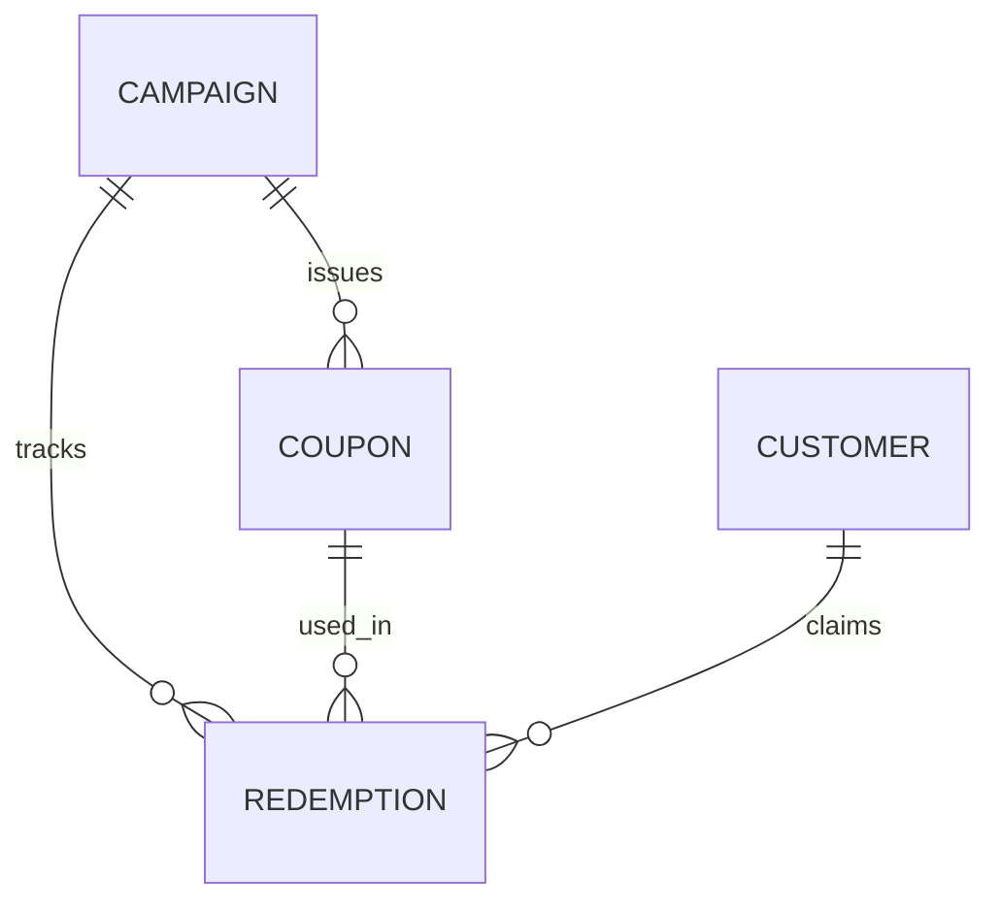

## 3. Tables, keys, constraints, indexes
```sql
CREATE TABLE campaign(id uuid PRIMARY KEY,name text NOT NULL,starts_at timestamptz NOT NULL,ends_at timestamptz NOT NULL,max_redemptions bigint,per_user_limit int NOT NULL DEFAULT 1 CHECK(per_user_limit>0),status text NOT NULL CHECK(status IN ('draft','active','paused','ended')),CHECK(ends_at>starts_at));
CREATE TABLE coupon(id uuid PRIMARY KEY,campaign_id uuid NOT NULL REFERENCES campaign(id),code text NOT NULL UNIQUE,discount_type text NOT NULL CHECK(discount_type IN ('fixed','percent')),discount_value bigint NOT NULL CHECK(discount_value>0),active boolean NOT NULL DEFAULT true);
CREATE TABLE redemption(id uuid PRIMARY KEY,campaign_id uuid NOT NULL REFERENCES campaign(id),coupon_id uuid NOT NULL REFERENCES coupon(id),customer_id uuid NOT NULL,order_id uuid NOT NULL UNIQUE,redeemed_at timestamptz NOT NULL DEFAULT now(),discount_minor bigint NOT NULL CHECK(discount_minor>=0));
CREATE INDEX redemption_campaign_idx ON redemption(campaign_id,redeemed_at);
CREATE INDEX redemption_user_campaign_idx ON redemption(customer_id,campaign_id);
```

## 4. Five important SQL queries
```sql
-- Candidate validation; enforce again during redemption
SELECT c.*,p.starts_at,p.ends_at,p.max_redemptions,p.per_user_limit FROM coupon c JOIN campaign p ON p.id=c.campaign_id WHERE c.code=:code AND c.active AND p.status='active' AND now() BETWEEN p.starts_at AND p.ends_at;
-- Campaign use
SELECT count(*) FROM redemption WHERE campaign_id=:campaign;
-- Customer use
SELECT count(*) FROM redemption WHERE campaign_id=:campaign AND customer_id=:customer;
-- Idempotent per-order redemption
INSERT INTO redemption(id,campaign_id,coupon_id,customer_id,order_id,discount_minor) VALUES (:id,:campaign,:coupon,:customer,:order,:discount) ON CONFLICT(order_id) DO NOTHING;
-- Campaign utilization/cost
SELECT campaign_id,count(*) uses,sum(discount_minor) discount_cost FROM redemption GROUP BY campaign_id ORDER BY uses DESC;
```

## 5. Transactions, isolation, concurrency
A `COUNT(*)` followed by insert races. Lock a campaign/counter row or use an atomic counter when enforcing a strict global cap; serialize per-customer cap enforcement as needed. Recalculate discount server-side and snapshot the final discount on the order. Unique `order_id` makes order retries safe.

## 6. What changes at 100× scale
Use per-campaign bounded token allocation or sharded counters for hot campaigns. Cache immutable eligibility rules but never trust cached counts to enforce a hard cap. Version rule sets and export redemption analytics asynchronously.

---

---

# 13. Subscription Billing

## 1. Business requirements and access patterns

**Requirements:** catalog plans/prices; start, renew, upgrade, downgrade, pause, and cancel subscriptions; calculate billing periods; issue immutable invoices and invoice lines; record payment attempts; support trials, tax, proration, and usage-based charges if needed.

**Hot access patterns:** subscriptions due for renewal; current subscription for a customer; invoice by ID/number; unpaid invoices; billing history; usage ingestion idempotently by external event ID.

## 2. ER diagram and cardinalities

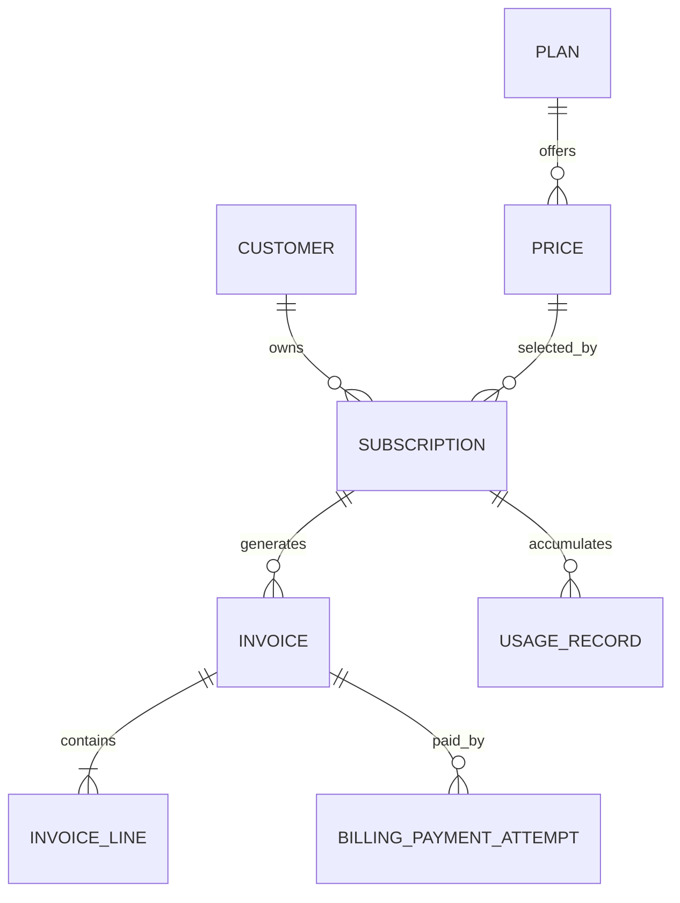

A plan can have multiple versioned prices; invoices snapshot amounts/tax/description so later catalog edits do not rewrite history.

## 3. Core schema

```sql
CREATE TABLE customer (
  id uuid PRIMARY KEY,
  email text NOT NULL,
  status text NOT NULL CHECK (status IN ('active','blocked','deleted'))
);
CREATE TABLE plan (
  id uuid PRIMARY KEY,
  code text NOT NULL UNIQUE,
  name text NOT NULL
);
CREATE TABLE plan_price (
  id uuid PRIMARY KEY,
  plan_id uuid NOT NULL REFERENCES plan(id),
  version integer NOT NULL,
  currency char(3) NOT NULL,
  amount_minor bigint NOT NULL CHECK (amount_minor >= 0),
  interval_unit text NOT NULL CHECK (interval_unit IN ('month','year','week','day')),
  interval_count integer NOT NULL CHECK (interval_count > 0),
  active boolean NOT NULL DEFAULT true,
  UNIQUE (plan_id, version)
);
CREATE TABLE subscription (
  id uuid PRIMARY KEY,
  customer_id uuid NOT NULL REFERENCES customer(id),
  price_id uuid NOT NULL REFERENCES plan_price(id),
  status text NOT NULL CHECK (status IN ('trialing','active','past_due','paused','cancelled','ended')),
  current_period_start timestamptz NOT NULL,
  current_period_end timestamptz NOT NULL,
  cancel_at_period_end boolean NOT NULL DEFAULT false,
  version bigint NOT NULL DEFAULT 0,
  CHECK (current_period_end > current_period_start)
);
CREATE INDEX subscription_due_idx ON subscription (current_period_end, id)
  WHERE status IN ('trialing','active','past_due');
CREATE INDEX subscription_customer_idx ON subscription (customer_id, status);
CREATE TABLE invoice (
  id uuid PRIMARY KEY,
  invoice_number text NOT NULL UNIQUE,
  customer_id uuid NOT NULL REFERENCES customer(id),
  subscription_id uuid REFERENCES subscription(id),
  period_start timestamptz,
  period_end timestamptz,
  currency char(3) NOT NULL,
  subtotal_minor bigint NOT NULL CHECK (subtotal_minor >= 0),
  tax_minor bigint NOT NULL CHECK (tax_minor >= 0),
  total_minor bigint NOT NULL CHECK (total_minor >= 0),
  status text NOT NULL CHECK (status IN ('draft','open','paid','void','uncollectible')),
  issued_at timestamptz,
  due_at timestamptz,
  UNIQUE (subscription_id, period_start, period_end)
);
CREATE TABLE invoice_line (
  id uuid PRIMARY KEY,
  invoice_id uuid NOT NULL REFERENCES invoice(id),
  description text NOT NULL,
  quantity numeric(18,6) NOT NULL CHECK (quantity > 0),
  unit_amount_minor bigint NOT NULL,
  line_total_minor bigint NOT NULL,
  tax_rate numeric(8,6) NOT NULL DEFAULT 0,
  price_snapshot jsonb NOT NULL DEFAULT '{}'
);
CREATE INDEX invoice_customer_history_idx ON invoice (customer_id, issued_at DESC, id DESC);
CREATE TABLE billing_payment_attempt (
  id uuid PRIMARY KEY,
  invoice_id uuid NOT NULL REFERENCES invoice(id),
  attempt_no integer NOT NULL CHECK (attempt_no > 0),
  status text NOT NULL CHECK (status IN ('started','succeeded','failed','unknown')),
  provider_reference text UNIQUE,
  attempted_at timestamptz NOT NULL DEFAULT now(),
  UNIQUE (invoice_id, attempt_no)
);
CREATE TABLE usage_record (
  id bigint GENERATED ALWAYS AS IDENTITY PRIMARY KEY,
  subscription_id uuid NOT NULL REFERENCES subscription(id),
  external_event_id text NOT NULL,
  metric text NOT NULL,
  quantity numeric(20,6) NOT NULL CHECK (quantity >= 0),
  occurred_at timestamptz NOT NULL,
  UNIQUE (subscription_id, external_event_id)
);
CREATE INDEX usage_period_idx ON usage_record (subscription_id, metric, occurred_at);
```

## 4. Five important SQL queries

```sql
-- Q1: Find subscriptions due to bill (claim batches with SKIP LOCKED in worker).
SELECT id, customer_id, price_id, current_period_end
FROM subscription
WHERE status IN ('trialing','active','past_due') AND current_period_end <= now()
ORDER BY current_period_end LIMIT 500 FOR UPDATE SKIP LOCKED;

-- Q2: Fetch current subscriptions for a customer.
SELECT s.*, p.code, pp.amount_minor, pp.currency, pp.interval_unit, pp.interval_count
FROM subscription s JOIN plan_price pp ON pp.id = s.price_id
JOIN plan p ON p.id = pp.plan_id
WHERE s.customer_id = :customer_id AND s.status IN ('trialing','active','past_due');

-- Q3: Insert invoice idempotently for a subscription period.
INSERT INTO invoice (id, invoice_number, customer_id, subscription_id,
  period_start, period_end, currency, subtotal_minor, tax_minor, total_minor, status)
VALUES (:id, :number, :customer_id, :subscription_id,
  :period_start, :period_end, :currency, :subtotal, :tax, :total, 'open')
ON CONFLICT (subscription_id, period_start, period_end) DO NOTHING;

-- Q4: List overdue invoices.
SELECT id, invoice_number, customer_id, total_minor, currency, due_at
FROM invoice WHERE status = 'open' AND due_at < now()
ORDER BY due_at LIMIT 500;

-- Q5: Aggregate metered usage within a billing period.
SELECT metric, sum(quantity) AS total_quantity
FROM usage_record
WHERE subscription_id = :subscription_id
  AND occurred_at >= :period_start AND occurred_at < :period_end
GROUP BY metric;

-- Q6: Invoice payment history.
SELECT attempt_no, status, provider_reference, attempted_at
FROM billing_payment_attempt WHERE invoice_id = :invoice_id ORDER BY attempt_no;
```

## 5. Transaction boundaries and risks

Invoice generation should be idempotent on `(subscription_id, period_start, period_end)`. Claim due subscriptions in small batches with `FOR UPDATE SKIP LOCKED`; calculate invoice lines and totals; commit the invoice and an outbox event together. Payment collection is external and must be a separate state machine. Use immutable issued invoice lines and credit notes for corrections. Race risks include two renewal workers, plan changes during invoicing, usage arriving late, duplicate metering events, proration rounding, and a provider timeout after collecting payment.

## 6. At 100× scale

Partition usage records by event date and/or tenant, roll up usage by `(subscription, metric, billing window)` for invoicing, and export invoice analytics to an OLAP store. Use a durable queue for renewal jobs, idempotent payment collection, and explicit late-arriving usage/correction policies. Consider separate write models for subscription state and invoice ledger if workload profiles diverge.

---

---

# 14. Expense Reimbursement

## 1. Business requirements and access patterns
Employees submit claims with receipts and line items; a versioned policy determines eligibility; managers approve/reject; finance pays approved claims. Keep evidence and every workflow action auditable. Access patterns: employee claim list, manager inbox, approve/reject, finance payment queue, claim timeline.

## 2. ER diagram and cardinalities
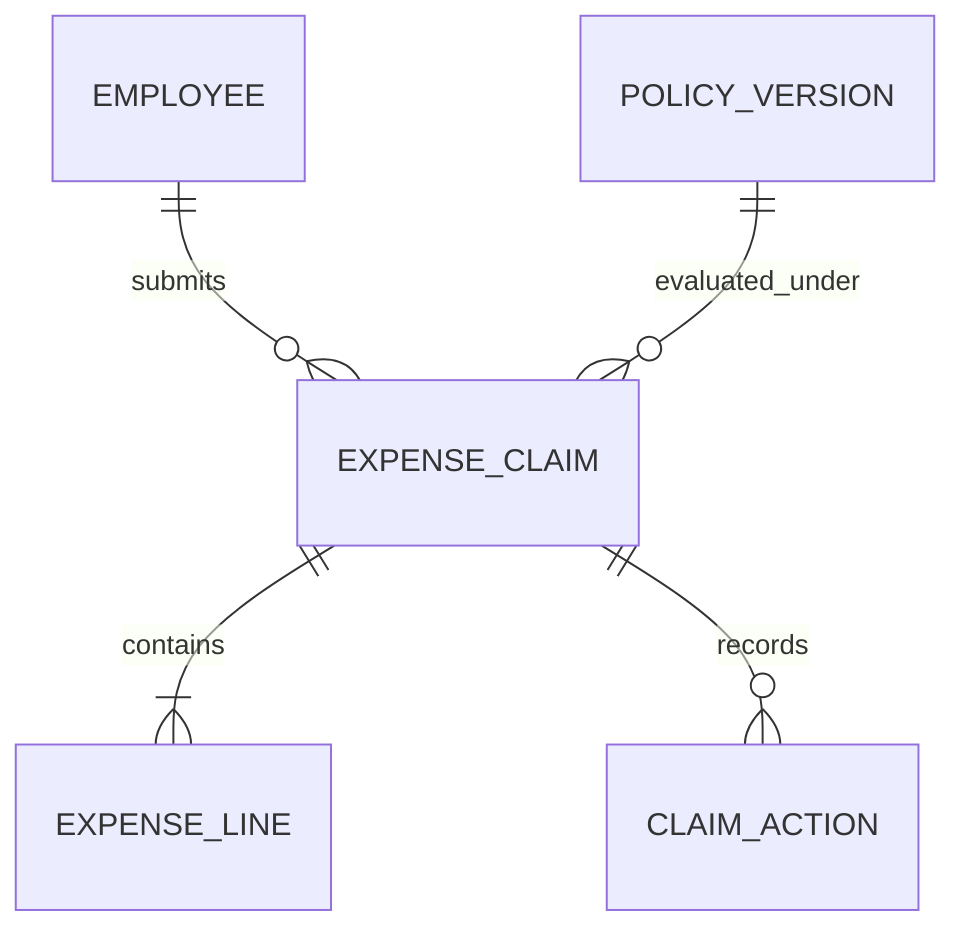

## 3. Tables, keys, constraints, indexes
```sql
CREATE TABLE policy_version(id uuid PRIMARY KEY,policy_name text NOT NULL,version int NOT NULL,rules jsonb NOT NULL,effective_from timestamptz NOT NULL,UNIQUE(policy_name,version));
CREATE TABLE expense_claim(id uuid PRIMARY KEY,employee_id uuid NOT NULL,policy_version_id uuid NOT NULL REFERENCES policy_version(id),currency char(3) NOT NULL,total_minor bigint NOT NULL CHECK(total_minor>0),status text NOT NULL CHECK(status IN ('draft','submitted','approved','rejected','paid','withdrawn')),submitted_at timestamptz,created_at timestamptz NOT NULL DEFAULT now());
CREATE TABLE expense_line(id uuid PRIMARY KEY,claim_id uuid NOT NULL REFERENCES expense_claim(id),amount_minor bigint NOT NULL CHECK(amount_minor>0),expense_date date NOT NULL,category text NOT NULL,receipt_object_key text NOT NULL);
CREATE TABLE claim_action(id bigint GENERATED ALWAYS AS IDENTITY PRIMARY KEY,claim_id uuid NOT NULL REFERENCES expense_claim(id),actor_id uuid NOT NULL,action text NOT NULL,from_status text,to_status text,comment text,policy_snapshot jsonb,created_at timestamptz NOT NULL DEFAULT now());
CREATE INDEX claim_pending_idx ON expense_claim(status,submitted_at) WHERE status IN ('submitted','approved');
```

## 4. Five important SQL queries
```sql
-- Employee claims
SELECT id,status,total_minor,currency,submitted_at FROM expense_claim WHERE employee_id=:employee ORDER BY created_at DESC LIMIT 30;
-- Approval inbox; authorize manager against reporting line/team before returning rows
SELECT * FROM expense_claim WHERE status='submitted' ORDER BY submitted_at LIMIT 50;
-- Compare-and-set approval
UPDATE expense_claim SET status='approved' WHERE id=:claim AND status='submitted' RETURNING id;
-- Workflow/audit history
SELECT actor_id,action,from_status,to_status,comment,created_at FROM claim_action WHERE claim_id=:claim ORDER BY created_at,id;
-- Finance payment queue
SELECT id,employee_id,total_minor,currency FROM expense_claim WHERE status='approved' ORDER BY submitted_at LIMIT 100;
```

## 5. Transactions, isolation, concurrency
In one transaction, authorize the actor, transition the claim from the expected state, and append `claim_action`. Snapshot the exact policy version used. Payment provider calls happen asynchronously using idempotent payment references; receipt blobs live in object storage. Prevent self-approval by policy in the command path, not just by hiding a button.

## 6. What changes at 100× scale
Index inbox queries by approver/team and status, partition action history by time, and move receipt retrieval behind signed URLs and strict authorization. Keep policy evaluation versioned and payment reconciliation separate from the claim workflow.

---

---

# 15. Loan Origination and Repayment

## 1. Business requirements and access patterns
Track application, underwriting, offer, disbursement, schedule versions, repayments, and overdue installments. Monetary transactions need immutable references; recalculated schedules must not rewrite past payments or old terms. Access patterns: application/decision history, due schedule, repayment intake, loan balance, delinquency work queue.

## 2. ER diagram and cardinalities
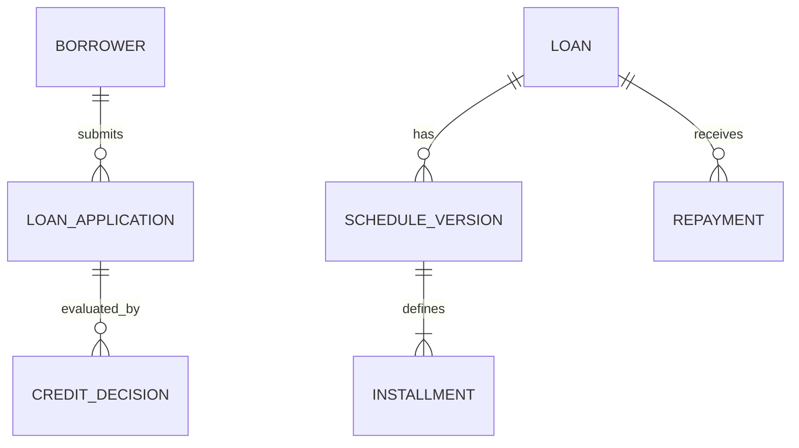

## 3. Tables, keys, constraints, indexes
```sql
CREATE TABLE loan_application(id uuid PRIMARY KEY,borrower_id uuid NOT NULL,requested_minor bigint NOT NULL CHECK(requested_minor>0),currency char(3) NOT NULL,status text NOT NULL CHECK(status IN ('submitted','review','approved','rejected','withdrawn')),created_at timestamptz NOT NULL DEFAULT now());
CREATE TABLE credit_decision(id uuid PRIMARY KEY,application_id uuid NOT NULL REFERENCES loan_application(id),policy_version text NOT NULL,outcome text NOT NULL,reason_codes jsonb NOT NULL,decided_by uuid,decided_at timestamptz NOT NULL DEFAULT now());
CREATE TABLE loan(id uuid PRIMARY KEY,application_id uuid NOT NULL UNIQUE REFERENCES loan_application(id),principal_minor bigint NOT NULL CHECK(principal_minor>0),currency char(3) NOT NULL,annual_rate numeric(9,6) NOT NULL CHECK(annual_rate>=0),status text NOT NULL CHECK(status IN ('active','paid_off','defaulted','closed')));
CREATE TABLE schedule_version(id uuid PRIMARY KEY,loan_id uuid NOT NULL REFERENCES loan(id),version int NOT NULL,effective_at timestamptz NOT NULL,UNIQUE(loan_id,version));
CREATE TABLE installment(id uuid PRIMARY KEY,schedule_version_id uuid NOT NULL REFERENCES schedule_version(id),due_date date NOT NULL,principal_minor bigint NOT NULL CHECK(principal_minor>=0),interest_minor bigint NOT NULL CHECK(interest_minor>=0),status text NOT NULL CHECK(status IN ('due','partial','paid','waived')),UNIQUE(schedule_version_id,due_date));
CREATE TABLE repayment(id uuid PRIMARY KEY,loan_id uuid NOT NULL REFERENCES loan(id),external_ref text NOT NULL UNIQUE,amount_minor bigint NOT NULL CHECK(amount_minor>0),received_at timestamptz NOT NULL,allocation jsonb NOT NULL);
CREATE INDEX installment_due_idx ON installment(due_date) WHERE status IN ('due','partial');
```

## 4. Five important SQL queries
```sql
-- Application and its decisions
SELECT status,created_at FROM loan_application WHERE id=:application;
SELECT * FROM credit_decision WHERE application_id=:application ORDER BY decided_at;
-- Installments for one schedule version
SELECT due_date,principal_minor,interest_minor,status FROM installment WHERE schedule_version_id=:schedule ORDER BY due_date;
-- Idempotent repayment intake
INSERT INTO repayment(id,loan_id,external_ref,amount_minor,received_at,allocation) VALUES (:id,:loan,:ref,:amount,:received,:allocation) ON CONFLICT(external_ref) DO NOTHING;
-- Total received so far
SELECT loan_id,SUM(amount_minor) FROM repayment WHERE loan_id=:loan GROUP BY loan_id;
-- Overdue installments in the current schedule (current schedule selection is explicit business logic)
SELECT * FROM installment WHERE schedule_version_id=:schedule AND due_date<current_date AND status IN ('due','partial') ORDER BY due_date;
```

## 5. Transactions, isolation, concurrency
Use numeric rates and integer minor units with a documented rounding convention. Schedule recalculation creates a new version. Repayment allocation, ledger posting, and schedule/balance projection update must be atomic or coordinated through an idempotent financial workflow. Store model/policy version and decision reason codes for auditability.

## 6. What changes at 100× scale
Partition repayment and decision history by time, maintain balance/arrears projections, and reconcile them against immutable transactions. Keep application workflow and servicing ledger bounded; warehouse portfolio analytics and risk modeling. Do not rewrite finalized payment allocations silently.

---

---

# 16. Fraud Detection Case Management

## 1. Business requirements and access patterns
Ingest alerts from rules/models, associate alerts with accounts/devices/other entities, group alerts into investigation cases, and retain analyst evidence and decisions. Hot paths: severity-ranked triage, case timeline, linked-entity search, assignments, and investigation outcomes.

## 2. ER diagram and cardinalities
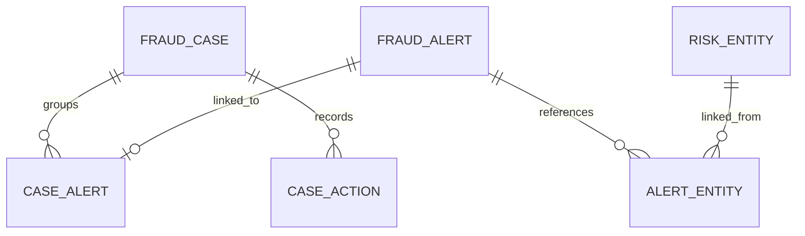

## 3. Tables, keys, constraints, indexes
```sql
CREATE TABLE fraud_alert(id uuid PRIMARY KEY,source_event_id text NOT NULL UNIQUE,rule_version text NOT NULL,severity smallint NOT NULL CHECK(severity BETWEEN 1 AND 100),status text NOT NULL CHECK(status IN ('new','triaged','linked','dismissed')),observed_at timestamptz NOT NULL,signals jsonb NOT NULL);
CREATE TABLE fraud_case(id uuid PRIMARY KEY,status text NOT NULL CHECK(status IN ('open','investigating','escalated','confirmed','cleared','closed')),priority smallint NOT NULL,assigned_to uuid,created_at timestamptz NOT NULL DEFAULT now(),closed_at timestamptz);
CREATE TABLE case_alert(case_id uuid NOT NULL REFERENCES fraud_case(id),alert_id uuid NOT NULL UNIQUE REFERENCES fraud_alert(id),linked_at timestamptz NOT NULL DEFAULT now(),PRIMARY KEY(case_id,alert_id));
CREATE TABLE risk_entity(id uuid PRIMARY KEY,entity_type text NOT NULL,tokenized_value text NOT NULL,UNIQUE(entity_type,tokenized_value));
CREATE TABLE alert_entity(alert_id uuid NOT NULL REFERENCES fraud_alert(id),entity_id uuid NOT NULL REFERENCES risk_entity(id),relation text NOT NULL,confidence numeric(5,4),PRIMARY KEY(alert_id,entity_id,relation));
CREATE TABLE case_action(id bigint GENERATED ALWAYS AS IDENTITY PRIMARY KEY,case_id uuid NOT NULL REFERENCES fraud_case(id),actor_id uuid NOT NULL,action text NOT NULL,rationale text,evidence_ref text,created_at timestamptz NOT NULL DEFAULT now());
CREATE INDEX alert_triage_idx ON fraud_alert(severity DESC,observed_at) WHERE status='new';
```

## 4. Five important SQL queries
```sql
-- Triage queue
SELECT id,severity,observed_at,signals FROM fraud_alert WHERE status='new' ORDER BY severity DESC,observed_at LIMIT 100;
-- Entities linked to a case
SELECT DISTINCT e.entity_type,e.tokenized_value,ae.relation FROM case_alert ca JOIN alert_entity ae ON ae.alert_id=ca.alert_id JOIN risk_entity e ON e.id=ae.entity_id WHERE ca.case_id=:case;
-- Case timeline
SELECT action,actor_id,rationale,evidence_ref,created_at FROM case_action WHERE case_id=:case ORDER BY created_at,id;
-- Similar alerts tied to an entity
SELECT a.id,a.severity,a.observed_at FROM alert_entity ae JOIN fraud_alert a ON a.id=ae.alert_id WHERE ae.entity_id=:entity AND a.observed_at>=:from ORDER BY a.observed_at DESC LIMIT 100;
-- Claim an unassigned open case
UPDATE fraud_case SET assigned_to=:analyst,status='investigating' WHERE id=:case AND assigned_to IS NULL AND status='open' RETURNING id;
```

## 5. Transactions, isolation, concurrency
Deduplicate incoming alerts by source event ID. Link an alert to a case transactionally; the unique alert constraint prevents double-linking. Append each analyst action with the case transition. Store evidence as immutable object references and checksums. Tokenize sensitive entity values and restrict access to raw signals.

## 6. What changes at 100× scale
Move raw signal events to a partitioned event store; optimize the relational DB for analyst workflow. Add entity resolution and graph analytics only when relationship traversals need it. Preserve model/rule versions, rationale, retention policy, and legal-hold metadata.

---

---

# 17. Identity and Access Management (IAM / RBAC)

## 1. Business requirements and access patterns

**Requirements:** authenticate principals; assign roles to users within tenants; map roles to permissions; optionally scope assignments to a resource; revoke access reliably; maintain an audit trail; support service identities. RBAC answers what permissions a principal has; authentication/session management is adjacent but separate.

**Hot access patterns:** effective permissions for `(user, tenant)`; users assigned a role; role-permission editing; authorization checks on every request; audit who granted/revoked access.

## 2. ER diagram and cardinalities

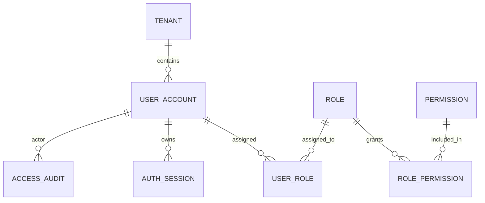

Many-to-many: users↔roles, roles↔permissions. Keep assignments tenant-scoped. Role hierarchy and deny rules require an explicit precedence model; do not add them casually.

## 3. Core schema

```sql
CREATE TABLE tenant (
  id uuid PRIMARY KEY,
  name text NOT NULL
);
CREATE TABLE user_account (
  id uuid PRIMARY KEY,
  email citext NOT NULL UNIQUE,
  status text NOT NULL CHECK (status IN ('active','disabled','deleted'))
);
CREATE TABLE role (
  id uuid PRIMARY KEY,
  tenant_id uuid NOT NULL REFERENCES tenant(id),
  name text NOT NULL,
  is_system boolean NOT NULL DEFAULT false,
  UNIQUE (tenant_id, name),
  UNIQUE (tenant_id, id)
);
CREATE TABLE permission (
  id uuid PRIMARY KEY,
  resource text NOT NULL,
  action text NOT NULL,
  UNIQUE (resource, action)
);
CREATE TABLE role_permission (
  role_id uuid NOT NULL REFERENCES role(id) ON DELETE CASCADE,
  permission_id uuid NOT NULL REFERENCES permission(id) ON DELETE CASCADE,
  PRIMARY KEY (role_id, permission_id)
);
CREATE TABLE user_role (
  tenant_id uuid NOT NULL REFERENCES tenant(id),
  user_id uuid NOT NULL REFERENCES user_account(id),
  role_id uuid NOT NULL,
  scope_type text NOT NULL DEFAULT 'tenant',
  scope_id text NOT NULL DEFAULT '*',
  granted_by uuid REFERENCES user_account(id),
  granted_at timestamptz NOT NULL DEFAULT now(),
  PRIMARY KEY (tenant_id, user_id, role_id, scope_type, scope_id),
  FOREIGN KEY (tenant_id, role_id) REFERENCES role(tenant_id, id) ON DELETE CASCADE
);
CREATE INDEX user_role_by_role_idx ON user_role (tenant_id, role_id, user_id);
CREATE INDEX user_role_by_user_idx ON user_role (tenant_id, user_id, role_id);
CREATE TABLE auth_session (
  id uuid PRIMARY KEY,
  user_id uuid NOT NULL REFERENCES user_account(id),
  token_hash bytea NOT NULL UNIQUE,
  expires_at timestamptz NOT NULL,
  revoked_at timestamptz,
  created_at timestamptz NOT NULL DEFAULT now()
);
CREATE INDEX session_active_user_idx ON auth_session (user_id, expires_at) WHERE revoked_at IS NULL;
CREATE TABLE access_audit (
  id bigint GENERATED ALWAYS AS IDENTITY PRIMARY KEY,
  tenant_id uuid NOT NULL REFERENCES tenant(id),
  actor_user_id uuid REFERENCES user_account(id),
  target_user_id uuid REFERENCES user_account(id),
  action text NOT NULL,
  details jsonb NOT NULL DEFAULT '{}',
  created_at timestamptz NOT NULL DEFAULT now()
);
CREATE INDEX access_audit_tenant_time_idx ON access_audit (tenant_id, created_at DESC, id DESC);
```

`citext` requires the PostgreSQL extension; alternatively store a normalized email column. Scope IDs are strings here to support multiple resource types; a more strongly typed domain can use separate scoped tables or resource foreign keys.

## 4. Five important SQL queries

```sql
-- Q1: Effective permissions for a tenant-scoped user.
SELECT DISTINCT p.resource, p.action
FROM user_role ur
JOIN role_permission rp ON rp.role_id = ur.role_id
JOIN permission p ON p.id = rp.permission_id
WHERE ur.tenant_id = :tenant_id AND ur.user_id = :user_id
  AND (ur.scope_type = 'tenant' OR (ur.scope_type = :resource_type AND ur.scope_id = :resource_id));

-- Q2: Users with a given role.
SELECT user_id, granted_by, granted_at
FROM user_role WHERE tenant_id = :tenant_id AND role_id = :role_id;

-- Q3: Grant a role idempotently.
INSERT INTO user_role (tenant_id, user_id, role_id, scope_type, scope_id, granted_by)
VALUES (:tenant_id, :user_id, :role_id, :scope_type, :scope_id, :actor_id)
ON CONFLICT DO NOTHING;

-- Q4: Revoke a role assignment.
DELETE FROM user_role
WHERE tenant_id = :tenant_id AND user_id = :user_id AND role_id = :role_id
  AND scope_type = :scope_type AND scope_id = :scope_id;

-- Q5: Revoke all active sessions after disabling a user.
UPDATE auth_session SET revoked_at = now()
WHERE user_id = :user_id AND revoked_at IS NULL;

-- Q6: Audit recent access changes.
SELECT actor_user_id, target_user_id, action, details, created_at
FROM access_audit WHERE tenant_id = :tenant_id
ORDER BY created_at DESC, id DESC LIMIT 100;
```

## 5. Transaction boundaries and risks

Role/permission changes and their audit records should commit together. Use row-level locking or a permission-version counter to invalidate authorization caches when roles change. Authentication/session revocation has a different consistency requirement from role lookup; define revocation SLA. Risks include cross-tenant leakage, stale cached permissions, privilege escalation by allowing users to grant roles they do not control, and role-deletion cascades deleting audit meaning. Keep immutable audit records independent of mutable assignment rows.

## 6. At 100× scale

Cache compiled permissions by `(tenant, principal, policy_version)` with short TTL or version-based invalidation. Separate audit event storage from the authorization OLTP path; partition audit by time. For complex attribute-based access control, introduce a policy evaluation service and policy/version model, but retain the relational source of truth for assignments. Make tenant isolation explicit in every query and test it.

---

---

# 18. Calendar and Meeting Scheduling

## 1. Business requirements and access patterns
Users own calendars, invite attendees, and create recurring meetings with exceptions. Availability checks and room reservations need conflict handling; recurrence must account for time zones and daylight-saving changes. Hot paths: list events in a time window, invitations, attendee responses, conflict checks, and occurrence cancellation.

## 2. ER diagram and cardinalities
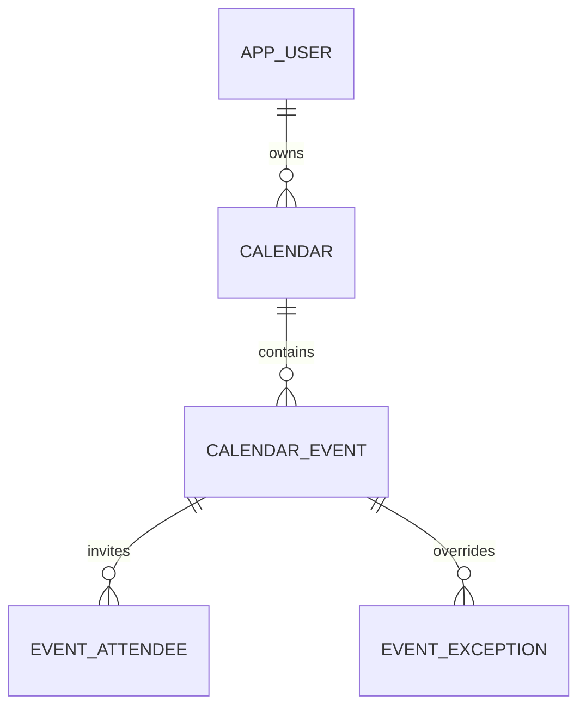

## 3. Tables, keys, constraints, indexes
```sql
CREATE TABLE calendar(id uuid PRIMARY KEY,owner_id uuid NOT NULL,name text NOT NULL,timezone text NOT NULL);
CREATE TABLE calendar_event(id uuid PRIMARY KEY,calendar_id uuid NOT NULL REFERENCES calendar(id),title text NOT NULL,starts_at timestamptz NOT NULL,ends_at timestamptz NOT NULL,timezone text NOT NULL,recurrence_rule text,status text NOT NULL CHECK(status IN ('active','cancelled')),version int NOT NULL DEFAULT 1,CHECK(ends_at>starts_at));
CREATE TABLE event_attendee(event_id uuid NOT NULL REFERENCES calendar_event(id),user_id uuid NOT NULL,response text NOT NULL CHECK(response IN ('needs_action','accepted','declined','tentative')),PRIMARY KEY(event_id,user_id));
CREATE TABLE event_exception(id uuid PRIMARY KEY,event_id uuid NOT NULL REFERENCES calendar_event(id),recurrence_id timestamptz NOT NULL,cancelled boolean NOT NULL DEFAULT false,override_starts_at timestamptz,override_ends_at timestamptz,UNIQUE(event_id,recurrence_id));
CREATE INDEX event_window_idx ON calendar_event(calendar_id,starts_at) WHERE status='active';
```

## 4. Five important SQL queries
```sql
-- Events overlapping a time window (recurrence expansion is separate)
SELECT * FROM calendar_event WHERE calendar_id=:calendar AND status='active' AND starts_at<:window_end AND ends_at>:window_start ORDER BY starts_at;
-- Attendees and responses
SELECT user_id,response FROM event_attendee WHERE event_id=:event;
-- Optimistic edit
UPDATE calendar_event SET title=:title,starts_at=:start,ends_at=:end,version=version+1 WHERE id=:event AND version=:expected_version RETURNING version;
-- User's invited events in a range
SELECT e.* FROM event_attendee a JOIN calendar_event e ON e.id=a.event_id WHERE a.user_id=:user AND e.starts_at>=:from AND e.starts_at<:to ORDER BY e.starts_at;
-- Conflict check for an exclusive resource; final enforcement needs a constraint on materialized occurrences
SELECT id FROM calendar_event WHERE calendar_id=:calendar AND status='active' AND starts_at<:end AND ends_at>:start;
```

## 5. Transactions, isolation, concurrency
Store event instants in UTC and preserve the intended IANA timezone for recurrence expansion. A recurring local 9 AM meeting does not have a fixed UTC time across daylight-saving changes. Use optimistic versioning for edits and unique `(event_id, recurrence_id)` exceptions. For exclusive rooms, materialize a bounded horizon and enforce non-overlap with a range exclusion constraint.

## 6. What changes at 100× scale
Expand recurring instances on demand with caching, materializing only the horizon needed for conflicts. Index by calendar/time and attendee/time. Build read projections for high-fan-out invitations while keeping canonical events and attendee responses authoritative.

---

---

# 19. Team Chat Application

## 1. Business requirements and access patterns

**Requirements:** workspaces, channels, members, messages, threads, reactions, attachments, and read cursors. Support message edits/deletes, authorization by channel membership, stable chronological pagination, and search.

**Hot access patterns:** newest messages in a channel; messages after a cursor; unread count/read cursor; workspace/channel list for a user; reactions on one message; search by term within allowed channels.

## 2. ER diagram and cardinalities

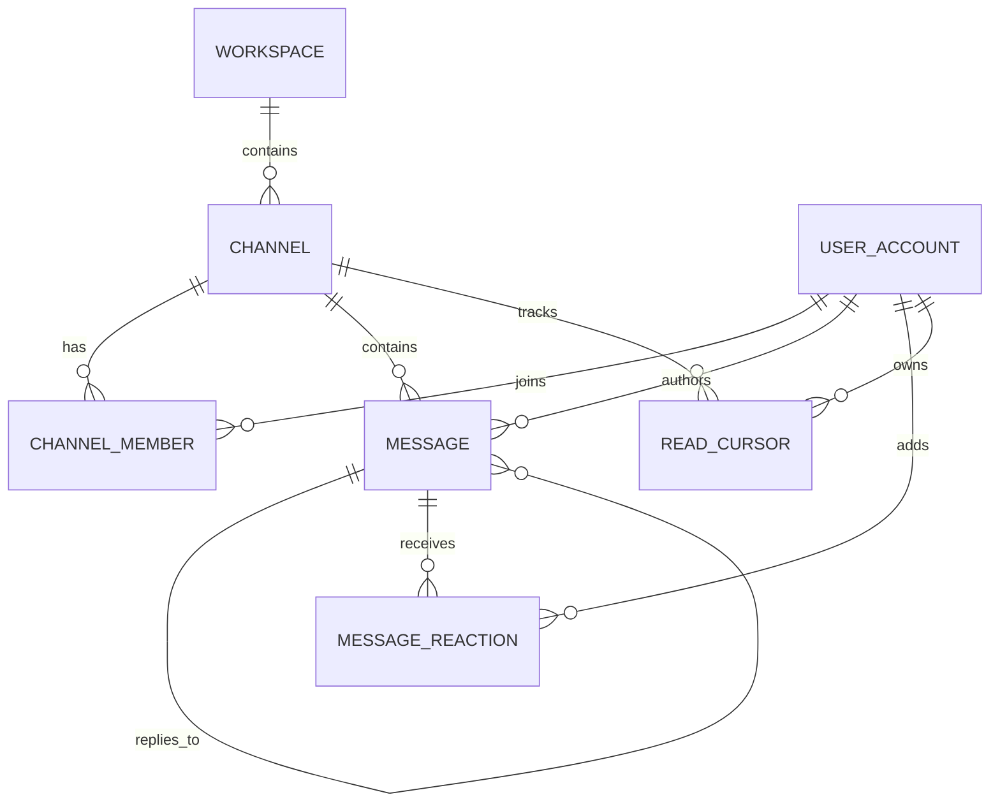

## 3. Core schema

```sql
CREATE TABLE workspace (
  id uuid PRIMARY KEY,
  name text NOT NULL
);
CREATE TABLE user_account (
  id uuid PRIMARY KEY,
  display_name text NOT NULL
);
CREATE TABLE channel (
  id uuid PRIMARY KEY,
  workspace_id uuid NOT NULL REFERENCES workspace(id),
  name text NOT NULL,
  visibility text NOT NULL CHECK (visibility IN ('public','private')),
  created_at timestamptz NOT NULL DEFAULT now(),
  UNIQUE (workspace_id, name)
);
CREATE TABLE channel_member (
  channel_id uuid NOT NULL REFERENCES channel(id) ON DELETE CASCADE,
  user_id uuid NOT NULL REFERENCES user_account(id),
  role text NOT NULL DEFAULT 'member' CHECK (role IN ('owner','moderator','member')),
  joined_at timestamptz NOT NULL DEFAULT now(),
  PRIMARY KEY (channel_id, user_id)
);
CREATE INDEX channel_member_user_idx ON channel_member (user_id, channel_id);
CREATE TABLE message (
  id bigint GENERATED ALWAYS AS IDENTITY PRIMARY KEY,
  channel_id uuid NOT NULL REFERENCES channel(id),
  author_id uuid NOT NULL REFERENCES user_account(id),
  parent_message_id bigint REFERENCES message(id),
  body text NOT NULL,
  created_at timestamptz NOT NULL DEFAULT now(),
  edited_at timestamptz,
  deleted_at timestamptz
);
CREATE INDEX message_channel_page_idx ON message (channel_id, created_at DESC, id DESC) WHERE deleted_at IS NULL;
CREATE INDEX message_thread_idx ON message (parent_message_id, created_at, id) WHERE parent_message_id IS NOT NULL;
CREATE TABLE message_reaction (
  message_id bigint NOT NULL REFERENCES message(id) ON DELETE CASCADE,
  user_id uuid NOT NULL REFERENCES user_account(id),
  emoji text NOT NULL,
  created_at timestamptz NOT NULL DEFAULT now(),
  PRIMARY KEY (message_id, user_id, emoji)
);
CREATE TABLE read_cursor (
  user_id uuid NOT NULL REFERENCES user_account(id),
  channel_id uuid NOT NULL REFERENCES channel(id) ON DELETE CASCADE,
  last_read_message_id bigint REFERENCES message(id),
  last_read_at timestamptz NOT NULL DEFAULT now(),
  PRIMARY KEY (user_id, channel_id)
);
```

Attachments are best stored as object-store references in a separate `message_attachment` table; do not store file bytes in the hot messages table.

## 4. Five important SQL queries

```sql
-- Q1: Latest messages in a channel.
SELECT id, author_id, body, created_at, parent_message_id
FROM message WHERE channel_id = :channel_id AND deleted_at IS NULL
ORDER BY created_at DESC, id DESC LIMIT 50;

-- Q2: Older messages using keyset pagination.
SELECT id, author_id, body, created_at
FROM message WHERE channel_id = :channel_id AND deleted_at IS NULL
  AND (created_at, id) < (:cursor_time, :cursor_id)
ORDER BY created_at DESC, id DESC LIMIT 50;

-- Q3: Channels a user belongs to in a workspace.
SELECT c.id, c.name, c.visibility, cm.role
FROM channel_member cm JOIN channel c ON c.id = cm.channel_id
WHERE cm.user_id = :user_id AND c.workspace_id = :workspace_id
ORDER BY c.name;

-- Q4: Upsert the read cursor; never move it backwards.
INSERT INTO read_cursor (user_id, channel_id, last_read_message_id, last_read_at)
VALUES (:user_id, :channel_id, :message_id, now())
ON CONFLICT (user_id, channel_id) DO UPDATE
SET last_read_message_id = EXCLUDED.last_read_message_id, last_read_at = now()
WHERE read_cursor.last_read_message_id IS NULL
   OR read_cursor.last_read_message_id < EXCLUDED.last_read_message_id;

-- Q5: Add a reaction idempotently.
INSERT INTO message_reaction (message_id, user_id, emoji)
VALUES (:message_id, :user_id, :emoji) ON CONFLICT DO NOTHING;

-- Q6: Full-text search (create a GIN index on to_tsvector('simple', body)).
SELECT id, channel_id, author_id, body, created_at
FROM message
WHERE channel_id = :channel_id AND deleted_at IS NULL
  AND to_tsvector('simple', body) @@ plainto_tsquery('simple', :query)
ORDER BY created_at DESC LIMIT 50;
```

## 5. Transaction boundaries and risks

Membership checks must occur before message reads/writes (or be enforced in the service/RLS policy). Message insert and outbox notification should commit together. Edits should verify author/moderator privileges and use optimistic versioning if concurrent edits matter. The `read_cursor` row should only move forward. Risks: hot channels, large unread-count scans, deleting users referenced by history, and search revealing private-channel messages. Use cursor pagination, soft-delete policies, and tenant/channel authorization on every path.

## 6. At 100× scale

Partition messages by time and/or channel hash; very large channels may have a dedicated partition/key. Use a search engine for large-scale search, object storage for attachments, and a fanout strategy chosen by channel size (fanout-on-write for small channels; fanout-on-read for very large ones). Cache recent messages but keep the database authoritative. Deliver notifications asynchronously through an outbox/stream.

---

---

# 20. Document Collaboration and Versioning

## 1. Business requirements and access patterns
Users edit shared documents, access grants govern read/edit/comment, revisions are immutable, and comments anchor to revisions. Large bodies and attachments may live in object storage. Access patterns: visible document list, head revision read/write, history, comments, and permission resolution.

## 2. ER diagram and cardinalities
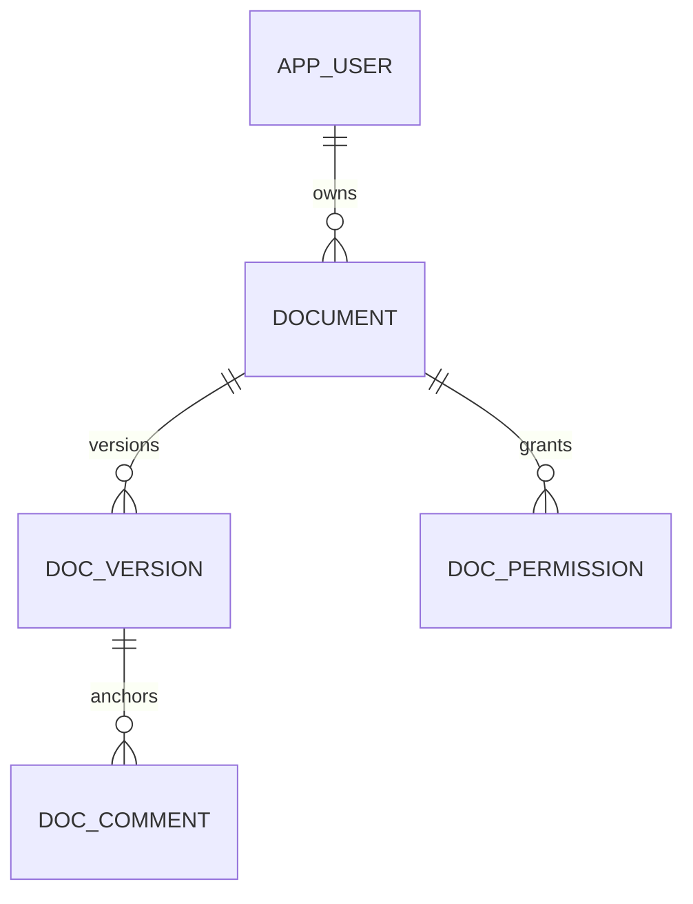

## 3. Tables, keys, constraints, indexes
```sql
CREATE TABLE document(id uuid PRIMARY KEY,owner_id uuid NOT NULL,title text NOT NULL,current_version int NOT NULL DEFAULT 0,created_at timestamptz NOT NULL DEFAULT now(),deleted_at timestamptz);
CREATE TABLE doc_version(document_id uuid NOT NULL REFERENCES document(id),version_no int NOT NULL,parent_version int,content_ref text NOT NULL,content_hash text NOT NULL,author_id uuid NOT NULL,created_at timestamptz NOT NULL DEFAULT now(),PRIMARY KEY(document_id,version_no));
CREATE TABLE doc_permission(document_id uuid NOT NULL REFERENCES document(id),principal_type text NOT NULL CHECK(principal_type IN ('user','group')),principal_id uuid NOT NULL,permission text NOT NULL CHECK(permission IN ('viewer','commenter','editor','owner')),granted_by uuid NOT NULL,PRIMARY KEY(document_id,principal_type,principal_id));
CREATE TABLE doc_comment(id uuid PRIMARY KEY,document_id uuid NOT NULL REFERENCES document(id),version_no int NOT NULL,author_id uuid NOT NULL,body text NOT NULL,anchor jsonb,created_at timestamptz NOT NULL DEFAULT now(),FOREIGN KEY(document_id,version_no) REFERENCES doc_version(document_id,version_no));
CREATE INDEX document_owner_recent_idx ON document(owner_id,created_at DESC) WHERE deleted_at IS NULL;
```

## 4. Five important SQL queries
```sql
-- Version history
SELECT version_no,parent_version,author_id,content_ref,content_hash,created_at FROM doc_version WHERE document_id=:doc ORDER BY version_no DESC;
-- Append a new immutable revision after validating the expected head
INSERT INTO doc_version(document_id,version_no,parent_version,content_ref,content_hash,author_id) VALUES (:doc,:next,:expected,:ref,:hash,:author);
-- Advance head only if unchanged
UPDATE document SET current_version=:next WHERE id=:doc AND current_version=:expected RETURNING current_version;
-- Comments on a specific revision
SELECT * FROM doc_comment WHERE document_id=:doc AND version_no=:version ORDER BY created_at;
-- Direct user permission (group inheritance must be resolved separately)
SELECT permission FROM doc_permission WHERE document_id=:doc AND principal_type='user' AND principal_id=:user;
```

## 5. Transactions, isolation, concurrency
Write version metadata and advance the current head in one transaction. If compare-and-set fails, merge/rebase rather than overwrite. Upload content durably before publishing its object reference. Authorization must precede blob retrieval, export, and sharing; cache permission results only with reliable invalidation.

## 6. What changes at 100× scale
Keep large bodies/diffs in object storage, partition version history if needed, and cache permission projections carefully. Use retention/compaction without deleting legally required revisions. Add collaborative editing operation logs only if real-time multi-writer editing requires them; immutable snapshots alone don't solve OT/CRDT synchronization.

---

---

# 21. Workflow and Approval Engine

## 1. Business requirements and access patterns

**Requirements:** versioned workflow definitions; durable workflow executions; steps/tasks with retries and timers; pause/resume/cancel; execution history; idempotent external side effects; and recovery after worker crashes.

**Hot access patterns:** create an execution; claim runnable steps; get execution state/history; find timers due; retry failed steps; find stalled executions.

## 2. ER diagram and cardinalities

```mermaid
erDiagram
  WORKFLOW_DEFINITION ||--o{ WORKFLOW_VERSION : versions
  WORKFLOW_VERSION ||--o{ WORKFLOW_EXECUTION : starts
  WORKFLOW_EXECUTION ||--o{ STEP_EXECUTION : contains
  STEP_EXECUTION ||--o{ STEP_ATTEMPT : retries
  WORKFLOW_EXECUTION ||--o{ WORKFLOW_EVENT : records
```

A workflow version is immutable. Each execution points to one version. A step can have multiple attempts; durable state must not live only in a worker's memory.

## 3. Core schema

```sql
CREATE TABLE workflow_definition (
  id uuid PRIMARY KEY,
  name text NOT NULL UNIQUE
);
CREATE TABLE workflow_version (
  id uuid PRIMARY KEY,
  workflow_id uuid NOT NULL REFERENCES workflow_definition(id),
  version integer NOT NULL,
  definition jsonb NOT NULL,
  created_at timestamptz NOT NULL DEFAULT now(),
  UNIQUE (workflow_id, version)
);
CREATE TABLE workflow_execution (
  id uuid PRIMARY KEY,
  workflow_version_id uuid NOT NULL REFERENCES workflow_version(id),
  business_key text,
  status text NOT NULL CHECK (status IN ('running','waiting','succeeded','failed','cancelled')),
  input jsonb NOT NULL DEFAULT '{}',
  output jsonb,
  state_version bigint NOT NULL DEFAULT 0,
  started_at timestamptz NOT NULL DEFAULT now(),
  finished_at timestamptz
);
CREATE UNIQUE INDEX workflow_business_key_idx ON workflow_execution (workflow_version_id, business_key)
  WHERE business_key IS NOT NULL;
CREATE INDEX workflow_stalled_idx ON workflow_execution (started_at)
  WHERE status IN ('running','waiting');
CREATE TABLE step_execution (
  id uuid PRIMARY KEY,
  execution_id uuid NOT NULL REFERENCES workflow_execution(id) ON DELETE CASCADE,
  step_key text NOT NULL,
  status text NOT NULL CHECK (status IN ('blocked','ready','running','waiting','succeeded','failed','skipped')),
  attempt_count integer NOT NULL DEFAULT 0 CHECK (attempt_count >= 0),
  available_at timestamptz NOT NULL DEFAULT now(),
  lease_owner text,
  lease_until timestamptz,
  state jsonb NOT NULL DEFAULT '{}',
  version bigint NOT NULL DEFAULT 0,
  UNIQUE (execution_id, step_key)
);
CREATE INDEX step_runnable_idx ON step_execution (available_at, id)
  WHERE status = 'ready';
CREATE INDEX step_expired_lease_idx ON step_execution (lease_until)
  WHERE status = 'running';
CREATE TABLE step_attempt (
  id bigint GENERATED ALWAYS AS IDENTITY PRIMARY KEY,
  step_execution_id uuid NOT NULL REFERENCES step_execution(id),
  attempt_no integer NOT NULL,
  status text NOT NULL CHECK (status IN ('started','succeeded','failed','timed_out','unknown')),
  input jsonb,
  output jsonb,
  error jsonb,
  started_at timestamptz NOT NULL DEFAULT now(),
  finished_at timestamptz,
  UNIQUE (step_execution_id, attempt_no)
);
CREATE TABLE workflow_event (
  id bigint GENERATED ALWAYS AS IDENTITY PRIMARY KEY,
  execution_id uuid NOT NULL REFERENCES workflow_execution(id),
  event_type text NOT NULL,
  payload jsonb NOT NULL DEFAULT '{}',
  created_at timestamptz NOT NULL DEFAULT now()
);
CREATE INDEX workflow_event_timeline_idx ON workflow_event (execution_id, created_at, id);
```

## 4. Five important SQL queries

```sql
-- Q1: Create execution idempotently by business key.
INSERT INTO workflow_execution (id, workflow_version_id, business_key, status, input)
VALUES (:id, :workflow_version_id, :business_key, 'running', :input)
ON CONFLICT (workflow_version_id, business_key) WHERE business_key IS NOT NULL DO NOTHING;

-- Q2: Claim runnable steps in a short transaction.
WITH candidates AS (
  SELECT id FROM step_execution
  WHERE status = 'ready' AND available_at <= now()
  ORDER BY available_at, id LIMIT 100 FOR UPDATE SKIP LOCKED
)
UPDATE step_execution s
SET status = 'running', lease_owner = :worker_id,
    lease_until = now() + interval '60 seconds', attempt_count = attempt_count + 1,
    version = version + 1
FROM candidates c WHERE s.id = c.id
RETURNING s.*;

-- Q3: Complete only if this worker still owns the lease/version.
UPDATE step_execution
SET status = 'succeeded', state = :new_state, lease_owner = NULL, lease_until = NULL,
    version = version + 1
WHERE id = :step_id AND status = 'running' AND lease_owner = :worker_id
  AND version = :claimed_version
RETURNING id;

-- Q4: Find expired running leases for recovery.
SELECT id, execution_id, lease_owner, lease_until
FROM step_execution WHERE status = 'running' AND lease_until < now()
ORDER BY lease_until LIMIT 500;

-- Q5: Read execution history.
SELECT event_type, payload, created_at
FROM workflow_event WHERE execution_id = :execution_id ORDER BY id;

-- Q6: Find failed steps awaiting retry.
SELECT id, execution_id, step_key, attempt_count, available_at
FROM step_execution WHERE status = 'ready' AND available_at <= now()
ORDER BY available_at LIMIT 100;
```

## 5. Transaction boundaries and risks

Claiming a step and updating its lease should be atomic and short; never hold DB locks while executing user code or calling a tool. Completion must include step output/state, event, and next-step scheduling in one transaction (or use an outbox). A lease prevents concurrent active workers, while a fencing token/version prevents a stale worker from committing after lease expiry. External side effects still need idempotency keys because a worker may crash after the side effect but before saving success. Choose at-least-once delivery plus idempotent activities rather than claiming exactly-once execution.

## 6. At 100× scale

Partition events by time and executions by tenant/hash; retain compact current-state rows and move old history to cheaper storage. Separate schedulers/work queues by task type/priority. Use a durable timer index or timing wheel for huge timer volumes, and implement quotas/backpressure. Keep workflow definition versions immutable and use snapshots/compaction to avoid replaying unbounded history on every read.

---

---

# 22. API Key and Developer Portal

## 1. Business requirements and access patterns
Developers create scoped keys for applications/tenants, rotate or revoke them, and inspect usage. Raw secrets are shown once and never stored in plaintext. Access patterns: key validation, scope resolution, key inventory, rotation/revocation, and usage by key/time.

## 2. ER diagram and cardinalities
```mermaid
erDiagram
 DEVELOPER ||--o{ APPLICATION : owns
 APPLICATION ||--o{ API_KEY : has
 API_KEY ||--o{ KEY_SCOPE : grants
```

## 3. Tables, keys, constraints, indexes
```sql
CREATE TABLE developer(id uuid PRIMARY KEY,email citext NOT NULL UNIQUE);
CREATE TABLE application(id uuid PRIMARY KEY,developer_id uuid NOT NULL REFERENCES developer(id),tenant_id uuid NOT NULL,name text NOT NULL,UNIQUE(tenant_id,name));
CREATE TABLE api_key(id uuid PRIMARY KEY,application_id uuid NOT NULL REFERENCES application(id),secret_hash bytea NOT NULL UNIQUE,prefix text NOT NULL,status text NOT NULL CHECK(status IN ('active','revoked','expired')),expires_at timestamptz,created_at timestamptz NOT NULL DEFAULT now(),last_used_at timestamptz);
CREATE TABLE key_scope(key_id uuid NOT NULL REFERENCES api_key(id),scope text NOT NULL,PRIMARY KEY(key_id,scope));
CREATE INDEX api_key_app_idx ON api_key(application_id,created_at DESC);
CREATE INDEX api_key_active_idx ON api_key(prefix) WHERE status='active';
```

## 4. Five important SQL queries
```sql
-- Lookup by public prefix, then verify supplied secret against hash in constant-time application code
SELECT id,secret_hash,status,expires_at FROM api_key WHERE prefix=:prefix AND status='active' AND (expires_at IS NULL OR expires_at>now());
-- List keys without exposing hashes
SELECT id,prefix,status,expires_at,last_used_at FROM api_key WHERE application_id=:app ORDER BY created_at DESC;
-- Revoke conditionally
UPDATE api_key SET status='revoked' WHERE id=:key AND status='active' RETURNING id;
-- Scopes for a key
SELECT scope FROM key_scope WHERE key_id=:key ORDER BY scope;
-- Active key counts
SELECT application_id,count(*) FROM api_key WHERE status='active' GROUP BY application_id;
```

## 5. Transactions, isolation, concurrency
Generate high-entropy credentials, store only a one-way HMAC/hash, and show plaintext once. Rotation can allow a short overlap, but revocation must propagate quickly. Update last-used asynchronously rather than writing on every API request. Do not log secrets or return hashes through APIs.

## 6. What changes at 100× scale
Move usage metering to a stream/aggregator and keep key lookup small, indexed, and cacheable. Use bounded revocation cache TTL/invalidation and per-tenant quota enforcement. Partition usage by time/tenant, not the relatively small key inventory.

---

---

# 23. Feature Flag and Experimentation Platform

## 1. Business requirements and access patterns
Teams define flag versions, environment-specific targeting rules, rollout percentages and experiment variants. Evaluation must be deterministic for a subject and a given config version; exposure ingestion must not block serving flags. Reads: current config, version history, experiment exposure aggregates, admin audit.

## 2. ER diagram and cardinalities
```mermaid
erDiagram
 PROJECT ||--o{ FEATURE_FLAG : defines
 FEATURE_FLAG ||--o{ FLAG_VERSION : versions
 ENVIRONMENT ||--o{ FLAG_VERSION : deploys
 EXPERIMENT ||--o{ VARIANT : contains
```

## 3. Tables, keys, constraints, indexes
```sql
CREATE TABLE project(id uuid PRIMARY KEY,name text NOT NULL UNIQUE);
CREATE TABLE environment(id uuid PRIMARY KEY,project_id uuid NOT NULL REFERENCES project(id),name text NOT NULL,UNIQUE(project_id,name));
CREATE TABLE feature_flag(id uuid PRIMARY KEY,project_id uuid NOT NULL REFERENCES project(id),key text NOT NULL,UNIQUE(project_id,key));
CREATE TABLE flag_version(id uuid PRIMARY KEY,flag_id uuid NOT NULL REFERENCES feature_flag(id),environment_id uuid NOT NULL REFERENCES environment(id),version int NOT NULL,enabled boolean NOT NULL,rules jsonb NOT NULL,published_at timestamptz,published_by uuid NOT NULL,UNIQUE(flag_id,environment_id,version));
CREATE TABLE flag_current(flag_id uuid NOT NULL REFERENCES feature_flag(id),environment_id uuid NOT NULL REFERENCES environment(id),version_id uuid NOT NULL REFERENCES flag_version(id),PRIMARY KEY(flag_id,environment_id));
CREATE TABLE exposure_event(id bigint GENERATED ALWAYS AS IDENTITY PRIMARY KEY,experiment_key text NOT NULL,subject_hash text NOT NULL,variant_key text NOT NULL,occurred_at timestamptz NOT NULL DEFAULT now(),event_key text NOT NULL UNIQUE);
CREATE INDEX exposure_experiment_time_idx ON exposure_event(experiment_key,occurred_at);
```

## 4. Five important SQL queries
```sql
-- Current published config
SELECT v.* FROM flag_current c JOIN flag_version v ON v.id=c.version_id WHERE c.flag_id=:flag AND c.environment_id=:env;
-- Publish by moving pointer after immutable version is inserted
UPDATE flag_current SET version_id=:version WHERE flag_id=:flag AND environment_id=:env RETURNING version_id;
-- Versions/audit history
SELECT version,rules,enabled,published_by,published_at FROM flag_version WHERE flag_id=:flag AND environment_id=:env ORDER BY version DESC;
-- Idempotent exposure ingestion
INSERT INTO exposure_event(experiment_key,subject_hash,variant_key,event_key) VALUES (:experiment,:subject,:variant,:event_key) ON CONFLICT(event_key) DO NOTHING;
-- Exposure counts by variant
SELECT variant_key,count(*) FROM exposure_event WHERE experiment_key=:experiment AND occurred_at>=:from GROUP BY variant_key;
```

## 5. Transactions, isolation, concurrency
Publish an immutable config version, then atomically move the current-version pointer. Use stable hashing of `(experiment, subject)` for assignments and record the version/variant that produced an exposure. Admin writes require audit and optimistic versioning; keep DB reads out of the hot evaluation path where possible.

## 6. What changes at 100× scale
Distribute signed/versioned configs through edge caches or SDK polling with last-known-good fallback. Partition exposure events by time and stream them to a warehouse. Test evaluation parity across SDKs and bound targeting-rule complexity.

---

---

# 24. Shipment Tracking

## 1. Business requirements and access patterns

**Requirements:** create shipments, track carrier-specific events, show latest status/location, correlate carrier tracking numbers, estimate delivery, manage exceptions and proof of delivery, and reconcile duplicate/out-of-order carrier callbacks.

**Hot access patterns:** lookup by tracking number; timeline for one shipment; latest state; shipments delayed or stuck; ingest carrier webhook idempotently; track by customer/order.

## 2. ER diagram and cardinalities

```mermaid
erDiagram
  CUSTOMER ||--o{ SHIPMENT : owns
  SHIPMENT ||--o{ SHIPMENT_EVENT : records
  CARRIER ||--o{ SHIPMENT : transports
  SHIPMENT ||--o{ SHIPMENT_STOP : visits
```

One shipment has many immutable tracking events. Current status is a projection/cache derived from events; a late event should not automatically overwrite a newer status.

## 3. Core schema

```sql
CREATE TABLE customer (
  id uuid PRIMARY KEY,
  name text NOT NULL
);
CREATE TABLE carrier (
  id uuid PRIMARY KEY,
  code text NOT NULL UNIQUE,
  name text NOT NULL
);
CREATE TABLE shipment (
  id uuid PRIMARY KEY,
  customer_id uuid NOT NULL REFERENCES customer(id),
  carrier_id uuid NOT NULL REFERENCES carrier(id),
  carrier_tracking_number text NOT NULL,
  order_ref text,
  status text NOT NULL CHECK (status IN ('label_created','picked_up','in_transit','out_for_delivery','delivered','exception','returned')),
  latest_event_at timestamptz,
  estimated_delivery_at timestamptz,
  delivered_at timestamptz,
  created_at timestamptz NOT NULL DEFAULT now(),
  UNIQUE (carrier_id, carrier_tracking_number)
);
CREATE INDEX shipment_customer_recent_idx ON shipment (customer_id, created_at DESC);
CREATE INDEX shipment_estimated_delivery_idx ON shipment (estimated_delivery_at)
  WHERE status NOT IN ('delivered','returned');
CREATE TABLE shipment_event (
  id bigint GENERATED ALWAYS AS IDENTITY PRIMARY KEY,
  shipment_id uuid NOT NULL REFERENCES shipment(id),
  carrier_event_id text,
  event_code text NOT NULL,
  status text NOT NULL,
  description text,
  location jsonb,
  carrier_occurred_at timestamptz NOT NULL,
  ingested_at timestamptz NOT NULL DEFAULT now(),
  raw_payload jsonb NOT NULL DEFAULT '{}'
);
CREATE UNIQUE INDEX shipment_event_dedupe_idx ON shipment_event (shipment_id, carrier_event_id)
  WHERE carrier_event_id IS NOT NULL;
CREATE INDEX shipment_event_timeline_idx ON shipment_event (shipment_id, carrier_occurred_at, id);
```

## 4. Five important SQL queries

```sql
-- Q1: Track by carrier and tracking number.
SELECT id, status, latest_event_at, estimated_delivery_at, delivered_at
FROM shipment WHERE carrier_id = :carrier_id AND carrier_tracking_number = :tracking_number;

-- Q2: Shipment timeline.
SELECT event_code, status, description, location, carrier_occurred_at
FROM shipment_event WHERE shipment_id = :shipment_id
ORDER BY carrier_occurred_at, id;

-- Q3: Idempotently ingest a carrier event.
INSERT INTO shipment_event (shipment_id, carrier_event_id, event_code, status,
  description, location, carrier_occurred_at, raw_payload)
VALUES (:shipment_id, :event_id, :event_code, :status, :description, :location, :occurred_at, :payload)
ON CONFLICT (shipment_id, carrier_event_id) WHERE carrier_event_id IS NOT NULL DO NOTHING;

-- Q4: Find likely-delayed shipments (business definition of late may vary).
SELECT id, customer_id, carrier_id, carrier_tracking_number, estimated_delivery_at, status
FROM shipment
WHERE estimated_delivery_at < now() AND status NOT IN ('delivered','returned')
ORDER BY estimated_delivery_at LIMIT 500;

-- Q5: Customer's recent shipments.
SELECT id, order_ref, carrier_tracking_number, status, estimated_delivery_at, created_at
FROM shipment WHERE customer_id = :customer_id
ORDER BY created_at DESC LIMIT 50;

-- Q6: Monitor shipments with no event recently.
SELECT id, carrier_id, carrier_tracking_number, status, latest_event_at
FROM shipment WHERE status IN ('picked_up','in_transit','out_for_delivery')
  AND latest_event_at < now() - interval '24 hours'
ORDER BY latest_event_at LIMIT 500;
```

## 5. Transaction boundaries and risks

Insert the event and update the shipment projection in the same transaction, but only advance projected state according to a carrier/status precedence policy and event time. Deduplicate by carrier event ID when possible; otherwise build a fingerprint from stable carrier fields. Carrier callbacks may be retried, delayed, and delivered out of order. Keep raw payloads for debugging with PII controls. An outbox is useful for customer notifications, which should not run in the ingestion transaction.

## 6. At 100× scale

Partition shipment events by event date and possibly carrier; route ingestion through a queue; use CDC/stream processing to build latest-state projections and exception feeds. Keep tracking-number lookup indexed, and use a search/geospatial service only if address/location search needs it. Retention and raw payload policies are important because event history grows far faster than shipments.

---

---

# 25. Ride-hailing Dispatch

## 1. Business requirements and access patterns
This design focuses on expiring offers, not GPS/trip storage: a trip is offered to nearby drivers; one driver accepts, declines, or times out; dispatch can then offer to the next candidate. Ensure at most one accepted assignment. Reads: driver inbox, offer expiry, trip assignment, offer conversion metrics.

## 2. ER diagram and cardinalities
```mermaid
erDiagram
 DISPATCH_TRIP ||--o{ DRIVER_OFFER : broadcasts
 DRIVER ||--o{ DRIVER_OFFER : receives
 DRIVER_OFFER ||--o{ OFFER_EVENT : records
 DISPATCH_TRIP ||--o| TRIP_ASSIGNMENT : assigned
```

## 3. Tables, keys, constraints, indexes
```sql
CREATE TABLE dispatch_trip(id uuid PRIMARY KEY,status text NOT NULL CHECK(status IN ('searching','assigned','cancelled','expired')),requested_at timestamptz NOT NULL DEFAULT now(),assigned_driver_id uuid,version bigint NOT NULL DEFAULT 0);
CREATE TABLE driver_offer(id uuid PRIMARY KEY,trip_id uuid NOT NULL REFERENCES dispatch_trip(id),driver_id uuid NOT NULL,status text NOT NULL CHECK(status IN ('pending','accepted','declined','expired','withdrawn')),offered_at timestamptz NOT NULL DEFAULT now(),expires_at timestamptz NOT NULL,responded_at timestamptz,UNIQUE(trip_id,driver_id));
CREATE UNIQUE INDEX one_accepted_offer_per_trip ON driver_offer(trip_id) WHERE status='accepted';
CREATE INDEX offer_driver_inbox_idx ON driver_offer(driver_id,offered_at DESC) WHERE status='pending';
CREATE INDEX offer_expiry_idx ON driver_offer(expires_at) WHERE status='pending';
CREATE TABLE trip_assignment(trip_id uuid PRIMARY KEY REFERENCES dispatch_trip(id),driver_id uuid NOT NULL,offer_id uuid NOT NULL UNIQUE REFERENCES driver_offer(id),assigned_at timestamptz NOT NULL DEFAULT now());
```

## 4. Five important SQL queries
```sql
-- Driver's live offers
SELECT * FROM driver_offer WHERE driver_id=:driver AND status='pending' AND expires_at>now() ORDER BY offered_at DESC LIMIT 20;
-- Accept only an unexpired offer
UPDATE driver_offer SET status='accepted',responded_at=now() WHERE id=:offer AND driver_id=:driver AND status='pending' AND expires_at>now() RETURNING trip_id;
-- Claim an unassigned trip (must be in same transaction as accepting offer)
UPDATE dispatch_trip SET status='assigned',assigned_driver_id=:driver,version=version+1 WHERE id=:trip AND status='searching' AND assigned_driver_id IS NULL RETURNING id;
-- Claim expired rows for a worker
SELECT id FROM driver_offer WHERE status='pending' AND expires_at<now() ORDER BY expires_at FOR UPDATE SKIP LOCKED LIMIT 100;
-- Acceptance ratio by hour
SELECT date_trunc('hour',offered_at),count(*) FILTER(WHERE status='accepted')::numeric/count(*) FROM driver_offer WHERE offered_at>=:from GROUP BY 1 ORDER BY 1;
```

## 5. Transactions, isolation, concurrency
Accepting an offer and assigning the trip are one transaction: lock trip and offer in a consistent order, check expiry and state, set offer accepted, claim the trip, and insert `trip_assignment`. A partial unique index is a backstop, not a substitute for the transition logic. Late acceptances after expiry must fail cleanly.

## 6. What changes at 100× scale
Let a geo/matching service nominate candidates, but persist authoritative offers in the DB. Use leased workers for expiry, partition offer history by time/city, and keep driver presence in a low-latency location store. Reconcile dispatch state from durable trip/offer events.

---

---

# 26. Food Delivery Platform

## 1. Business requirements and access patterns
Customers order from restaurant menus; restaurants accept and prepare; couriers are assigned separately; customers, restaurants and couriers need different read views. Snapshot item names/prices into the order. Access patterns: browse menu, place an idempotent order, restaurant queue, courier assignment, order timeline.

## 2. ER diagram and cardinalities
```mermaid
erDiagram
 RESTAURANT ||--o{ MENU_ITEM : sells
 CUSTOMER ||--o{ FOOD_ORDER : places
 FOOD_ORDER ||--|{ FOOD_ORDER_ITEM : contains
 FOOD_ORDER ||--o| DELIVERY_ASSIGNMENT : assigned
```

## 3. Tables, keys, constraints, indexes
```sql
CREATE TABLE restaurant(id uuid PRIMARY KEY,status text NOT NULL CHECK(status IN ('open','paused','closed')));
CREATE TABLE menu_item(id uuid PRIMARY KEY,restaurant_id uuid NOT NULL REFERENCES restaurant(id),name text NOT NULL,price_minor bigint NOT NULL CHECK(price_minor>=0),available boolean NOT NULL DEFAULT true);
CREATE TABLE food_order(id uuid PRIMARY KEY,customer_id uuid NOT NULL,restaurant_id uuid NOT NULL REFERENCES restaurant(id),idempotency_key text NOT NULL,status text NOT NULL CHECK(status IN ('placed','accepted','preparing','ready','picked_up','delivered','rejected','cancelled')),currency char(3) NOT NULL,total_minor bigint NOT NULL CHECK(total_minor>=0),created_at timestamptz NOT NULL DEFAULT now(),UNIQUE(customer_id,idempotency_key));
CREATE TABLE food_order_item(order_id uuid NOT NULL REFERENCES food_order(id),line_no int NOT NULL,menu_item_id uuid NOT NULL REFERENCES menu_item(id),name_snapshot text NOT NULL,unit_price_minor bigint NOT NULL,quantity int NOT NULL CHECK(quantity>0),PRIMARY KEY(order_id,line_no));
CREATE TABLE delivery_assignment(order_id uuid PRIMARY KEY REFERENCES food_order(id),courier_id uuid NOT NULL,status text NOT NULL CHECK(status IN ('offered','accepted','picked_up','completed','cancelled')),assigned_at timestamptz NOT NULL DEFAULT now());
CREATE INDEX restaurant_order_queue_idx ON food_order(restaurant_id,created_at) WHERE status IN ('placed','accepted','preparing','ready');
```

## 4. Five important SQL queries
```sql
-- Restaurant's active queue
SELECT id,status,total_minor,created_at FROM food_order WHERE restaurant_id=:restaurant AND status IN ('placed','accepted','preparing','ready') ORDER BY created_at LIMIT 50;
-- Price/name snapshots
SELECT name_snapshot,unit_price_minor,quantity FROM food_order_item WHERE order_id=:order ORDER BY line_no;
-- Restaurant accepts only while order is placed
UPDATE food_order SET status='accepted' WHERE id=:order AND restaurant_id=:restaurant AND status='placed' RETURNING id;
-- One courier assignment per order
INSERT INTO delivery_assignment(order_id,courier_id,status) VALUES (:order,:courier,'offered') ON CONFLICT(order_id) DO NOTHING;
-- Customer order history
SELECT id,restaurant_id,status,total_minor,created_at FROM food_order WHERE customer_id=:customer ORDER BY created_at DESC LIMIT 30;
```

## 5. Transactions, isolation, concurrency
Keep payment, restaurant order status, and courier assignment as distinct state machines. Every state change should use compare-and-set and append a timeline event. Commit an outbox message with local state; downstream payment/refund/dispatch actions are idempotent saga steps. Restaurant acceptance timeout and cancellation races need a single winner.

## 6. What changes at 100× scale
Cache menus; queue restaurant/courier workflows; maintain audience-specific read projections (customer, restaurant, courier). Partition order history by creation time while preserving line-item integrity in OLTP. Projections must be reconstructable from canonical events.

---

---

# 27. Airline Reservation and Seat Allocation

## 1. Business requirements and access patterns
Flights have bounded seat inventory. Seats are temporarily held, ticketed after payment, or released on cancellation/expiry. Prevent double allocation of a seat on a flight. Access patterns: seat map, hold/confirm, expiry cleanup, passenger manifest, occupancy.

## 2. ER diagram and cardinalities
```mermaid
erDiagram
 FLIGHT ||--o{ FLIGHT_SEAT : offers
 PASSENGER ||--o{ BOOKING : makes
 FLIGHT_SEAT ||--o{ SEAT_HOLD : claimed_by
 BOOKING ||--o{ TICKET : issues
```

## 3. Tables, keys, constraints, indexes
```sql
CREATE TABLE flight(id uuid PRIMARY KEY,flight_number text NOT NULL,departure_at timestamptz NOT NULL,arrival_at timestamptz NOT NULL,status text NOT NULL,CHECK(arrival_at>departure_at));
CREATE TABLE flight_seat(flight_id uuid NOT NULL REFERENCES flight(id),seat_no text NOT NULL,cabin text NOT NULL,PRIMARY KEY(flight_id,seat_no));
CREATE TABLE booking(id uuid PRIMARY KEY,passenger_id uuid NOT NULL,status text NOT NULL CHECK(status IN ('held','confirmed','cancelled','expired')),hold_expires_at timestamptz,idempotency_key text NOT NULL,created_at timestamptz NOT NULL DEFAULT now(),UNIQUE(passenger_id,idempotency_key));
CREATE TABLE seat_hold(flight_id uuid NOT NULL,seat_no text NOT NULL,booking_id uuid NOT NULL REFERENCES booking(id),status text NOT NULL CHECK(status IN ('held','ticketed','released','expired')),expires_at timestamptz,PRIMARY KEY(flight_id,seat_no),FOREIGN KEY(flight_id,seat_no) REFERENCES flight_seat(flight_id,seat_no));
CREATE TABLE ticket(id uuid PRIMARY KEY,booking_id uuid NOT NULL REFERENCES booking(id),flight_id uuid NOT NULL,seat_no text NOT NULL,ticket_number text NOT NULL UNIQUE,status text NOT NULL CHECK(status IN ('issued','voided','refunded')),issued_at timestamptz NOT NULL DEFAULT now(),FOREIGN KEY(flight_id,seat_no) REFERENCES flight_seat(flight_id,seat_no));
CREATE UNIQUE INDEX one_issued_ticket_per_seat ON ticket(flight_id,seat_no) WHERE status='issued';
```

## 4. Five important SQL queries
```sql
-- Seat map and claims
SELECT s.seat_no,s.cabin,h.status,h.expires_at FROM flight_seat s LEFT JOIN seat_hold h ON h.flight_id=s.flight_id AND h.seat_no=s.seat_no WHERE s.flight_id=:flight ORDER BY s.seat_no;
-- Initial seat claim (unique PK prevents concurrent duplicate claims)
INSERT INTO seat_hold(flight_id,seat_no,booking_id,status,expires_at) VALUES (:flight,:seat,:booking,'held',:expiry) ON CONFLICT(flight_id,seat_no) DO NOTHING;
-- Confirm only if this booking still owns a live hold
UPDATE seat_hold SET status='ticketed',expires_at=NULL WHERE flight_id=:flight AND seat_no=:seat AND booking_id=:booking AND status='held' AND expires_at>now() RETURNING seat_no;
-- Expired hold candidates
SELECT flight_id,seat_no,booking_id FROM seat_hold WHERE status='held' AND expires_at<now() ORDER BY expires_at FOR UPDATE SKIP LOCKED LIMIT 100;
-- Passenger manifest
SELECT t.ticket_number,t.seat_no,b.passenger_id FROM ticket t JOIN booking b ON b.id=t.booking_id WHERE t.flight_id=:flight ORDER BY t.seat_no;
```

## 5. Transactions, isolation, concurrency
The seat claim must be an atomic write, not SELECT-then-INSERT. An expired row still occupies the PK, so reclaim it under lock after checking expiry, or use a separate seat-inventory row with conditional owner/expiry fields. Ticket issuance and the hold transition happen together after payment confirmation; never hold DB locks while calling payment services.

## 6. What changes at 100× scale
Contention is localized to a flight/seat, so preserve per-seat serialization. Cache seat maps for display but always revalidate when claiming. Expire holds with leased workers, partition old ticket history, and reconcile ticket/payment state after ambiguous provider responses.

---

---

# 28. Vehicle Fleet Management

## 1. Business requirements and access patterns
Track vehicles, drivers, temporal assignments, maintenance, inspections, fuel and odometer history. Prevent a vehicle or driver from being assigned to overlapping intervals. Read active assignments, upcoming maintenance, fuel costs, and utilization over a period.

## 2. ER diagram and cardinalities
```mermaid
erDiagram
 VEHICLE ||--o{ VEHICLE_ASSIGNMENT : assigned
 DRIVER ||--o{ VEHICLE_ASSIGNMENT : drives
 VEHICLE ||--o{ MAINTENANCE : requires
 VEHICLE ||--o{ FUEL_EVENT : records
```

## 3. Tables, keys, constraints, indexes
```sql
CREATE EXTENSION IF NOT EXISTS btree_gist;
CREATE TABLE vehicle(id uuid PRIMARY KEY,vin text NOT NULL UNIQUE,plate text NOT NULL UNIQUE,status text NOT NULL CHECK(status IN ('active','maintenance','retired')));
CREATE TABLE driver(id uuid PRIMARY KEY,employee_ref text NOT NULL UNIQUE,status text NOT NULL);
CREATE TABLE vehicle_assignment(id uuid PRIMARY KEY,vehicle_id uuid NOT NULL REFERENCES vehicle(id),driver_id uuid NOT NULL REFERENCES driver(id),active_period tstzrange NOT NULL,CHECK(NOT isempty(active_period)));
ALTER TABLE vehicle_assignment ADD CONSTRAINT no_vehicle_overlap EXCLUDE USING gist(vehicle_id WITH =,active_period WITH &&);
ALTER TABLE vehicle_assignment ADD CONSTRAINT no_driver_overlap EXCLUDE USING gist(driver_id WITH =,active_period WITH &&);
CREATE TABLE maintenance(id uuid PRIMARY KEY,vehicle_id uuid NOT NULL REFERENCES vehicle(id),planned_start timestamptz NOT NULL,planned_end timestamptz NOT NULL,status text NOT NULL,CHECK(planned_end>planned_start));
CREATE TABLE fuel_event(id bigint GENERATED ALWAYS AS IDENTITY PRIMARY KEY,vehicle_id uuid NOT NULL REFERENCES vehicle(id),occurred_at timestamptz NOT NULL,litres numeric(10,3) NOT NULL CHECK(litres>0),cost_minor bigint NOT NULL CHECK(cost_minor>=0),odometer_km numeric(12,1));
CREATE INDEX fuel_vehicle_time_idx ON fuel_event(vehicle_id,occurred_at DESC);
```

## 4. Five important SQL queries
```sql
-- Current assignment
SELECT * FROM vehicle_assignment WHERE active_period @> now();
-- Vehicle assignment history
SELECT * FROM vehicle_assignment WHERE vehicle_id=:vehicle ORDER BY lower(active_period) DESC;
-- Planned maintenance
SELECT * FROM maintenance WHERE status IN ('planned','scheduled') AND planned_start>=now() ORDER BY planned_start;
-- Fuel totals by month
SELECT vehicle_id,date_trunc('month',occurred_at),sum(litres),sum(cost_minor) FROM fuel_event WHERE occurred_at>=:from GROUP BY 1,2;
-- Latest odometer sample
SELECT DISTINCT ON(vehicle_id) vehicle_id,odometer_km,occurred_at FROM fuel_event WHERE odometer_km IS NOT NULL ORDER BY vehicle_id,occurred_at DESC;
```

## 5. Transactions, isolation, concurrency
Temporal exclusion constraints prevent overlapping driver/vehicle assignments. Validate maintenance conflicts in the same transaction as assignment/status change. Late telemetry may arrive out of order, so validate odometer monotonicity against a source sequence or controlled correction path rather than blindly overwriting.

## 6. What changes at 100× scale
Partition fuel/telematics by time and move raw sensor data to a time-series store. Keep assignment/maintenance state relational, materialize utilization/cost rollups, and index operational queries by depot, region, availability and next-maintenance date.

---

---

# 29. Hospital Appointment Scheduling

## 1. Business requirements and access patterns
Patients book doctors or resources; appointments can be held, booked, cancelled, rescheduled or waitlisted. Prevent overlaps and enforce cancellation policy. Keep clinical record data separate from scheduling metadata to minimize sensitive-data exposure.

## 2. ER diagram and cardinalities
```mermaid
erDiagram
 CLINICIAN ||--o{ APPOINTMENT : sees
 PATIENT ||--o{ APPOINTMENT : books
 CLINICIAN ||--o{ WAITLIST_ENTRY : has
 APPOINTMENT ||--o{ APPOINTMENT_EVENT : records
```

## 3. Tables, keys, constraints, indexes
```sql
CREATE EXTENSION IF NOT EXISTS btree_gist;
CREATE TABLE clinician(id uuid PRIMARY KEY,department_id uuid NOT NULL,active boolean NOT NULL DEFAULT true);
CREATE TABLE patient(id uuid PRIMARY KEY,external_mrn_token text NOT NULL UNIQUE,status text NOT NULL);
CREATE TABLE appointment(id uuid PRIMARY KEY,clinician_id uuid NOT NULL REFERENCES clinician(id),patient_id uuid NOT NULL REFERENCES patient(id),visit_period tstzrange NOT NULL,status text NOT NULL CHECK(status IN ('held','booked','checked_in','completed','cancelled','no_show')),hold_expires_at timestamptz,created_at timestamptz NOT NULL DEFAULT now(),CHECK(NOT isempty(visit_period)));
ALTER TABLE appointment ADD CONSTRAINT clinician_no_overlap EXCLUDE USING gist(clinician_id WITH =,visit_period WITH &&) WHERE(status IN ('held','booked','checked_in'));
ALTER TABLE appointment ADD CONSTRAINT patient_no_overlap EXCLUDE USING gist(patient_id WITH =,visit_period WITH &&) WHERE(status IN ('held','booked','checked_in'));
CREATE INDEX patient_appointment_idx ON appointment(patient_id,lower(visit_period) DESC);
CREATE TABLE waitlist_entry(id uuid PRIMARY KEY,clinician_id uuid NOT NULL REFERENCES clinician(id),patient_id uuid NOT NULL REFERENCES patient(id),requested_period tstzrange NOT NULL,priority int NOT NULL DEFAULT 0,status text NOT NULL CHECK(status IN ('waiting','offered','booked','removed')));
```

## 4. Five important SQL queries
```sql
-- Clinician schedule in a time window
SELECT * FROM appointment WHERE clinician_id=:clinician AND status IN ('held','booked','checked_in') AND visit_period && tstzrange(:start,:end,'[)') ORDER BY lower(visit_period);
-- Book; range exclusion handles races
INSERT INTO appointment(id,clinician_id,patient_id,visit_period,status) VALUES (:id,:clinician,:patient,tstzrange(:start,:end,'[)'),'booked');
-- Patient upcoming appointments
SELECT * FROM appointment WHERE patient_id=:patient AND status IN ('held','booked') AND upper(visit_period)>now() ORDER BY lower(visit_period);
-- Cancel and publish an outbox event in the same transaction
UPDATE appointment SET status='cancelled' WHERE id=:appointment AND status IN ('booked','held') RETURNING clinician_id,visit_period;
-- Waitlist candidates
SELECT * FROM waitlist_entry WHERE clinician_id=:clinician AND status='waiting' ORDER BY priority DESC,id LIMIT 20;
```

## 5. Transactions, isolation, concurrency
Enforce clinician/resource non-overlap with range exclusion constraints. Rescheduling should update/insert the new appointment and release the old slot in one transaction. Waitlist promotion uses compare-and-set to prevent two workers booking the same released slot. Keep PHI outside scheduling tables unless required, and log sensitive access.

## 6. What changes at 100× scale
Materialize availability windows for faster search but validate against authoritative appointment rows at booking time. Partition appointment history by date/facility and apply strict authorization, encryption, retention, and audit policies. Cache provider availability only as a hint.

---

---

# 30. Metrics and Time-series Platform

## 1. Business requirements and access patterns
Ingest high-volume timestamped measurements, query bounded time windows, build rollups, and apply retention/downsampling. Control series/label cardinality; unique dimensions can explode index and storage costs. Access patterns: append samples, query a series, aggregate a window, fetch latest sample, and read rollups.

## 2. ER diagram and cardinalities
```mermaid
erDiagram
 METRIC_DEFINITION ||--o{ METRIC_SAMPLE : describes
 DEVICE ||--o{ METRIC_SAMPLE : emits
 METRIC_DEFINITION ||--o{ METRIC_ROLLUP : aggregates
```

## 3. Tables, keys, constraints, indexes
```sql
CREATE TABLE metric_definition(id bigint GENERATED ALWAYS AS IDENTITY PRIMARY KEY,name text NOT NULL UNIQUE,unit text NOT NULL,allowed_labels jsonb NOT NULL DEFAULT '{}');
CREATE TABLE metric_sample(metric_id bigint NOT NULL REFERENCES metric_definition(id),device_id text NOT NULL,observed_at timestamptz NOT NULL,value double precision NOT NULL,labels jsonb NOT NULL DEFAULT '{}',PRIMARY KEY(metric_id,device_id,observed_at));
CREATE INDEX metric_sample_time_brin ON metric_sample USING brin(observed_at);
CREATE INDEX metric_sample_device_time_idx ON metric_sample(metric_id,device_id,observed_at DESC);
CREATE TABLE metric_rollup(metric_id bigint NOT NULL REFERENCES metric_definition(id),device_id text NOT NULL,bucket_start timestamptz NOT NULL,granularity text NOT NULL,sample_count bigint NOT NULL,min_value double precision,max_value double precision,sum_value double precision,PRIMARY KEY(metric_id,device_id,granularity,bucket_start));
```

## 4. Five important SQL queries
```sql
-- Series over a time window
SELECT observed_at,value FROM metric_sample WHERE metric_id=:metric AND device_id=:device AND observed_at>=:from AND observed_at<:to ORDER BY observed_at;
-- Minute rollup
SELECT date_bin('1 minute',observed_at,:origin) bucket,avg(value),min(value),max(value),count(*) FROM metric_sample WHERE metric_id=:metric AND observed_at>=:from AND observed_at<:to GROUP BY 1 ORDER BY 1;
-- Latest sample
SELECT observed_at,value FROM metric_sample WHERE metric_id=:metric AND device_id=:device ORDER BY observed_at DESC LIMIT 1;
-- Read precomputed hourly rollups
SELECT bucket_start,min_value,max_value,sum_value/sample_count avg_value FROM metric_rollup WHERE metric_id=:metric AND granularity='hour' AND bucket_start>=:from AND bucket_start<:to ORDER BY bucket_start;
-- Cardinality check before allowing a new label
SELECT count(DISTINCT (device_id,labels)) FROM metric_sample WHERE metric_id=:metric AND observed_at>=:from;
```

## 5. Transactions, isolation, concurrency
Samples are append-only; dedupe if producers provide stable event IDs. Ingest with bounded batches/COPY, not one transaction for an unbounded batch. Rollups must be idempotent by metric/device/granularity/bucket. Retention should drop partitions, not issue huge row-by-row deletes.

## 6. What changes at 100× scale
Use time partitioning, compression, BRIN indexes, continuous rollups, and tiered retention. For extreme ingestion, use a purpose-built time-series or columnar store and keep metadata in PostgreSQL. Enforce cardinality budgets and separate hot raw data from long-term aggregates.

---

---

# 31. Centralized Audit Log Service

## 1. Business requirements and access patterns
Append immutable actor/action/resource events, support filtering by tenant, actor, resource and time, and retain records under explicit policy. Audit logs are not debug logs and should resist unauthorized modification/deletion. Queries include resource history, actor activity, tenant exports and integrity verification.

## 2. ER diagram and cardinalities
```mermaid
erDiagram
 TENANT ||--o{ AUDIT_EVENT : owns
 AUDIT_EVENT }o--|| ACTOR : performed_by
 AUDIT_EVENT }o--|| RESOURCE : affects
```

## 3. Tables, keys, constraints, indexes
```sql
CREATE TABLE audit_event(id bigint GENERATED ALWAYS AS IDENTITY PRIMARY KEY,tenant_id uuid NOT NULL,event_key text NOT NULL,occurred_at timestamptz NOT NULL,ingested_at timestamptz NOT NULL DEFAULT now(),actor_ref text NOT NULL,action text NOT NULL,resource_type text NOT NULL,resource_ref text NOT NULL,metadata jsonb NOT NULL DEFAULT '{}',previous_hash bytea,event_hash bytea NOT NULL,UNIQUE(tenant_id,event_key));
CREATE INDEX audit_resource_time_idx ON audit_event(tenant_id,resource_type,resource_ref,occurred_at DESC,id DESC);
CREATE INDEX audit_actor_time_idx ON audit_event(tenant_id,actor_ref,occurred_at DESC,id DESC);
CREATE INDEX audit_time_brin ON audit_event USING brin(occurred_at);
CREATE TABLE audit_checkpoint(id bigint GENERATED ALWAYS AS IDENTITY PRIMARY KEY,partition_key text NOT NULL,through_event_id bigint NOT NULL,merkle_root bytea NOT NULL,published_at timestamptz NOT NULL DEFAULT now());
```

## 4. Five important SQL queries
```sql
-- Resource history
SELECT occurred_at,actor_ref,action,metadata FROM audit_event WHERE tenant_id=:tenant AND resource_type=:type AND resource_ref=:ref ORDER BY occurred_at DESC,id DESC LIMIT 100;
-- Actor activity in a time window
SELECT occurred_at,action,resource_type,resource_ref FROM audit_event WHERE tenant_id=:tenant AND actor_ref=:actor AND occurred_at>=:from AND occurred_at<:to ORDER BY occurred_at DESC LIMIT 500;
-- Idempotent ingestion
INSERT INTO audit_event(tenant_id,event_key,occurred_at,actor_ref,action,resource_type,resource_ref,metadata,previous_hash,event_hash) VALUES (:tenant,:key,:occurred,:actor,:action,:type,:ref,:meta,:prev,:hash) ON CONFLICT(tenant_id,event_key) DO NOTHING;
-- Event volume by action
SELECT action,count(*) FROM audit_event WHERE tenant_id=:tenant AND occurred_at>=:from GROUP BY action ORDER BY count(*) DESC;
-- Scan events after a checkpoint
SELECT id,event_hash,previous_hash FROM audit_event WHERE id>:checkpoint ORDER BY id LIMIT 10000;
```

## 5. Transactions, isolation, concurrency
Give ingestion principals INSERT-only access; separate retention/admin credentials. Hash chains require ordered serialization within their scope, so at high volume batch events into Merkle roots/checkpoints and anchor roots outside the writable database. Store both event time and trusted ingestion time. Protect log metadata from accidental PII sprawl.

## 6. What changes at 100× scale
Partition by time and/or tenant, use BRIN for broad scans and B-trees for actor/resource queries, export immutable chunks to WORM/object storage, and keep searchable metadata hot. Promote common filters from JSON to columns; avoid indexing arbitrary metadata keys.

---

---

# 32. Event Store and CQRS Read Models

## 1. Business requirements and access patterns
Aggregate streams append events in order with optimistic concurrency. Read models are projections that can be rebuilt by replay. Ensure duplicate delivery and worker crashes do not duplicate effects or skip projection progress. Access patterns: append/read aggregate stream, read projection state, checkpoint progress, replay failures.

## 2. ER diagram and cardinalities
```mermaid
erDiagram
 AGGREGATE ||--o{ DOMAIN_EVENT : emits
 PROJECTION ||--|| PROJECTION_CHECKPOINT : tracks
 DOMAIN_EVENT ||--o{ PROJECTION_FAILURE : may_fail
```

## 3. Tables, keys, constraints, indexes
```sql
CREATE TABLE domain_event(aggregate_type text NOT NULL,aggregate_id uuid NOT NULL,version bigint NOT NULL,event_id uuid NOT NULL UNIQUE,event_type text NOT NULL,schema_version int NOT NULL,occurred_at timestamptz NOT NULL DEFAULT now(),payload jsonb NOT NULL,PRIMARY KEY(aggregate_type,aggregate_id,version));
CREATE INDEX domain_event_time_idx ON domain_event(occurred_at,aggregate_type,aggregate_id,version);
CREATE TABLE projection_checkpoint(projection_name text PRIMARY KEY,last_event_key text,last_position bigint NOT NULL DEFAULT 0,updated_at timestamptz NOT NULL DEFAULT now());
CREATE TABLE projection_failure(id bigint GENERATED ALWAYS AS IDENTITY PRIMARY KEY,projection_name text NOT NULL,event_id uuid NOT NULL,error text NOT NULL,attempts int NOT NULL DEFAULT 1,last_seen_at timestamptz NOT NULL DEFAULT now(),UNIQUE(projection_name,event_id));
-- Add global_position bigint if the consumer requires a globally ordered stream cursor.
```

## 4. Five important SQL queries
```sql
-- Append at expected aggregate version; unique version prevents competing writers
INSERT INTO domain_event(aggregate_type,aggregate_id,version,event_id,event_type,schema_version,payload) VALUES (:type,:aggregate,:expected_version+1,:event_id,:event_type,:schema_version,:payload);
-- Load one aggregate stream
SELECT version,event_type,schema_version,payload,occurred_at FROM domain_event WHERE aggregate_type=:type AND aggregate_id=:aggregate ORDER BY version;
-- Read projection checkpoint
SELECT last_position,updated_at FROM projection_checkpoint WHERE projection_name=:projection;
-- Record projection failure idempotently
INSERT INTO projection_failure(projection_name,event_id,error) VALUES (:projection,:event,:error) ON CONFLICT(projection_name,event_id) DO UPDATE SET attempts=projection_failure.attempts+1,last_seen_at=now(),error=EXCLUDED.error;
-- Monitor projection lag (requires global position source)
SELECT p.projection_name,p.last_position,:latest_position-p.last_position AS lag FROM projection_checkpoint p;
```

## 5. Transactions, isolation, concurrency
The `(aggregate_type,aggregate_id,version)` key enforces per-aggregate order; failed competing appends reload state and retry. Apply projection update and checkpoint advancement in one transaction, deduping by event ID/position. Replays must suppress external side effects or make them idempotent. Per-aggregate order is usually enough; global total order is expensive and should be an explicit requirement.

## 6. What changes at 100× scale
Partition events by time or aggregate key and use a durable log for fan-out. Snapshot aggregates where replay length demands it; retain event schema versions and rebuild read models from snapshot plus tail. Store large payloads externally if needed, but preserve immutable event identity and cursor semantics.

---

---

# 33. Search Indexing Platform

## 1. Business requirements and access patterns
Source changes feed a derived search index. Track source document versions, indexing attempts, checkpoints, tombstones and index generations. The search engine is not the source of truth. Main reads: due jobs, failed jobs, indexed/current version comparison, reindex progress, and cutover.

## 2. ER diagram and cardinalities
```mermaid
erDiagram
 SEARCH_INDEX ||--o{ INDEX_JOB : targets
 SOURCE_DOCUMENT ||--o{ INDEX_JOB : schedules
 INDEX_JOB ||--o{ INDEX_ATTEMPT : records
```

## 3. Tables, keys, constraints, indexes
```sql
CREATE TABLE search_index(id uuid PRIMARY KEY,name text NOT NULL,generation int NOT NULL,status text NOT NULL CHECK(status IN ('building','active','retired','failed')),UNIQUE(name,generation));
CREATE TABLE source_document(source_type text NOT NULL,source_id text NOT NULL,source_version bigint NOT NULL,deleted_at timestamptz,payload_ref text,updated_at timestamptz NOT NULL DEFAULT now(),PRIMARY KEY(source_type,source_id));
CREATE TABLE index_job(id bigint GENERATED ALWAYS AS IDENTITY PRIMARY KEY,index_id uuid NOT NULL REFERENCES search_index(id),source_type text NOT NULL,source_id text NOT NULL,target_version bigint NOT NULL,status text NOT NULL CHECK(status IN ('pending','running','done','retry','dead')),attempts int NOT NULL DEFAULT 0,next_attempt_at timestamptz,UNIQUE(index_id,source_type,source_id,target_version));
CREATE INDEX index_job_due_idx ON index_job(next_attempt_at,id) WHERE status IN ('pending','retry');
CREATE TABLE index_checkpoint(index_id uuid PRIMARY KEY REFERENCES search_index(id),source_cursor text,updated_at timestamptz NOT NULL DEFAULT now());
```

## 4. Five important SQL queries
```sql
-- Claim jobs without duplicate workers
WITH j AS (SELECT id FROM index_job WHERE status IN ('pending','retry') AND COALESCE(next_attempt_at,'-infinity')<=now() ORDER BY id FOR UPDATE SKIP LOCKED LIMIT 100) UPDATE index_job SET status='running',attempts=attempts+1 FROM j WHERE index_job.id=j.id RETURNING index_job.*;
-- Failed jobs
SELECT * FROM index_job WHERE status IN ('retry','dead') ORDER BY next_attempt_at NULLS FIRST LIMIT 100;
-- Current source version/tombstone
SELECT source_version,deleted_at,payload_ref FROM source_document WHERE source_type=:type AND source_id=:id;
-- Enqueue each source version once
INSERT INTO index_job(index_id,source_type,source_id,target_version,status) VALUES (:index,:type,:id,:version,'pending') ON CONFLICT DO NOTHING;
-- Reindex status summary
SELECT index_id,status,count(*) FROM index_job GROUP BY index_id,status;
```

## 5. Transactions, isolation, concurrency
Jobs are at-least-once. Before writing to search, ensure the job version is not older than the indexed version. Tombstones must be versioned so a delayed old update cannot resurrect a deleted document. Capture source changes via outbox or CDC; job completion is recorded only after search write acknowledgement.

## 6. What changes at 100× scale
Batch bulk-index calls, create a new index generation for full rebuild, then atomically swap an alias. Use bounded queues/backpressure, partition job history, and monitor lag/errors. The search engine serves queries; the relational DB owns source version, cursor, and job durability.

---

---

# 34. Distributed Job Scheduler

## 1. Business requirements and access patterns

**Requirements:** register recurring or one-off jobs; calculate next fire time; claim due work across multiple scheduler instances; lease a run to a worker; retry failures; prevent stale workers from overwriting newer results; support time zones, misfire policy, concurrency caps, and job history.

**Hot access patterns:** due schedules; claim due runs; job history; failed retries; expired leases; pause/resume schedule; inspect next scheduled time.

## 2. ER diagram and cardinalities

```mermaid
erDiagram
  JOB ||--o{ JOB_RUN : creates
  JOB ||--o{ JOB_SCHEDULE : triggers
  JOB_RUN ||--o{ JOB_ATTEMPT : retries
```

A schedule describes when work should be created; a run is one logical execution; an attempt is one try. Keep those concepts separate.

## 3. Core schema

```sql
CREATE TABLE job (
  id uuid PRIMARY KEY,
  name text NOT NULL,
  handler_key text NOT NULL,
  payload jsonb NOT NULL DEFAULT '{}',
  enabled boolean NOT NULL DEFAULT true,
  max_concurrency integer NOT NULL DEFAULT 1 CHECK (max_concurrency > 0),
  created_at timestamptz NOT NULL DEFAULT now()
);
CREATE TABLE job_schedule (
  id uuid PRIMARY KEY,
  job_id uuid NOT NULL REFERENCES job(id) ON DELETE CASCADE,
  schedule_type text NOT NULL CHECK (schedule_type IN ('once','cron','fixed_interval')),
  expression text NOT NULL,
  timezone text NOT NULL DEFAULT 'UTC',
  next_run_at timestamptz,
  misfire_policy text NOT NULL DEFAULT 'skip' CHECK (misfire_policy IN ('skip','catch_up','fire_once')),
  enabled boolean NOT NULL DEFAULT true
);
CREATE INDEX schedule_due_idx ON job_schedule (next_run_at, id) WHERE enabled;
CREATE TABLE job_run (
  id uuid PRIMARY KEY,
  job_id uuid NOT NULL REFERENCES job(id),
  schedule_id uuid REFERENCES job_schedule(id),
  scheduled_for timestamptz NOT NULL,
  idempotency_key text UNIQUE, -- required for externally submitted one-off jobs
  status text NOT NULL CHECK (status IN ('queued','running','succeeded','failed','cancelled')),
  available_at timestamptz NOT NULL DEFAULT now(),
  attempt_count integer NOT NULL DEFAULT 0,
  lease_owner text,
  lease_token uuid,
  lease_until timestamptz,
  result jsonb,
  created_at timestamptz NOT NULL DEFAULT now(),
  UNIQUE (schedule_id, scheduled_for)
);
CREATE INDEX job_run_ready_idx ON job_run (available_at, created_at, id) WHERE status = 'queued';
CREATE INDEX job_run_expired_lease_idx ON job_run (lease_until) WHERE status = 'running';
CREATE TABLE job_attempt (
  id bigint GENERATED ALWAYS AS IDENTITY PRIMARY KEY,
  run_id uuid NOT NULL REFERENCES job_run(id),
  attempt_no integer NOT NULL,
  worker_id text NOT NULL,
  status text NOT NULL CHECK (status IN ('started','succeeded','failed','timed_out','unknown')),
  error jsonb,
  started_at timestamptz NOT NULL DEFAULT now(),
  finished_at timestamptz,
  UNIQUE (run_id, attempt_no)
);
```

## 4. Five important SQL queries

```sql
-- Q1: Claim due schedules; the application computes next_run_at from cron/timezone rules.
SELECT id, job_id, expression, timezone, next_run_at, misfire_policy
FROM job_schedule WHERE enabled AND next_run_at <= now()
ORDER BY next_run_at LIMIT 100 FOR UPDATE SKIP LOCKED;

-- Q2: Insert exactly one logical run per schedule fire time.
INSERT INTO job_run (id, job_id, schedule_id, scheduled_for, status, available_at)
VALUES (:run_id, :job_id, :schedule_id, :scheduled_for, 'queued', now())
ON CONFLICT (schedule_id, scheduled_for) DO NOTHING;

-- Q3: Claim runnable jobs with a fresh fencing token.
WITH candidates AS (
  SELECT id FROM job_run WHERE status = 'queued' AND available_at <= now()
  ORDER BY available_at, created_at LIMIT 100 FOR UPDATE SKIP LOCKED
)
UPDATE job_run r SET status = 'running', lease_owner = :worker_id,
  lease_token = :new_token, lease_until = now() + interval '60 seconds',
  attempt_count = attempt_count + 1
FROM candidates c WHERE r.id = c.id RETURNING r.*;

-- Q4: Complete run only with the current lease token.
UPDATE job_run SET status = 'succeeded', result = :result,
  lease_owner = NULL, lease_until = NULL
WHERE id = :run_id AND status = 'running' AND lease_token = :lease_token
RETURNING id;

-- Q5: Failed runs for operations dashboard.
SELECT id, job_id, attempt_count, available_at, created_at
FROM job_run WHERE status = 'failed' ORDER BY created_at DESC LIMIT 100;

-- Q6: Recover expired worker leases; retry policy determines queued vs failed.
UPDATE job_run SET status = 'queued', available_at = now(), lease_owner = NULL,
  lease_token = NULL, lease_until = NULL
WHERE status = 'running' AND lease_until < now() RETURNING id;
```

## 5. Transaction boundaries and risks

Schedule claiming/run creation should be atomic; unique `(schedule_id, scheduled_for)` handles scheduler overlap. Workers claim a run with a lease and random fencing token; completion must present the token. Reaper logic should not reset a run a worker has renewed. Use `SKIP LOCKED` to distribute work across scheduler instances. Business side effects need their own idempotency keys: the scheduler cannot guarantee exactly-once external execution. Define misfire behavior and DST/time-zone semantics up front.

## 6. At 100× scale

Partition old run/attempt history, shard queue rows by tenant or queue, and separate schedule evaluation from execution workers. Use queue technology or a dedicated timer service if DB polling becomes the bottleneck, while retaining durable run state in a transactional store. Add per-tenant quotas, fairness, priorities, backpressure, and bounded retry policies.

---

---

# 35. Webhook Delivery Platform

## 1. Business requirements and access patterns

**Requirements:** register endpoints and subscribed event types; create durable events; deliver asynchronously; retry with backoff; sign requests; record response codes/latency; support pause/replay; and guarantee safe deduplication. The realistic default is **at-least-once delivery**, not exactly-once.

**Hot access patterns:** pending deliveries; delivery attempts for an endpoint/event; endpoint configuration; failed deliveries by age; redrive a dead delivery; event lookup by ID.

## 2. ER diagram and cardinalities

```mermaid
erDiagram
  TENANT ||--o{ WEBHOOK_ENDPOINT : configures
  WEBHOOK_ENDPOINT ||--o{ WEBHOOK_SUBSCRIPTION : subscribes
  WEBHOOK_EVENT ||--o{ WEBHOOK_DELIVERY : fans_out_to
  WEBHOOK_ENDPOINT ||--o{ WEBHOOK_DELIVERY : receives
  WEBHOOK_DELIVERY ||--o{ WEBHOOK_ATTEMPT : attempts
```

An event may fan out to many subscribed endpoints. Each `(endpoint, event)` delivery has many attempts but only one delivery record.

## 3. Core schema

```sql
CREATE TABLE webhook_endpoint (
  id uuid PRIMARY KEY,
  tenant_id uuid NOT NULL,
  url text NOT NULL,
  secret_ciphertext bytea NOT NULL,
  active boolean NOT NULL DEFAULT true,
  created_at timestamptz NOT NULL DEFAULT now()
);
CREATE INDEX webhook_endpoint_tenant_idx ON webhook_endpoint (tenant_id, active);
CREATE TABLE webhook_subscription (
  endpoint_id uuid NOT NULL REFERENCES webhook_endpoint(id) ON DELETE CASCADE,
  event_type text NOT NULL,
  PRIMARY KEY (endpoint_id, event_type)
);
CREATE TABLE webhook_event (
  id uuid PRIMARY KEY,
  tenant_id uuid NOT NULL,
  event_type text NOT NULL,
  payload jsonb NOT NULL,
  created_at timestamptz NOT NULL DEFAULT now()
);
CREATE INDEX webhook_event_tenant_recent_idx ON webhook_event (tenant_id, created_at DESC);
CREATE TABLE webhook_delivery (
  id uuid PRIMARY KEY,
  event_id uuid NOT NULL REFERENCES webhook_event(id),
  endpoint_id uuid NOT NULL REFERENCES webhook_endpoint(id),
  status text NOT NULL CHECK (status IN ('pending','delivering','succeeded','dead','cancelled')),
  attempts_count integer NOT NULL DEFAULT 0,
  next_attempt_at timestamptz NOT NULL DEFAULT now(),
  locked_by text,
  lease_until timestamptz,
  last_status_code integer,
  last_error text,
  created_at timestamptz NOT NULL DEFAULT now(),
  UNIQUE (event_id, endpoint_id)
);
CREATE INDEX webhook_delivery_ready_idx ON webhook_delivery (next_attempt_at, id) WHERE status = 'pending';
CREATE INDEX webhook_delivery_dead_idx ON webhook_delivery (created_at DESC) WHERE status = 'dead';
CREATE TABLE webhook_attempt (
  id bigint GENERATED ALWAYS AS IDENTITY PRIMARY KEY,
  delivery_id uuid NOT NULL REFERENCES webhook_delivery(id),
  attempt_no integer NOT NULL,
  status_code integer,
  duration_ms integer,
  error text,
  attempted_at timestamptz NOT NULL DEFAULT now(),
  UNIQUE (delivery_id, attempt_no)
);
```

## 4. Five important SQL queries

```sql
-- Q1: Create a delivery per endpoint/event (dedupe).
INSERT INTO webhook_delivery (id, event_id, endpoint_id, status, next_attempt_at)
VALUES (:id, :event_id, :endpoint_id, 'pending', now())
ON CONFLICT (event_id, endpoint_id) DO NOTHING;

-- Q2: Claim due deliveries.
WITH candidates AS (
  SELECT id FROM webhook_delivery
  WHERE status = 'pending' AND next_attempt_at <= now()
  ORDER BY next_attempt_at, id LIMIT 100 FOR UPDATE SKIP LOCKED
)
UPDATE webhook_delivery d SET status = 'delivering', locked_by = :worker_id,
  lease_until = now() + interval '60 seconds'
FROM candidates c WHERE d.id = c.id RETURNING d.*;

-- Q3: Record an attempt.
INSERT INTO webhook_attempt (delivery_id, attempt_no, status_code, duration_ms, error)
VALUES (:delivery_id, :attempt_no, :status_code, :duration_ms, :error);

-- Q4: Mark success only if the active worker still owns delivery.
UPDATE webhook_delivery SET status = 'succeeded', last_status_code = :code,
  attempts_count = attempts_count + 1, locked_by = NULL, lease_until = NULL
WHERE id = :delivery_id AND status = 'delivering' AND locked_by = :worker_id
RETURNING id;

-- Q5: Schedule retry or dead-letter based on attempt policy.
UPDATE webhook_delivery SET status = :next_status, next_attempt_at = :retry_at,
  attempts_count = attempts_count + 1, last_status_code = :code, last_error = :error,
  locked_by = NULL, lease_until = NULL
WHERE id = :delivery_id AND status = 'delivering' AND locked_by = :worker_id;

-- Q6: Find endpoints with repeated failures.
SELECT endpoint_id, count(*) AS dead_count, max(created_at) AS newest_failure
FROM webhook_delivery WHERE status = 'dead'
GROUP BY endpoint_id ORDER BY dead_count DESC LIMIT 100;
```

## 5. Transaction boundaries and risks

Persist the domain event and outbox record in the producer transaction; a relay creates event/delivery rows or publishes to a queue. Delivery claim and lease are transactional, but HTTP calls happen outside DB transactions. Record each attempt and use bounded exponential backoff with jitter, a max-attempt policy, and dead-letter/replay operations. Sign the exact body bytes and include event ID/timestamp to support receiver deduplication. Risks: endpoint timeouts, duplicate requests, SSRF, secret leakage, DNS rebinding, and retries amplifying an outage. Validate outbound destinations and re-check redirects/IP ranges.

## 6. At 100× scale

Use a durable queue for delivery dispatch, with Postgres storing delivery state and attempt history; partition event/attempt history by time. Apply per-endpoint concurrency limits, per-tenant rate limits, circuit breakers, and delivery fairness. Encrypt secrets with a managed KMS, rotate them, and keep request/response body retention bounded. Large payloads may live in object storage with immutable references.

---

---

# 36. Data Synchronization and Conflict Resolution

## 1. Business requirements and access patterns
Devices/services edit records offline and sync later. Store per-object revisions, operation IDs, tombstones, conflicts, and per-client cursors. Access patterns: idempotent mutation upload, fetch changes since cursor, detect stale base revisions, resolve conflicts, and propagate deletions.

## 2. ER diagram and cardinalities
```mermaid
erDiagram
 SYNC_CLIENT ||--o{ SYNC_OPERATION : submits
 SYNC_OBJECT ||--o{ OBJECT_REVISION : versions
 SYNC_OBJECT ||--o{ SYNC_CONFLICT : has
```

## 3. Tables, keys, constraints, indexes
```sql
CREATE TABLE sync_object(tenant_id uuid NOT NULL,object_type text NOT NULL,object_id uuid NOT NULL,current_revision bigint NOT NULL,deleted_at timestamptz,payload jsonb NOT NULL,updated_at timestamptz NOT NULL DEFAULT now(),PRIMARY KEY(tenant_id,object_type,object_id));
CREATE TABLE object_revision(tenant_id uuid NOT NULL,object_type text NOT NULL,object_id uuid NOT NULL,revision bigint NOT NULL,parent_revision bigint,actor_id uuid NOT NULL,operation_id uuid NOT NULL UNIQUE,payload jsonb NOT NULL,is_tombstone boolean NOT NULL DEFAULT false,created_at timestamptz NOT NULL DEFAULT now(),PRIMARY KEY(tenant_id,object_type,object_id,revision));
CREATE TABLE sync_operation(operation_id uuid PRIMARY KEY,client_id uuid NOT NULL,received_at timestamptz NOT NULL DEFAULT now(),result text NOT NULL,result_revision bigint);
CREATE TABLE sync_conflict(id uuid PRIMARY KEY,tenant_id uuid NOT NULL,object_type text NOT NULL,object_id uuid NOT NULL,base_revision bigint,incoming_operation_id uuid NOT NULL REFERENCES sync_operation(operation_id),status text NOT NULL CHECK(status IN ('open','resolved','discarded')),resolution jsonb);
CREATE INDEX object_revision_changefeed_idx ON object_revision(tenant_id,created_at);
```

## 4. Five important SQL queries
```sql
-- Deduplication lookup
SELECT result,result_revision FROM sync_operation WHERE operation_id=:op;
-- Apply only when base revision matches
UPDATE sync_object SET current_revision=current_revision+1,payload=:payload,updated_at=now() WHERE tenant_id=:tenant AND object_type=:type AND object_id=:id AND current_revision=:base RETURNING current_revision;
-- Change feed (timestamps alone are not a production-safe cursor)
SELECT * FROM object_revision WHERE tenant_id=:tenant AND created_at>:since ORDER BY created_at LIMIT 1000;
-- Open conflicts
SELECT * FROM sync_conflict WHERE tenant_id=:tenant AND status='open' ORDER BY id;
-- Tombstones to propagate deletion
SELECT * FROM object_revision WHERE tenant_id=:tenant AND is_tombstone=true AND created_at>:since;
```

## 5. Transactions, isolation, concurrency
Persist the operation ID and revision mutation atomically. On stale base revision, record a conflict or apply a documented deterministic merge; don't silently overwrite. Keep tombstones longer than the maximum offline window. Production change feeds need commit-ordered sequence/LSN cursors, not timestamps alone.

## 6. What changes at 100× scale
Use CDC/durable change logs with per-tenant or per-object cursors. Partition history by tenant/time; compact only after supported clients advance beyond a revision. Add version vectors only when independent multi-writer replicas require causal tracking; a central authority can use integer revisions.

---

---

# 37. Multi-region Configuration Service

## 1. Business requirements and access patterns
Services read configuration locally per region; operators publish versions, staged rollouts and rollbacks. State the consistency model explicitly: single-writer control plane with eventual propagation is the simpler baseline. Access paths: current config, version history, rollout %, region acknowledgement, rollback.

## 2. ER diagram and cardinalities
```mermaid
erDiagram
 CONFIG_KEY ||--o{ CONFIG_VERSION : versions
 CONFIG_VERSION ||--o{ REGION_APPLY : propagates
 CONFIG_KEY ||--o{ CONFIG_CURRENT : points_to
```

## 3. Tables, keys, constraints, indexes
```sql
CREATE TABLE config_key(id uuid PRIMARY KEY,namespace text NOT NULL,key text NOT NULL,UNIQUE(namespace,key));
CREATE TABLE config_version(id uuid PRIMARY KEY,config_key_id uuid NOT NULL REFERENCES config_key(id),environment text NOT NULL,version bigint NOT NULL,value jsonb NOT NULL,checksum text NOT NULL,created_by uuid NOT NULL,created_at timestamptz NOT NULL DEFAULT now(),UNIQUE(config_key_id,environment,version));
CREATE TABLE config_current(config_key_id uuid NOT NULL REFERENCES config_key(id),environment text NOT NULL,version_id uuid NOT NULL REFERENCES config_version(id),PRIMARY KEY(config_key_id,environment));
CREATE TABLE region_apply(config_version_id uuid NOT NULL REFERENCES config_version(id),region text NOT NULL,status text NOT NULL CHECK(status IN ('pending','applied','failed')),applied_at timestamptz,error text,PRIMARY KEY(config_version_id,region));
CREATE INDEX config_history_idx ON config_version(config_key_id,environment,version DESC);
```

## 4. Five important SQL queries
```sql
-- Current config
SELECT v.version,v.value,v.checksum FROM config_current c JOIN config_version v ON v.id=c.version_id WHERE c.config_key_id=:key AND c.environment=:env;
-- Insert immutable version
INSERT INTO config_version(id,config_key_id,environment,version,value,checksum,created_by) VALUES (:id,:key,:env,:version,:value,:checksum,:actor);
-- Promote pointer
UPDATE config_current SET version_id=:version_id WHERE config_key_id=:key AND environment=:env RETURNING version_id;
-- Region apply status
SELECT region,status,applied_at,error FROM region_apply WHERE config_version_id=:version ORDER BY region;
-- Roll back to an existing version
UPDATE config_current SET version_id=:previous_version WHERE config_key_id=:key AND environment=:env RETURNING version_id;
```

## 5. Transactions, isolation, concurrency
Versions are immutable; publish then move the pointer atomically. Define single-writer versus multi-writer explicitly; don't accidentally introduce concurrent regional writes with no conflict policy. Consumers verify checksums/version monotonicity and retain last-known-good settings. Acknowledge each region asynchronously.

## 6. What changes at 100× scale
Serve config from region-local caches/replicas and distribute updates over a durable log/pub-sub channel. Track propagation lag. Use signed configs, bounded staleness for safety-critical settings, staged cohorts and atomic rollback pointers.

---

---

# 38. Analytics and Reporting Warehouse

## 1. Business requirements and access patterns

**Requirements:** answer high-volume aggregate questions over business events; preserve historical dimensions; support ingestion/reprocessing, late events, and dedupe; and isolate analytical queries from latency-sensitive OLTP. This is an OLAP model: optimize for scans, grouping, and time-based partition pruning, not frequent row-by-row updates.

**Hot access patterns:** revenue/orders by day/product/region; cohort and funnel analysis; customer lifetime value; incremental load by watermark; data quality counts; rerun a batch without double-counting.

## 2. ER diagram and grain

```mermaid
erDiagram
  DIM_DATE ||--o{ FACT_ORDER_LINE : dates
  DIM_CUSTOMER ||--o{ FACT_ORDER_LINE : attributes
  DIM_PRODUCT ||--o{ FACT_ORDER_LINE : describes
  DIM_REGION ||--o{ FACT_ORDER_LINE : locates
  ETL_BATCH ||--o{ FACT_ORDER_LINE : loads
```

**Fact grain:** one row per order line at the time of purchase. Dimension tables describe business keys; use Type 2 history when attribute changes must be historically correct. A separate order-level fact may be needed for order-level measures to avoid summing them once per line.

## 3. Core schema (PostgreSQL-style dimensional baseline)

```sql
CREATE TABLE dim_date (
  date_key integer PRIMARY KEY, -- e.g. YYYYMMDD
  calendar_date date NOT NULL UNIQUE,
  year_num integer NOT NULL,
  quarter_num integer NOT NULL,
  month_num integer NOT NULL,
  day_num integer NOT NULL
);
CREATE TABLE dim_customer (
  customer_key bigint GENERATED ALWAYS AS IDENTITY PRIMARY KEY,
  customer_business_id text NOT NULL,
  effective_from timestamptz NOT NULL,
  effective_to timestamptz NOT NULL,
  is_current boolean NOT NULL,
  region text,
  segment text,
  UNIQUE (customer_business_id, effective_from),
  CHECK (effective_to > effective_from)
);
CREATE UNIQUE INDEX dim_customer_current_idx ON dim_customer (customer_business_id) WHERE is_current;
CREATE TABLE dim_product (
  product_key bigint GENERATED ALWAYS AS IDENTITY PRIMARY KEY,
  product_business_id text NOT NULL,
  product_name text NOT NULL,
  category text,
  effective_from timestamptz NOT NULL,
  effective_to timestamptz NOT NULL,
  is_current boolean NOT NULL,
  UNIQUE (product_business_id, effective_from)
);
CREATE UNIQUE INDEX dim_product_current_idx ON dim_product (product_business_id) WHERE is_current;
CREATE TABLE etl_batch (
  id bigint GENERATED ALWAYS AS IDENTITY PRIMARY KEY,
  source_name text NOT NULL,
  source_batch_key text NOT NULL,
  status text NOT NULL CHECK (status IN ('started','succeeded','failed')),
  started_at timestamptz NOT NULL DEFAULT now(),
  completed_at timestamptz,
  UNIQUE (source_name, source_batch_key)
);
CREATE TABLE fact_order_line (
  order_line_id text NOT NULL,
  order_id text NOT NULL,
  date_key integer NOT NULL REFERENCES dim_date(date_key),
  customer_key bigint NOT NULL REFERENCES dim_customer(customer_key),
  product_key bigint NOT NULL REFERENCES dim_product(product_key),
  etl_batch_id bigint NOT NULL REFERENCES etl_batch(id),
  quantity numeric(18,4) NOT NULL,
  gross_amount_minor bigint NOT NULL,
  discount_amount_minor bigint NOT NULL,
  net_amount_minor bigint NOT NULL,
  currency char(3) NOT NULL,
  PRIMARY KEY (order_line_id)
);
CREATE INDEX fact_order_date_product_idx ON fact_order_line (date_key, product_key);
CREATE INDEX fact_order_date_customer_idx ON fact_order_line (date_key, customer_key);
```

In a real warehouse, use the platform's native partitioning, clustering/sort keys, distribution keys, and columnar storage. The example is for dimensional modeling concepts rather than a universal physical layout.

## 4. Five important SQL queries

```sql
-- Q1: Net revenue by day for a date range.
SELECT d.calendar_date, sum(f.net_amount_minor) AS net_revenue_minor
FROM fact_order_line f JOIN dim_date d ON d.date_key = f.date_key
WHERE d.calendar_date >= :start_date AND d.calendar_date < :end_date
GROUP BY d.calendar_date ORDER BY d.calendar_date;

-- Q2: Revenue by product category.
SELECT p.category, sum(f.net_amount_minor) AS revenue_minor, sum(f.quantity) AS units
FROM fact_order_line f JOIN dim_product p ON p.product_key = f.product_key
JOIN dim_date d ON d.date_key = f.date_key
WHERE d.calendar_date >= :start_date AND d.calendar_date < :end_date
GROUP BY p.category ORDER BY revenue_minor DESC;

-- Q3: Monthly revenue by customer segment using the historical customer dimension row.
SELECT d.year_num, d.month_num, c.segment, sum(f.net_amount_minor) AS revenue_minor
FROM fact_order_line f JOIN dim_date d ON d.date_key = f.date_key
JOIN dim_customer c ON c.customer_key = f.customer_key
GROUP BY d.year_num, d.month_num, c.segment
ORDER BY d.year_num, d.month_num, c.segment;

-- Q4: Largest customers over a period.
SELECT c.customer_business_id, sum(f.net_amount_minor) AS lifetime_period_revenue
FROM fact_order_line f JOIN dim_customer c ON c.customer_key = f.customer_key
JOIN dim_date d ON d.date_key = f.date_key
WHERE d.calendar_date >= :start_date AND d.calendar_date < :end_date
GROUP BY c.customer_business_id ORDER BY lifetime_period_revenue DESC LIMIT 100;

-- Q5: Detect duplicate business events in a staging table before load.
SELECT order_line_id, count(*)
FROM staging_order_line GROUP BY order_line_id HAVING count(*) > 1;

-- Q6: Reconciliation by ETL batch.
SELECT b.id, b.status, count(f.order_line_id) AS loaded_rows,
       sum(f.net_amount_minor) AS loaded_net_minor
FROM etl_batch b LEFT JOIN fact_order_line f ON f.etl_batch_id = b.id
WHERE b.id = :batch_id GROUP BY b.id, b.status;
```

## 5. Transaction boundaries and risks

Load into staging, validate/dedupe, resolve dimension surrogate keys, then merge facts and mark the batch complete atomically where feasible. For large loads, use idempotent batch keys and staging-to-partition swaps or warehouse-native merge semantics. Late-arriving facts may need inferred dimension members and restatement. Risks: double-counting order-level amounts at line grain, incorrect Type 2 joins, currency mixing, duplicate replay, and mixing operational reporting with a slow scan-heavy workload.

## 6. At 100× scale

Move from a general-purpose row store to a columnar analytical warehouse/lakehouse; partition by event/date and cluster/sort on common filter columns. Use CDC or streaming ingestion, incremental transformations, materialized aggregates, data contracts, lineage, and quality checks. Keep raw immutable events, curated dimensional models, and serving aggregates as separate layers. Apply governance/PII minimization and access policies in the warehouse itself.

---

---

# 39. Git Hosting Platform

## 1. Business requirements and access patterns
Host repositories, immutable commits/trees/blobs, movable refs, pull requests, reviews, comments, permissions and deployments. Git's object graph is better stored in packfiles/content-addressed storage than as nested relational rows; SQL holds collaboration metadata and ref pointers. Access: ref lookup/update, open PR list, review history, repo authorization.

## 2. ER diagram and cardinalities
```mermaid
erDiagram
 ORGANIZATION ||--o{ REPOSITORY : owns
 REPOSITORY ||--o{ GIT_REF : has
 REPOSITORY ||--o{ PULL_REQUEST : contains
 PULL_REQUEST ||--o{ REVIEW : receives
 PULL_REQUEST ||--o{ PR_COMMENT : discusses
```

## 3. Tables, keys, constraints, indexes
```sql
CREATE TABLE organization(id uuid PRIMARY KEY,slug text NOT NULL UNIQUE);
CREATE TABLE repository(id uuid PRIMARY KEY,organization_id uuid NOT NULL REFERENCES organization(id),name text NOT NULL,visibility text NOT NULL CHECK(visibility IN ('private','internal','public')),default_branch text NOT NULL,UNIQUE(organization_id,name));
CREATE TABLE git_object(repository_id uuid NOT NULL REFERENCES repository(id),object_hash text NOT NULL,object_type text NOT NULL CHECK(object_type IN ('commit','tree','blob','tag')),size_bytes bigint NOT NULL CHECK(size_bytes>=0),storage_key text NOT NULL,created_at timestamptz NOT NULL DEFAULT now(),PRIMARY KEY(repository_id,object_hash));
CREATE TABLE git_ref(repository_id uuid NOT NULL REFERENCES repository(id),ref_name text NOT NULL,object_hash text NOT NULL,version bigint NOT NULL DEFAULT 0,updated_at timestamptz NOT NULL DEFAULT now(),PRIMARY KEY(repository_id,ref_name),FOREIGN KEY(repository_id,object_hash) REFERENCES git_object(repository_id,object_hash));
CREATE TABLE pull_request(id uuid PRIMARY KEY,repository_id uuid NOT NULL REFERENCES repository(id),number int NOT NULL,author_id uuid NOT NULL,source_ref text NOT NULL,target_ref text NOT NULL,status text NOT NULL CHECK(status IN ('open','merged','closed','draft')),created_at timestamptz NOT NULL DEFAULT now(),UNIQUE(repository_id,number));
CREATE TABLE review(id uuid PRIMARY KEY,pull_request_id uuid NOT NULL REFERENCES pull_request(id),reviewer_id uuid NOT NULL,decision text NOT NULL CHECK(decision IN ('approved','changes_requested','commented')),submitted_at timestamptz NOT NULL DEFAULT now());
CREATE TABLE repository_environment(id uuid PRIMARY KEY,repository_id uuid NOT NULL REFERENCES repository(id),name text NOT NULL,UNIQUE(repository_id,name));
CREATE TABLE deployment(id uuid PRIMARY KEY,environment_id uuid NOT NULL REFERENCES repository_environment(id),version text NOT NULL,deployed_at timestamptz NOT NULL,outcome text NOT NULL);
CREATE INDEX pr_repo_status_recent_idx ON pull_request(repository_id,status,created_at DESC);
```

## 4. Five important SQL queries
```sql
-- Branch/ref lookup
SELECT ref_name,object_hash,version FROM git_ref WHERE repository_id=:repo AND ref_name=:ref;
-- Optimistic ref update; branch protections must be checked before update
UPDATE git_ref SET object_hash=:new_hash,version=version+1,updated_at=now() WHERE repository_id=:repo AND ref_name=:ref AND object_hash=:old_hash RETURNING version;
-- Open pull requests
SELECT * FROM pull_request WHERE repository_id=:repo AND status IN ('open','draft') ORDER BY created_at DESC LIMIT 50;
-- Reviews for a PR
SELECT reviewer_id,decision,submitted_at FROM review WHERE pull_request_id=:pr ORDER BY submitted_at;
-- Recent object metadata (not graph traversal)
SELECT object_hash,object_type,size_bytes,storage_key FROM git_object WHERE repository_id=:repo AND created_at>=:from ORDER BY created_at DESC LIMIT 100;
```

## 5. Transactions, isolation, concurrency
Ref movement is compare-and-set: validate branch protection/review policy, then atomically update the old ref value to the new object ID. Object writes are immutable and content-addressed; validate object graph connectivity before making refs visible. Keep collaboration/audit events separate from blob bytes.

## 6. What changes at 100× scale
Store packfiles/blobs in optimized Git object storage and keep refs/PR metadata relational. Cache hot refs and permission decisions with invalidation. Separate graph operations from SQL listing queries, and shard by repository only after defining fork/shared-object identity.

---

---

# 40. AI Agent Execution Platform

## 1. Business requirements and access patterns

**Requirements:** define agents and immutable versions; execute runs with model calls, tool calls, messages, artifacts, budgets, and human approvals; recover from worker crashes; enforce tenant isolation and tool permissions; measure latency/cost; and preserve a trace for audit/debugging. Prompts, tool outputs, and artifacts may contain secrets or sensitive data, so retention and access policies matter.

**Hot access patterns:** create/retrieve run by idempotency key; list runs by tenant/agent; read ordered trace; inspect tool calls and approvals; aggregate token/cost metrics; find running/stalled runs; resume a paused run after approval.

## 2. ER diagram and cardinalities

```mermaid
erDiagram
  TENANT ||--o{ AGENT : owns
  AGENT ||--o{ AGENT_VERSION : versions
  AGENT_VERSION ||--o{ AGENT_RUN : executes
  AGENT_RUN ||--o{ RUN_STEP : contains
  RUN_STEP ||--o{ TOOL_CALL : invokes
  AGENT_RUN ||--o{ RUN_MESSAGE : records
  AGENT_RUN ||--o{ RUN_ARTIFACT : produces
  AGENT_RUN ||--o{ HUMAN_APPROVAL : may_require
```

Agent configuration versions are immutable; a run points to the exact version and model/tool policy used. Steps and tool calls need stable sequence numbers and idempotency keys.

## 3. Core schema

```sql
CREATE TABLE tenant (
  id uuid PRIMARY KEY,
  name text NOT NULL
);
CREATE TABLE agent (
  id uuid PRIMARY KEY,
  tenant_id uuid NOT NULL REFERENCES tenant(id),
  name text NOT NULL,
  active boolean NOT NULL DEFAULT true,
  UNIQUE (tenant_id, name),
  UNIQUE (tenant_id, id)
);
CREATE TABLE agent_version (
  id uuid PRIMARY KEY,
  agent_id uuid NOT NULL REFERENCES agent(id),
  version integer NOT NULL,
  config jsonb NOT NULL,
  prompt_template text NOT NULL,
  created_at timestamptz NOT NULL DEFAULT now(),
  UNIQUE (agent_id, version)
);
CREATE TABLE agent_run (
  id uuid PRIMARY KEY,
  tenant_id uuid NOT NULL REFERENCES tenant(id),
  agent_version_id uuid NOT NULL REFERENCES agent_version(id),
  idempotency_key text NOT NULL,
  status text NOT NULL CHECK (status IN ('queued','running','waiting_approval','succeeded','failed','cancelled')),
  input_ref text,
  output_ref text,
  model_provider text,
  model_name text,
  budget_minor bigint CHECK (budget_minor >= 0),
  spent_minor bigint NOT NULL DEFAULT 0 CHECK (spent_minor >= 0),
  state_version bigint NOT NULL DEFAULT 0,
  started_at timestamptz NOT NULL DEFAULT now(),
  finished_at timestamptz,
  UNIQUE (tenant_id, idempotency_key)
);
CREATE INDEX agent_run_tenant_recent_idx ON agent_run (tenant_id, started_at DESC, id DESC);
CREATE INDEX agent_run_active_idx ON agent_run (started_at) WHERE status IN ('queued','running','waiting_approval');
CREATE TABLE run_step (
  id uuid PRIMARY KEY,
  run_id uuid NOT NULL REFERENCES agent_run(id) ON DELETE CASCADE,
  sequence_no integer NOT NULL,
  step_type text NOT NULL CHECK (step_type IN ('model','tool','router','guardrail','approval')),
  status text NOT NULL CHECK (status IN ('queued','running','succeeded','failed','skipped','waiting_approval')),
  input_ref text,
  output_ref text,
  started_at timestamptz,
  finished_at timestamptz,
  error jsonb,
  UNIQUE (run_id, sequence_no)
);
CREATE INDEX run_step_status_idx ON run_step (status, run_id);
CREATE TABLE tool_call (
  id uuid PRIMARY KEY,
  step_id uuid NOT NULL REFERENCES run_step(id),
  tool_name text NOT NULL,
  idempotency_key text NOT NULL,
  arguments_ref text,
  result_ref text,
  status text NOT NULL CHECK (status IN ('requested','running','succeeded','failed','unknown','denied')),
  duration_ms integer,
  UNIQUE (tool_name, idempotency_key)
);
CREATE TABLE run_message (
  id bigint GENERATED ALWAYS AS IDENTITY PRIMARY KEY,
  run_id uuid NOT NULL REFERENCES agent_run(id) ON DELETE CASCADE,
  sequence_no integer NOT NULL,
  role text NOT NULL CHECK (role IN ('system','user','assistant','tool')),
  content_ref text NOT NULL,
  token_count integer,
  created_at timestamptz NOT NULL DEFAULT now(),
  UNIQUE (run_id, sequence_no)
);
CREATE INDEX run_message_timeline_idx ON run_message (run_id, sequence_no);
CREATE TABLE run_artifact (
  id uuid PRIMARY KEY,
  run_id uuid NOT NULL REFERENCES agent_run(id) ON DELETE CASCADE,
  artifact_type text NOT NULL,
  object_uri text NOT NULL,
  checksum text,
  created_at timestamptz NOT NULL DEFAULT now()
);
CREATE TABLE model_usage (
  id bigint GENERATED ALWAYS AS IDENTITY PRIMARY KEY,
  tenant_id uuid NOT NULL REFERENCES tenant(id),
  run_id uuid NOT NULL REFERENCES agent_run(id),
  step_id uuid REFERENCES run_step(id),
  model_provider text NOT NULL,
  model_name text NOT NULL,
  provider_request_id text,
  input_tokens bigint NOT NULL DEFAULT 0 CHECK (input_tokens >= 0),
  output_tokens bigint NOT NULL DEFAULT 0 CHECK (output_tokens >= 0),
  cost_minor bigint NOT NULL DEFAULT 0 CHECK (cost_minor >= 0),
  latency_ms integer CHECK (latency_ms >= 0),
  measured_at timestamptz NOT NULL DEFAULT now(),
  UNIQUE (model_provider, provider_request_id)
);
CREATE INDEX model_usage_tenant_time_idx ON model_usage (tenant_id, measured_at DESC);
CREATE TABLE human_approval (
  id uuid PRIMARY KEY,
  run_id uuid NOT NULL REFERENCES agent_run(id) ON DELETE CASCADE,
  step_id uuid REFERENCES run_step(id),
  status text NOT NULL CHECK (status IN ('pending','approved','rejected','expired')),
  requested_action jsonb NOT NULL,
  decided_by text,
  decided_at timestamptz,
  expires_at timestamptz
);
CREATE INDEX approval_pending_idx ON human_approval (expires_at) WHERE status = 'pending';
```

Large prompts, model outputs, tool payloads, and documents should usually live in encrypted object storage or a governed blob store; keep references, checksums, and policy metadata in OLTP. Do not store API keys in `agent_version.config`; store secret references and resolve them through a secret manager.

## 4. Five important SQL queries

```sql
-- Q1: Idempotently create a run.
INSERT INTO agent_run (id, tenant_id, agent_version_id, idempotency_key, status, input_ref, budget_minor)
VALUES (:id, :tenant_id, :agent_version_id, :key, 'queued', :input_ref, :budget_minor)
ON CONFLICT (tenant_id, idempotency_key) DO NOTHING;

-- Q2: Recent runs for a tenant/agent.
SELECT r.id, r.status, r.started_at, r.finished_at, r.spent_minor, av.version
FROM agent_run r JOIN agent_version av ON av.id = r.agent_version_id
JOIN agent a ON a.id = av.agent_id
WHERE r.tenant_id = :tenant_id AND a.id = :agent_id
ORDER BY r.started_at DESC, r.id DESC LIMIT 50;

-- Q3: Ordered execution trace.
SELECT sequence_no, step_type, status, started_at, finished_at, error
FROM run_step WHERE run_id = :run_id ORDER BY sequence_no;

-- Q4: Tool calls for a run.
SELECT tc.tool_name, tc.status, tc.duration_ms, s.sequence_no
FROM tool_call tc JOIN run_step s ON s.id = tc.step_id
WHERE s.run_id = :run_id ORDER BY s.sequence_no;

-- Q5: Enforce a run budget before scheduling the next expensive operation.
UPDATE agent_run SET spent_minor = spent_minor + :estimated_cost,
  state_version = state_version + 1
WHERE id = :run_id AND status = 'running'
  AND spent_minor + :estimated_cost <= budget_minor
RETURNING spent_minor, budget_minor;

-- Q6: Cost and token usage by day/model (illustrative if usage table is added).
SELECT date_trunc('day', measured_at) AS day, model_provider, model_name,
       sum(input_tokens) AS input_tokens, sum(output_tokens) AS output_tokens,
       sum(cost_minor) AS cost_minor
FROM model_usage
WHERE tenant_id = :tenant_id AND measured_at >= :from_ts AND measured_at < :to_ts
GROUP BY 1, 2, 3 ORDER BY 1, 2, 3;
```

A practical implementation should add a `model_usage` table with one row per model invocation (tenant, run, step, provider/model, input/output tokens, latency, cost, measured_at) and unique provider/request IDs where available. The query above is the access pattern for that table.

## 5. Transaction boundaries and risks

Run creation, idempotency, and initial queued state are one transaction. Claiming a step/lease is another short transaction; model/tool calls happen outside DB transactions. On completion, persist output reference, usage/cost, status, and next-step state atomically. Tool calls require idempotency and an `unknown` state for timeout-after-side-effect. Budget checks must be atomic (guarded update); if parallel steps can spend concurrently, reserve estimated cost before dispatch and settle actual cost afterward. Human approval should be a durable state transition, not a blocked worker thread. Risks include duplicate tool effects, budget races, non-deterministic replay, secret/PII leakage, prompt injection reaching privileged tools, and tracing data retained longer than policy allows.

## 6. At 100× scale

Partition append-only traces and usage by time/tenant, move large contents to encrypted blob storage, and export usage to an analytical warehouse. Use a durable workflow queue for step execution; keep a small transactional state store for run/step status. Add per-tenant concurrency/token budgets, tool allowlists, approval gates for high-risk actions, redaction/retention policies, and trace sampling for high-volume low-risk runs. Separate raw sensitive payload access from general run metadata, with auditable access controls.

---

# Interview checklist: how to present any of these designs

For each system, talk through the design in this order:

1. **State the grain and invariants.** Example: “One inventory balance row per SKU/warehouse/bin; available stock can never be negative.”
2. **Name the top access patterns.** Start with the 3–5 queries that dominate latency and traffic.
3. **Draw cardinalities.** Identify one-to-many and many-to-many relations; show where a join table is needed.
4. **Choose keys and constraints.** Explain uniqueness scope, delete behavior, nullability, and immutable history.
5. **Write the hot SQL.** At least one read, one write, one idempotent retry, one paginated history query, and one operational/reconciliation query.
6. **Mark transaction boundaries.** Call out which state changes must commit together and which network calls must happen outside transactions.
7. **Explain concurrency.** Discuss guarded updates, locks, optimistic versions, `SKIP LOCKED`, idempotency, and deadlock ordering.
8. **Scale in the order justified by evidence.** First right-size indexes and queries; then add caching/read replicas/partitioning/queues; shard only when a clear access or ownership boundary exists.

## Frequent interview mistakes to avoid

- Using floating-point values for money.
- Relying on “check then update” without a lock or conditional write.
- Claiming exactly-once processing across a network boundary.
- Updating ledger/history rows in place instead of appending reversals/events.
- Using offset pagination for deep, high-volume history when keyset pagination is available.
- Adding indexes without naming the query they serve.
- Scaling the database before measuring query latency, write amplification, and contention.
- Mixing operational state and analytics facts without defining their grain.
- Forgetting idempotency, retries, reconciliation, retention, and access control.

---

# 41. CI/CD Pipeline Orchestration

## 1. Business requirements and access patterns
Pipelines are versioned definitions; each run pins a commit/config version and creates DAG jobs. Runners claim jobs under leases, record attempts, and publish immutable artifacts. Deployments target protected environments with approvals and concurrency limits. Access: runnable jobs, run summaries, attempts, artifact metadata, deployment history.

## 2. ER diagram and cardinalities
```mermaid
erDiagram
 CI_PROJECT ||--o{ PIPELINE : defines
 CI_PROJECT ||--o{ CI_ENVIRONMENT : owns
 PIPELINE ||--o{ PIPELINE_RUN : starts
 PIPELINE_RUN ||--o{ CI_JOB : contains
 CI_JOB ||--o{ JOB_ATTEMPT : tries
 PIPELINE_RUN ||--o{ ARTIFACT : produces
 CI_ENVIRONMENT ||--o{ CI_DEPLOYMENT : receives
 PIPELINE_RUN ||--o{ CI_DEPLOYMENT : deploys
```

## 3. Tables, keys, constraints, indexes
```sql
CREATE TABLE ci_project(id uuid PRIMARY KEY,name text NOT NULL,created_at timestamptz NOT NULL DEFAULT now());
CREATE TABLE pipeline(id uuid PRIMARY KEY,project_id uuid NOT NULL REFERENCES ci_project(id),name text NOT NULL,config_version bigint NOT NULL,config jsonb NOT NULL,UNIQUE(project_id,name));
CREATE TABLE pipeline_run(id uuid PRIMARY KEY,pipeline_id uuid NOT NULL REFERENCES pipeline(id),commit_sha text NOT NULL,config_version bigint NOT NULL,status text NOT NULL CHECK(status IN ('queued','running','succeeded','failed','cancelled')),created_at timestamptz NOT NULL DEFAULT now());
CREATE TABLE ci_job(id uuid PRIMARY KEY,run_id uuid NOT NULL REFERENCES pipeline_run(id),job_key text NOT NULL,status text NOT NULL CHECK(status IN ('blocked','queued','running','succeeded','failed','cancelled')),attempt_no int NOT NULL DEFAULT 0,runner_id text,lease_expires_at timestamptz,UNIQUE(run_id,job_key));
CREATE TABLE job_dependency(job_id uuid NOT NULL REFERENCES ci_job(id),depends_on_job_id uuid NOT NULL REFERENCES ci_job(id),PRIMARY KEY(job_id,depends_on_job_id),CHECK(job_id<>depends_on_job_id));
CREATE TABLE job_attempt(id uuid PRIMARY KEY,job_id uuid NOT NULL REFERENCES ci_job(id),attempt_no int NOT NULL,status text NOT NULL,started_at timestamptz,finished_at timestamptz,exit_code int,UNIQUE(job_id,attempt_no));
CREATE TABLE artifact(id uuid PRIMARY KEY,run_id uuid NOT NULL REFERENCES pipeline_run(id),digest text NOT NULL,object_key text NOT NULL,size_bytes bigint NOT NULL,created_at timestamptz NOT NULL DEFAULT now(),UNIQUE(run_id,digest));
CREATE TABLE ci_environment(id uuid PRIMARY KEY,project_id uuid NOT NULL REFERENCES ci_project(id),name text NOT NULL,protected boolean NOT NULL DEFAULT true,max_concurrent_deployments int NOT NULL DEFAULT 1 CHECK(max_concurrent_deployments>0),UNIQUE(project_id,name));
CREATE TABLE ci_deployment(id uuid PRIMARY KEY,environment_id uuid NOT NULL REFERENCES ci_environment(id),run_id uuid NOT NULL REFERENCES pipeline_run(id),status text NOT NULL CHECK(status IN ('queued','awaiting_approval','running','succeeded','failed','cancelled')),requested_at timestamptz NOT NULL DEFAULT now(),started_at timestamptz,finished_at timestamptz,created_at timestamptz NOT NULL DEFAULT now());
CREATE INDEX ci_job_claim_idx ON ci_job(status,lease_expires_at) WHERE status IN ('queued','running');
CREATE INDEX ci_deployment_history_idx ON ci_deployment(environment_id,created_at DESC);
CREATE UNIQUE INDEX ci_one_active_deployment_idx ON ci_deployment(environment_id) WHERE status IN ('queued','awaiting_approval','running');
```

## 4. Five important SQL queries
```sql
-- Runnable DAG jobs (claim in a transaction)
SELECT j.id FROM ci_job j WHERE j.status='queued' AND NOT EXISTS (SELECT 1 FROM job_dependency d JOIN ci_job p ON p.id=d.depends_on_job_id WHERE d.job_id=j.id AND p.status<>'succeeded') ORDER BY j.id FOR UPDATE SKIP LOCKED LIMIT 20;
-- Claim with lease
UPDATE ci_job SET status='running',runner_id=:runner,lease_expires_at=now()+interval '60 seconds',attempt_no=attempt_no+1 WHERE id=:job AND status='queued' RETURNING *;
-- Status summary for a run
SELECT status,count(*) FROM ci_job WHERE run_id=:run GROUP BY status;
-- Artifact metadata
SELECT digest,object_key,size_bytes FROM artifact WHERE run_id=:run ORDER BY created_at;
-- Deployment history
SELECT * FROM ci_deployment WHERE environment_id=:env ORDER BY created_at DESC LIMIT 50;
```

## 5. Transactions, isolation, concurrency
Check dependency readiness and claim a job atomically. Lease expiry implies at-least-once execution, so side-effecting steps need idempotency/fencing. Pin pipeline config and commit SHA. Deployments need a separate environment lock/approval transaction; never hold database locks while building, downloading, or deploying artifacts.

## 6. What changes at 100× scale
Use a durable queue for wake-ups, relational state for job/run truth, object storage for artifacts/logs, and autoscaled runners. Partition run/job history by creation time, use per-project/environment limits, and maintain compact status projections for dashboards.

---

---

# 42. Content Management System

## 1. Business requirements and access patterns
Authors create drafts/revisions, content types and locales; publishers schedule content. Public reads should resolve the published revision quickly while editorial writes keep immutable history. Access: published lookup by type/slug/locale, draft save, version history, schedule queue, editor permissions.

## 2. ER diagram and cardinalities
```mermaid
erDiagram
 CONTENT_TYPE ||--o{ CONTENT_ITEM : describes
 CONTENT_ITEM ||--o{ CONTENT_REVISION : versions
 CONTENT_ITEM ||--o{ PUBLICATION : schedules
 APP_USER ||--o{ CONTENT_REVISION : authors
```

## 3. Tables, keys, constraints, indexes
```sql
CREATE TABLE content_type(id uuid PRIMARY KEY,name text NOT NULL UNIQUE,schema jsonb NOT NULL);
CREATE TABLE content_item(id uuid PRIMARY KEY,type_id uuid NOT NULL REFERENCES content_type(id),slug text NOT NULL,locale text NOT NULL,status text NOT NULL CHECK(status IN ('draft','published','archived')),current_revision int NOT NULL DEFAULT 0,published_revision int,updated_at timestamptz NOT NULL DEFAULT now(),UNIQUE(type_id,slug,locale));
CREATE TABLE content_revision(content_id uuid NOT NULL REFERENCES content_item(id),revision int NOT NULL,data jsonb NOT NULL,author_id uuid NOT NULL,created_at timestamptz NOT NULL DEFAULT now(),PRIMARY KEY(content_id,revision));
CREATE TABLE publication(id uuid PRIMARY KEY,content_id uuid NOT NULL REFERENCES content_item(id),revision int NOT NULL,publish_at timestamptz NOT NULL,unpublish_at timestamptz,status text NOT NULL CHECK(status IN ('scheduled','published','cancelled')),FOREIGN KEY(content_id,revision) REFERENCES content_revision(content_id,revision));
CREATE INDEX content_published_idx ON content_item(type_id,locale,slug) WHERE status='published';
CREATE INDEX publication_due_idx ON publication(publish_at) WHERE status='scheduled';
```

## 4. Five important SQL queries
```sql
-- Published content lookup
SELECT c.id,r.data FROM content_item c JOIN content_revision r ON r.content_id=c.id AND r.revision=c.published_revision WHERE c.type_id=:type AND c.locale=:locale AND c.slug=:slug AND c.status='published';
-- Revision history
SELECT revision,author_id,created_at FROM content_revision WHERE content_id=:content ORDER BY revision DESC;
-- Insert immutable revision (validate current head in transaction)
INSERT INTO content_revision(content_id,revision,data,author_id) VALUES (:content,:next,:data,:author);
-- Publish only if the current draft head matches the scheduled version
UPDATE content_item SET status='published',published_revision=:revision,updated_at=now() WHERE id=:content AND current_revision=:revision RETURNING id;
-- Due schedules for workers
SELECT id,content_id,revision FROM publication WHERE status='scheduled' AND publish_at<=now() ORDER BY publish_at FOR UPDATE SKIP LOCKED LIMIT 100;
```

## 5. Transactions, isolation, concurrency
Content revisions are immutable. Publishing atomically switches `published_revision` after verifying the head has not changed; a scheduler must be idempotent and respect cancellations/unpublish windows. Validate `jsonb` data against the content-type schema version. Cache authorization checks carefully and audit exports.

## 6. What changes at 100× scale
Serve published pages through CDN/cache and keep editorial workflow in PostgreSQL. Partition revision/audit history as needed and search-index published documents. When content schemas evolve, version them and plan reindex/backfill rather than assuming old JSON matches the newest schema.

---

---

# 43. Learning Management System

## 1. Business requirements and access patterns
Learners enroll, complete lessons, submit assessment attempts, receive grades and certificates. Access: course catalogue, learner dashboard/progress, enrollment, submission and grading history, certificates, and instructor roster. Progress aggregates can be derived asynchronously; grades require audit/history.

## 2. ER diagram and cardinalities
```mermaid
erDiagram
 COURSE ||--o{ LESSON : contains
 LEARNER ||--o{ ENROLLMENT : has
 COURSE ||--o{ ENROLLMENT : admits
 ENROLLMENT ||--o{ LESSON_PROGRESS : tracks
 ASSESSMENT ||--o{ SUBMISSION : receives
```

## 3. Tables, keys, constraints, indexes
```sql
CREATE TABLE course(id uuid PRIMARY KEY,slug text NOT NULL UNIQUE,title text NOT NULL,status text NOT NULL CHECK(status IN ('draft','published','retired')));
CREATE TABLE lesson(id uuid PRIMARY KEY,course_id uuid NOT NULL REFERENCES course(id),position int NOT NULL,title text NOT NULL,content_ref text NOT NULL,UNIQUE(course_id,position));
CREATE TABLE enrollment(id uuid PRIMARY KEY,learner_id uuid NOT NULL,course_id uuid NOT NULL REFERENCES course(id),status text NOT NULL CHECK(status IN ('active','completed','withdrawn','blocked')),enrolled_at timestamptz NOT NULL DEFAULT now(),UNIQUE(learner_id,course_id));
CREATE TABLE lesson_progress(enrollment_id uuid NOT NULL REFERENCES enrollment(id),lesson_id uuid NOT NULL REFERENCES lesson(id),status text NOT NULL CHECK(status IN ('not_started','in_progress','completed')),completed_at timestamptz,PRIMARY KEY(enrollment_id,lesson_id));
CREATE TABLE assessment(id uuid PRIMARY KEY,course_id uuid NOT NULL REFERENCES course(id),rubric_version text NOT NULL,max_score numeric(8,2) NOT NULL CHECK(max_score>0));
CREATE TABLE submission(id uuid PRIMARY KEY,assessment_id uuid NOT NULL REFERENCES assessment(id),enrollment_id uuid NOT NULL REFERENCES enrollment(id),attempt_no int NOT NULL,submitted_at timestamptz NOT NULL DEFAULT now(),answer_ref text NOT NULL,score numeric(8,2),graded_by uuid,graded_at timestamptz,UNIQUE(assessment_id,enrollment_id,attempt_no));
CREATE TABLE certificate(id uuid PRIMARY KEY,enrollment_id uuid NOT NULL UNIQUE REFERENCES enrollment(id),certificate_code text NOT NULL UNIQUE,issued_at timestamptz NOT NULL,revoked_at timestamptz);
```

## 4. Five important SQL queries
```sql
-- Learner course dashboard
SELECT e.course_id,e.status,count(p.lesson_id) FILTER(WHERE p.status='completed') completed_lessons FROM enrollment e LEFT JOIN lesson_progress p ON p.enrollment_id=e.id WHERE e.learner_id=:learner GROUP BY e.id;
-- Ordered lessons
SELECT id,title,position FROM lesson WHERE course_id=:course ORDER BY position;
-- Idempotent enrollment
INSERT INTO enrollment(id,learner_id,course_id,status) VALUES (:id,:learner,:course,'active') ON CONFLICT(learner_id,course_id) DO NOTHING;
-- Submission attempts
SELECT attempt_no,submitted_at,score,graded_at FROM submission WHERE assessment_id=:assessment AND enrollment_id=:enrollment ORDER BY attempt_no DESC;
-- Eligible completed enrollments without a certificate
SELECT e.id FROM enrollment e WHERE e.course_id=:course AND e.status='completed' AND NOT EXISTS (SELECT 1 FROM certificate c WHERE c.enrollment_id=e.id);
```

## 5. Transactions, isolation, concurrency
Use unique enrollment constraints and lock/counter rows if course capacity or prerequisites are hard limits. Store the rubric version used for grading and retain grade changes as history rather than silently overwriting. Certificate issuance needs a unique code/idempotency key. Store submission files in object storage with authorization around retrieval.

## 6. What changes at 100× scale
Cache course catalogue, separate media into object storage/CDN, partition submissions/activity by time, and compute progress dashboards from rollups. Keep assessment writes and grade publishing transactional; send cohort/outcome analytics to a warehouse.

---

---

# 44. Integration Platform

## 1. Business requirements and access patterns
Users configure external connections and mappings; sync jobs read source cursors, transform records, checkpoint progress, and retry failures. Store secret-manager references—not credential values. Access: connection inventory, start sync idempotently, inspect cursor/failures, replay a failure, and measure run outcomes.

## 2. ER diagram and cardinalities
```mermaid
erDiagram
 TENANT ||--o{ CONNECTION : owns
 CONNECTION ||--o{ SYNC_RUN : executes
 CONNECTION ||--o{ FIELD_MAPPING : configures
 SYNC_RUN ||--o{ SYNC_FAILURE : records
 CONNECTION ||--o{ SYNC_CHECKPOINT : tracks
```

## 3. Tables, keys, constraints, indexes
```sql
CREATE TABLE connection(id uuid PRIMARY KEY,tenant_id uuid NOT NULL,provider text NOT NULL,external_account_ref text NOT NULL,secret_ref text NOT NULL,status text NOT NULL CHECK(status IN ('active','paused','revoked')),config jsonb NOT NULL,UNIQUE(tenant_id,provider,external_account_ref));
CREATE TABLE field_mapping(id uuid PRIMARY KEY,connection_id uuid NOT NULL REFERENCES connection(id),version int NOT NULL,mapping jsonb NOT NULL,created_at timestamptz NOT NULL DEFAULT now(),UNIQUE(connection_id,version));
CREATE TABLE sync_run(id uuid PRIMARY KEY,connection_id uuid NOT NULL REFERENCES connection(id),mapping_version int NOT NULL,status text NOT NULL CHECK(status IN ('queued','running','succeeded','failed','cancelled')),started_at timestamptz,finished_at timestamptz,idempotency_key text NOT NULL,UNIQUE(connection_id,idempotency_key));
CREATE TABLE sync_checkpoint(connection_id uuid NOT NULL REFERENCES connection(id),stream_key text NOT NULL,cursor_value text,updated_at timestamptz NOT NULL DEFAULT now(),PRIMARY KEY(connection_id,stream_key));
CREATE TABLE sync_failure(id bigint GENERATED ALWAYS AS IDENTITY PRIMARY KEY,run_id uuid NOT NULL REFERENCES sync_run(id),external_record_ref text,error_code text NOT NULL,payload_ref text,attempts int NOT NULL DEFAULT 1,status text NOT NULL CHECK(status IN ('open','replayed','ignored')));
```

## 4. Five important SQL queries
```sql
-- Active tenant connections
SELECT id,provider,status,secret_ref FROM connection WHERE tenant_id=:tenant AND status='active';
-- Start idempotently
INSERT INTO sync_run(id,connection_id,mapping_version,status,idempotency_key) VALUES (:id,:connection,:mapping,'queued',:key) ON CONFLICT(connection_id,idempotency_key) DO NOTHING;
-- Current checkpoint
SELECT cursor_value,updated_at FROM sync_checkpoint WHERE connection_id=:connection AND stream_key=:stream;
-- Advance checkpoint after destination records are durable
INSERT INTO sync_checkpoint(connection_id,stream_key,cursor_value) VALUES (:connection,:stream,:cursor) ON CONFLICT(connection_id,stream_key) DO UPDATE SET cursor_value=EXCLUDED.cursor_value,updated_at=now();
-- Open failures to replay
SELECT * FROM sync_failure WHERE run_id=:run AND status='open' ORDER BY id LIMIT 100;
```

## 5. Transactions, isolation, concurrency
Advance checkpoints only after all prior records are durable or represented as retryable failures. Never checkpoint across a partially committed batch. Pin mapping version per run; idempotent destination writes protect retry. Rotate credentials without exposing them in logs, and apply per-connection rate/concurrency limits.

## 6. What changes at 100× scale
Separate connector workers from metadata/control plane, use bounded batches and dead-letter/replay tools, and move large payloads to object storage. Partition run/failure history by time. Add provider-specific backpressure and checkpoint lag dashboards.

---

---

# 45. API Usage Metering and Billing

## 1. Business requirements and access patterns
Ingest billable API usage at high volume, deduplicate events, aggregate per tenant/metric/window, apply a versioned price list, and produce reproducible invoices. Access: idempotent event ingest, usage queries, bill preview, invoice history/finalization, and late-event reconciliation.

## 2. ER diagram and cardinalities
```mermaid
erDiagram
 TENANT ||--o{ USAGE_EVENT : emits
 PRICING_PLAN ||--o{ PRICE_VERSION : versions
 TENANT ||--o{ TENANT_SUBSCRIPTION : selects
 USAGE_INVOICE ||--o{ INVOICE_LINE : itemizes
```

## 3. Tables, keys, constraints, indexes
```sql
CREATE TABLE pricing_plan(id uuid PRIMARY KEY,name text NOT NULL UNIQUE);
CREATE TABLE price_version(id uuid PRIMARY KEY,plan_id uuid NOT NULL REFERENCES pricing_plan(id),version int NOT NULL,effective_from timestamptz NOT NULL,pricing jsonb NOT NULL,UNIQUE(plan_id,version));
CREATE TABLE tenant_subscription(tenant_id uuid PRIMARY KEY,price_version_id uuid NOT NULL REFERENCES price_version(id));
CREATE TABLE usage_event(id bigint GENERATED ALWAYS AS IDENTITY PRIMARY KEY,tenant_id uuid NOT NULL,event_id text NOT NULL,metric text NOT NULL,quantity numeric(20,6) NOT NULL CHECK(quantity>=0),occurred_at timestamptz NOT NULL,received_at timestamptz NOT NULL DEFAULT now(),dimensions jsonb NOT NULL DEFAULT '{}',UNIQUE(tenant_id,event_id));
CREATE INDEX usage_tenant_metric_time_idx ON usage_event(tenant_id,metric,occurred_at);
CREATE TABLE usage_invoice(id uuid PRIMARY KEY,tenant_id uuid NOT NULL,period_start date NOT NULL,period_end date NOT NULL,price_version_id uuid NOT NULL REFERENCES price_version(id),total_minor bigint NOT NULL CHECK(total_minor>=0),usage_snapshot jsonb NOT NULL,status text NOT NULL CHECK(status IN ('draft','final','void')),UNIQUE(tenant_id,period_start,period_end),CHECK(period_end>period_start));
CREATE TABLE usage_invoice_line(invoice_id uuid NOT NULL REFERENCES usage_invoice(id),metric text NOT NULL,quantity numeric(20,6) NOT NULL,unit_price_minor bigint NOT NULL,amount_minor bigint NOT NULL,pricing_snapshot jsonb NOT NULL,PRIMARY KEY(invoice_id,metric));
```

## 4. Five important SQL queries
```sql
-- Ingest exactly once
INSERT INTO usage_event(tenant_id,event_id,metric,quantity,occurred_at,dimensions) VALUES (:tenant,:event,:metric,:quantity,:time,:dimensions) ON CONFLICT(tenant_id,event_id) DO NOTHING;
-- Aggregate usage for a window
SELECT metric,sum(quantity) FROM usage_event WHERE tenant_id=:tenant AND occurred_at>=:start AND occurred_at<:end GROUP BY metric;
-- Late-arriving usage to reconcile
SELECT count(*) FROM usage_event WHERE tenant_id=:tenant AND received_at>=:since AND occurred_at<:closed_period_end;
-- Invoice history
SELECT period_start,period_end,total_minor,status,price_version_id FROM usage_invoice WHERE tenant_id=:tenant ORDER BY period_start DESC;
-- Finalize only a draft invoice (snapshot must already be complete)
UPDATE usage_invoice SET status='final' WHERE id=:invoice AND status='draft' RETURNING id;
```

## 5. Transactions, isolation, concurrency
Raw usage is append-only and deduped by `(tenant_id,event_id)`. Finalization snapshots the pricing version and usage inputs and moves invoice state atomically. Define late-arrival policy—adjustment invoice, next-period correction, or controlled reopening—rather than silently modifying a final invoice. Use exact numeric arithmetic and a documented rounding convention.

## 6. What changes at 100× scale
Move aggregation to streaming/batch compute, partition raw events by event time, and retain an immutable invoice artifact plus the event IDs included. Reconcile producer counts and aggregates before billing. Keep bill estimation separate from finalization and push analytics to a warehouse.

---

---

# 46. Dependency and Service Catalog

## 1. Business requirements and access patterns
Maintain services, owners, APIs, dependencies, environments, deployments and incident history. Dependencies form a graph; historical edges matter for incident retrospectives. Access: service ownership lookup, upstream/downstream traversal, deployment/incident history, missing-owner checks and topology snapshots.

## 2. ER diagram and cardinalities
```mermaid
erDiagram
 TEAM ||--o{ SERVICE : owns
 SERVICE ||--o{ SERVICE_API : exposes
 SERVICE ||--o{ DEPENDENCY_EDGE : source
 SERVICE ||--o{ DEPLOYMENT : has
 SERVICE ||--o{ INCIDENT : experiences
```

## 3. Tables, keys, constraints, indexes
```sql
CREATE TABLE team(id uuid PRIMARY KEY,name text NOT NULL UNIQUE,slack_channel text);
CREATE TABLE service(id uuid PRIMARY KEY,name text NOT NULL UNIQUE,team_id uuid REFERENCES team(id),tier text NOT NULL,lifecycle text NOT NULL CHECK(lifecycle IN ('active','deprecated','retired')));
CREATE TABLE service_api(id uuid PRIMARY KEY,service_id uuid NOT NULL REFERENCES service(id),name text NOT NULL,version text NOT NULL,spec_ref text NOT NULL,UNIQUE(service_id,name,version));
CREATE TABLE dependency_edge(source_service_id uuid NOT NULL REFERENCES service(id),target_service_id uuid NOT NULL REFERENCES service(id),dependency_type text NOT NULL,valid_from timestamptz NOT NULL,valid_to timestamptz,PRIMARY KEY(source_service_id,target_service_id,dependency_type,valid_from),CHECK(source_service_id<>target_service_id),CHECK(valid_to IS NULL OR valid_to>valid_from));
CREATE TABLE deployment(id uuid PRIMARY KEY,service_id uuid NOT NULL REFERENCES service(id),environment text NOT NULL,version text NOT NULL,deployed_at timestamptz NOT NULL,outcome text NOT NULL);
CREATE TABLE incident(id uuid PRIMARY KEY,service_id uuid NOT NULL REFERENCES service(id),severity text NOT NULL,started_at timestamptz NOT NULL,resolved_at timestamptz,summary text NOT NULL);
CREATE INDEX dependency_target_idx ON dependency_edge(target_service_id,valid_from DESC);
```

## 4. Five important SQL queries
```sql
-- Service owner
SELECT s.*,t.name team,t.slack_channel FROM service s LEFT JOIN team t ON t.id=s.team_id WHERE s.name=:name;
-- Immediate downstream dependencies active now
SELECT s.name,e.dependency_type FROM dependency_edge e JOIN service s ON s.id=e.source_service_id WHERE e.target_service_id=:service AND e.valid_to IS NULL;
-- Dependency edge as of timestamp
SELECT * FROM dependency_edge WHERE source_service_id=:service AND valid_from<=:at AND (valid_to IS NULL OR valid_to>:at);
-- Recent deployments
SELECT version,environment,deployed_at,outcome FROM deployment WHERE service_id=:service ORDER BY deployed_at DESC LIMIT 50;
-- Active services without owners
SELECT id,name FROM service WHERE team_id IS NULL AND lifecycle='active';
```

## 5. Transactions, isolation, concurrency
Treat dependency changes as temporal records: close the previous validity interval and insert the new edge in a transaction. Prevent cycles via graph validation with a clear concurrency strategy; two simultaneous edge additions can create a cycle even if each validates independently. Make deployment/incident imports idempotent by external event key.

## 6. What changes at 100× scale
Use recursive CTEs or a graph index for multi-hop traversal; cache topology snapshots and recompute when edges change. Ingest deployment/incident data from streams and preserve temporal state for incident-time queries. Keep searchable service metadata relational instead of hiding all fields in one JSON blob.

---

---

# 47. Object Storage Metadata Service

## 1. Business requirements and access patterns
Track buckets, keys, versions, multipart uploads, checksums, access policies and lifecycle state; blob bytes live outside PostgreSQL. Metadata state must coordinate with blob commit and cleanup. Access: latest object lookup, prefix listing, version lookup, multipart resume/abort, orphan cleanup.

## 2. ER diagram and cardinalities
```mermaid
erDiagram
 BUCKET ||--o{ OBJECT_VERSION : contains
 BUCKET ||--o{ MULTIPART_UPLOAD : accepts
 MULTIPART_UPLOAD ||--o{ OBJECT_PART : contains
 BUCKET ||--o{ ACCESS_POLICY : protects
```

## 3. Tables, keys, constraints, indexes
```sql
CREATE TABLE bucket(id uuid PRIMARY KEY,tenant_id uuid NOT NULL,name text NOT NULL,versioning_enabled boolean NOT NULL DEFAULT true,UNIQUE(tenant_id,name));
CREATE TABLE object_version(id uuid PRIMARY KEY,bucket_id uuid NOT NULL REFERENCES bucket(id),object_key text NOT NULL,version_no bigint NOT NULL,storage_key text NOT NULL,checksum_sha256 bytea NOT NULL,size_bytes bigint NOT NULL CHECK(size_bytes>=0),state text NOT NULL CHECK(state IN ('pending','committed','deleted')),created_at timestamptz NOT NULL DEFAULT now(),UNIQUE(bucket_id,object_key,version_no));
CREATE INDEX object_key_latest_idx ON object_version(bucket_id,object_key,version_no DESC) WHERE state='committed';
CREATE TABLE multipart_upload(id uuid PRIMARY KEY,bucket_id uuid NOT NULL REFERENCES bucket(id),object_key text NOT NULL,upload_token_hash bytea NOT NULL,status text NOT NULL CHECK(status IN ('open','completing','completed','aborted')),expires_at timestamptz NOT NULL,created_at timestamptz NOT NULL DEFAULT now());
CREATE TABLE object_part(upload_id uuid NOT NULL REFERENCES multipart_upload(id),part_no int NOT NULL,storage_key text NOT NULL,checksum bytea NOT NULL,size_bytes bigint NOT NULL CHECK(size_bytes>=0),PRIMARY KEY(upload_id,part_no));
CREATE TABLE access_policy(id uuid PRIMARY KEY,bucket_id uuid NOT NULL REFERENCES bucket(id),principal text NOT NULL,action text NOT NULL,resource_prefix text NOT NULL,effect text NOT NULL CHECK(effect IN ('allow','deny')));
```

## 4. Five important SQL queries
```sql
-- Latest committed version
SELECT * FROM object_version WHERE bucket_id=:bucket AND object_key=:key AND state='committed' ORDER BY version_no DESC LIMIT 1;
-- Prefix list with keyset pagination
SELECT object_key,version_no,size_bytes FROM object_version WHERE bucket_id=:bucket AND state='committed' AND object_key LIKE :prefix || '%' AND object_key>:last_key ORDER BY object_key LIMIT 1000;
-- Stage metadata before blob commit
INSERT INTO object_version(id,bucket_id,object_key,version_no,storage_key,checksum_sha256,size_bytes,state) VALUES (:id,:bucket,:key,:version,:storage_key,:checksum,:size,'pending');
-- Publish committed version after verifying checksum/blob durability
UPDATE object_version SET state='committed' WHERE id=:id AND state='pending' AND checksum_sha256=:verified_checksum RETURNING id;
-- Abandoned multipart uploads
SELECT id,bucket_id,object_key FROM multipart_upload WHERE status='open' AND expires_at<now() ORDER BY expires_at LIMIT 1000;
```

## 5. Transactions, isolation, concurrency
Use a staged protocol: pending metadata, blob upload/verification, then commit metadata. Garbage collection waits beyond a safety window and verifies no committed version references the blob. Make complete/abort idempotent, bind part numbers and checksums, and avoid deleting metadata while clients can still finish an upload.

## 6. What changes at 100× scale
Keep bytes in object storage and metadata in the relational DB. Use bucket/prefix-oriented indexes, keyset pagination, and partitioning by bucket/time if listing and retention require it. Reconcile pending metadata, missing blobs, and orphan blobs in background jobs.

---

---

# 48. Schema Registry and Event Compatibility

## 1. Business requirements and access patterns
Producers register immutable schema versions under subjects. Before publish, the registry checks backward/forward/full compatibility against the correct baseline and records schema references. Consumers retrieve a schema by ID for historical parsing. Access: register, fetch by ID, list versions, inspect references, deprecate and audit.

## 2. ER diagram and cardinalities
```mermaid
erDiagram
 SCHEMA_SUBJECT ||--o{ SCHEMA_VERSION : owns
 SCHEMA_VERSION ||--o{ SCHEMA_REFERENCE : imports
 SCHEMA_SUBJECT ||--o{ SCHEMA_AUDIT : records
```

## 3. Tables, keys, constraints, indexes
```sql
CREATE TABLE schema_subject(id uuid PRIMARY KEY,name text NOT NULL UNIQUE,compatibility_mode text NOT NULL CHECK(compatibility_mode IN ('none','backward','forward','full','transitive_backward','transitive_forward','transitive_full')));
CREATE TABLE schema_version(id bigint GENERATED ALWAYS AS IDENTITY PRIMARY KEY,subject_id uuid NOT NULL REFERENCES schema_subject(id),version int NOT NULL,schema_type text NOT NULL CHECK(schema_type IN ('avro','protobuf','json_schema')),schema_text text NOT NULL,schema_fingerprint text NOT NULL,created_by uuid NOT NULL,created_at timestamptz NOT NULL DEFAULT now(),status text NOT NULL CHECK(status IN ('active','deprecated')),UNIQUE(subject_id,version),UNIQUE(subject_id,schema_fingerprint));
CREATE TABLE schema_reference(schema_version_id bigint NOT NULL REFERENCES schema_version(id),ref_name text NOT NULL,referenced_schema_id bigint NOT NULL REFERENCES schema_version(id),PRIMARY KEY(schema_version_id,ref_name));
CREATE TABLE schema_audit(id bigint GENERATED ALWAYS AS IDENTITY PRIMARY KEY,subject_id uuid NOT NULL REFERENCES schema_subject(id),schema_version_id bigint REFERENCES schema_version(id),actor_id uuid NOT NULL,action text NOT NULL,metadata jsonb NOT NULL DEFAULT '{}',created_at timestamptz NOT NULL DEFAULT now());
CREATE INDEX schema_subject_history_idx ON schema_version(subject_id,version DESC);
```

## 4. Five important SQL queries
```sql
-- Schema history for subject
SELECT version,schema_type,schema_fingerprint,status FROM schema_version WHERE subject_id=:subject ORDER BY version DESC;
-- Fetch immutable schema by global ID
SELECT schema_text,schema_type,schema_fingerprint FROM schema_version WHERE id=:schema_id;
-- Register fingerprint idempotently after compatibility validation
INSERT INTO schema_version(subject_id,version,schema_type,schema_text,schema_fingerprint,created_by,status) VALUES (:subject,:version,:type,:text,:fingerprint,:actor,'active') ON CONFLICT(subject_id,schema_fingerprint) DO NOTHING;
-- References for a schema version
SELECT ref_name,referenced_schema_id FROM schema_reference WHERE schema_version_id=:version;
-- Deprecate without deleting historical parseability
UPDATE schema_version SET status='deprecated' WHERE id=:id AND status='active' RETURNING id;
```

## 5. Transactions, isolation, concurrency
Run compatibility validation against the latest schema or all historic versions according to policy before publishing. Register schema and references transactionally after validation. Versions are immutable; deprecation changes policy, not historical content. Prevent circular schema references and serialize concurrent writes per subject so version numbers stay unique.

## 6. What changes at 100× scale
Cache schema-ID/fingerprint lookups and replicate immutable schema content read-only. Keep writes serialized per subject, build compatibility CI/testing tools, and retain every schema still referenced by stored events. Use dependency graphs for references and plan migrations/reindexing explicitly.

---

---

