# Database Design Interview Guide: 12 Systems

**Baseline:** PostgreSQL 16+, relational OLTP unless stated otherwise. IDs are UUIDs unless a high-volume append-only table is explicitly better served by a `BIGINT`/time-sortable ID. Money is stored as integer minor units (paise/cents), never floating point. Timestamps are `timestamptz` in UTC. In production, add standard `created_at`, `updated_at`, audit, tenant, retention, and PII controls wherever appropriate.

This is an interview-ready baseline, not a claim that one schema fits every business. The most important design move is to state the invariants first, then make them enforceable with keys, constraints, conditional writes, and transaction boundaries.

## Cross-system design habits

- **Model the grain:** say exactly what one row represents (one payment intent, one inventory balance per SKU/location, one delivery attempt, one fact event).
- **Prefer constraints over application-only checks:** `UNIQUE`, foreign keys, `CHECK`, and conditional `UPDATE`s prevent races across app instances.
- **Separate current state from history:** mutable status/balance rows support fast reads; append-only events/ledger rows support audit and reconstruction.
- **Idempotency is explicit:** retries are normal in distributed systems. Use a unique key scoped to the caller or business object, and persist the outcome.
- **Index access patterns, not entities:** every index has a write/storage cost. Lead with the equality predicates, then range/order columns.
- **Avoid pretending an RDBMS solves cross-service transactions:** use an outbox/inbox, idempotent consumers, reconciliation, and sagas where work spans services.

---

# 1. Payment Gateway

## 1. Business requirements and access patterns

**Requirements:** accept a merchant payment request; safely retry API calls; attempt authorization/capture with an external processor; record state transitions; support partial/multiple refunds if the product allows them; reconcile processor statements; preserve an audit trail. A payment is not the same thing as a processor attempt.

**Hot access patterns:**
1. Create or retrieve a payment using `(merchant_id, idempotency_key)`.
2. Read payment status by payment ID or merchant order reference.
3. Append a processor attempt/event and inspect attempts in time order.
4. Capture/refund only when the current state allows it.
5. Find payments needing retry/reconciliation.

## 2. ER diagram and cardinalities

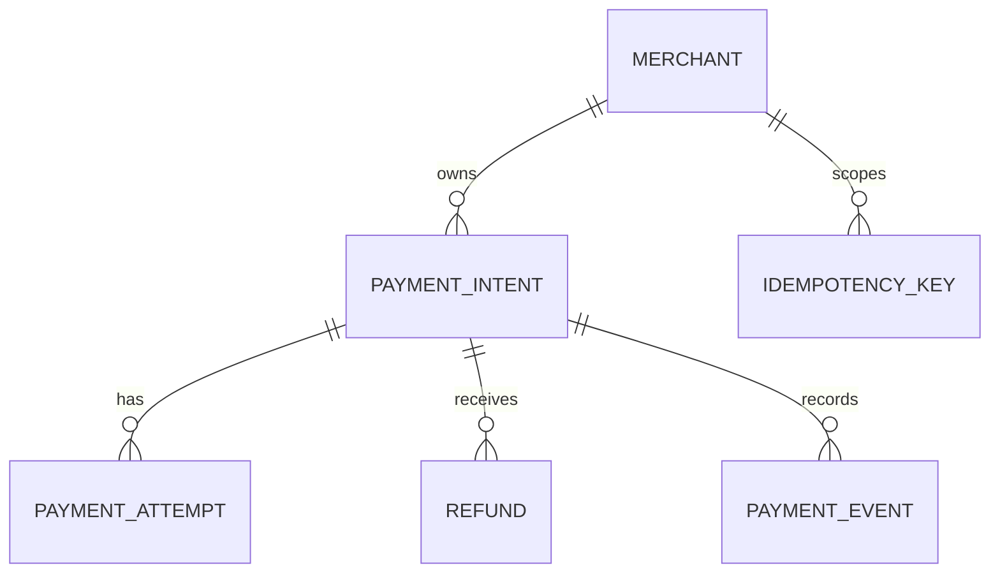

- One merchant has many payment intents.
- One payment intent can have many processor attempts, events, and refunds.
- An idempotency key is unique within a merchant and operation scope.

## 3. Core schema, keys, constraints, indexes

```sql
CREATE TABLE merchant (
  id uuid PRIMARY KEY,
  name text NOT NULL,
  status text NOT NULL CHECK (status IN ('active','suspended','closed'))
);

CREATE TABLE payment_intent (
  id uuid PRIMARY KEY,
  merchant_id uuid NOT NULL REFERENCES merchant(id),
  merchant_order_ref text NOT NULL,
  amount_minor bigint NOT NULL CHECK (amount_minor > 0),
  currency char(3) NOT NULL,
  status text NOT NULL CHECK (status IN
    ('created','requires_action','authorized','captured','partially_refunded','refunded','failed','cancelled')),
  idempotency_key text NOT NULL,
  created_at timestamptz NOT NULL DEFAULT now(),
  updated_at timestamptz NOT NULL DEFAULT now(),
  UNIQUE (merchant_id, idempotency_key),
  UNIQUE (merchant_id, merchant_order_ref)
);
CREATE INDEX payment_merchant_recent_idx ON payment_intent (merchant_id, created_at DESC, id DESC);
CREATE INDEX payment_reconcile_idx ON payment_intent (updated_at) WHERE status IN ('authorized','captured','partially_refunded');

CREATE TABLE payment_attempt (
  id uuid PRIMARY KEY,
  payment_id uuid NOT NULL REFERENCES payment_intent(id),
  attempt_no integer NOT NULL CHECK (attempt_no > 0),
  processor text NOT NULL,
  processor_reference text,
  status text NOT NULL CHECK (status IN ('started','authorized','captured','declined','unknown','failed')),
  error_code text,
  requested_at timestamptz NOT NULL DEFAULT now(),
  completed_at timestamptz,
  UNIQUE (payment_id, attempt_no),
  UNIQUE (processor, processor_reference)
);
CREATE INDEX attempt_payment_history_idx ON payment_attempt (payment_id, requested_at DESC);

CREATE TABLE refund (
  id uuid PRIMARY KEY,
  payment_id uuid NOT NULL REFERENCES payment_intent(id),
  amount_minor bigint NOT NULL CHECK (amount_minor > 0),
  status text NOT NULL CHECK (status IN ('requested','processing','succeeded','failed')),
  processor_reference text UNIQUE,
  idempotency_key text NOT NULL,
  created_at timestamptz NOT NULL DEFAULT now(),
  UNIQUE (payment_id, idempotency_key)
);
CREATE INDEX refund_payment_idx ON refund (payment_id, created_at DESC);

CREATE TABLE payment_event (
  id bigint GENERATED ALWAYS AS IDENTITY PRIMARY KEY,
  payment_id uuid NOT NULL REFERENCES payment_intent(id),
  event_type text NOT NULL,
  payload jsonb NOT NULL DEFAULT '{}',
  occurred_at timestamptz NOT NULL DEFAULT now()
);
CREATE INDEX payment_event_timeline_idx ON payment_event (payment_id, occurred_at, id);
```

**Important invariants:** successful plus reserved/in-flight refunds must not exceed the captured amount; enforce this in a transaction by locking the payment row and reserving refund capacity before sending the request (or with a carefully designed ledger/constraint mechanism). Processor references may be nullable, so a unique constraint permits multiple nulls in PostgreSQL. Never store raw card data/CVV; use a PCI-compliant tokenization provider.

## 4. Five important SQL queries

```sql
-- Q1: Idempotent payment creation (application checks returned row/result).
INSERT INTO payment_intent
  (id, merchant_id, merchant_order_ref, amount_minor, currency, status, idempotency_key)
VALUES (:id, :merchant_id, :order_ref, :amount_minor, :currency, 'created', :key)
ON CONFLICT (merchant_id, idempotency_key) DO NOTHING;

-- Q2: Fetch a merchant's latest payments (stable cursor pagination).
SELECT id, merchant_order_ref, amount_minor, currency, status, created_at
FROM payment_intent
WHERE merchant_id = :merchant_id
  AND (created_at, id) < (:cursor_created_at, :cursor_id)
ORDER BY created_at DESC, id DESC
LIMIT 50;

-- Q3: Claim a state transition only if it is still valid.
UPDATE payment_intent
SET status = 'captured', updated_at = now()
WHERE id = :payment_id AND status = 'authorized'
RETURNING id, amount_minor, currency;

-- Q4: Show processor attempts for a payment.
SELECT attempt_no, processor, status, processor_reference, error_code, requested_at, completed_at
FROM payment_attempt WHERE payment_id = :payment_id ORDER BY attempt_no;

-- Q5: Find stale payments for reconciliation.
SELECT id, merchant_id, updated_at, status
FROM payment_intent
WHERE status IN ('authorized','captured','partially_refunded')
  AND updated_at < now() - interval '15 minutes'
ORDER BY updated_at LIMIT 500;

-- Q6: Detect over-refunds (monitor/reconciliation query).
SELECT p.id, p.amount_minor,
       COALESCE(sum(r.amount_minor) FILTER (WHERE r.status = 'succeeded'), 0) AS refunded_minor
FROM payment_intent p LEFT JOIN refund r ON r.payment_id = p.id
WHERE p.id = :payment_id
GROUP BY p.id, p.amount_minor
HAVING COALESCE(sum(r.amount_minor) FILTER (WHERE r.status = 'succeeded'), 0) > p.amount_minor;
```

## 5. Transaction boundaries, isolation, concurrency risks

- **Create intent:** one short transaction; unique `(merchant_id, idempotency_key)` is the race arbiter.
- **Call processor:** do not hold a database transaction open over network I/O. Persist an attempt, call the processor, then persist the result; an `unknown` outcome must be reconciled, not blindly retried as a fresh charge.
- **Capture/refund:** lock the payment row (`SELECT ... FOR UPDATE`) or use conditional writes; verify captured amount minus successful/in-flight refunds before inserting a refund reservation. `READ COMMITTED` is usually adequate if every writer locks/conditionally updates the same payment row. `SERIALIZABLE` is an option but requires retry handling.
- **Risks:** duplicate API retries, processor timeouts after a successful charge, races between two refunds, out-of-order webhooks, and webhook replay. Deduplicate processor events and keep state transitions monotonic/validated.

## 6. What changes at 100× scale?

Partition high-volume `payment_event` by time and possibly hash by payment/merchant. Archive event payloads to object storage after retention requirements permit. Keep transactional payment state in PostgreSQL; send analytics/reconciliation feeds to a warehouse. Add an outbox for downstream publishing, idempotent consumers, read replicas for merchant history, and a dedicated reconciliation work queue. Do not shard the core payment state before measuring bottlenecks and deciding the required consistency boundaries.

---

# 2. Digital Wallet

## 1. Business requirements and access patterns

**Requirements:** hold funds by owner and currency; support top-ups, payments, withdrawals, and transfers; prevent overspending; make transfers idempotent; provide an immutable audit trail. Wallet balance is an invariant, not merely a cached number.

**Hot access patterns:** balance by wallet; transaction history; transfer between two wallets; resolve a transfer by idempotency key; reconcile balance snapshots against ledger entries.

## 2. ER diagram and cardinalities

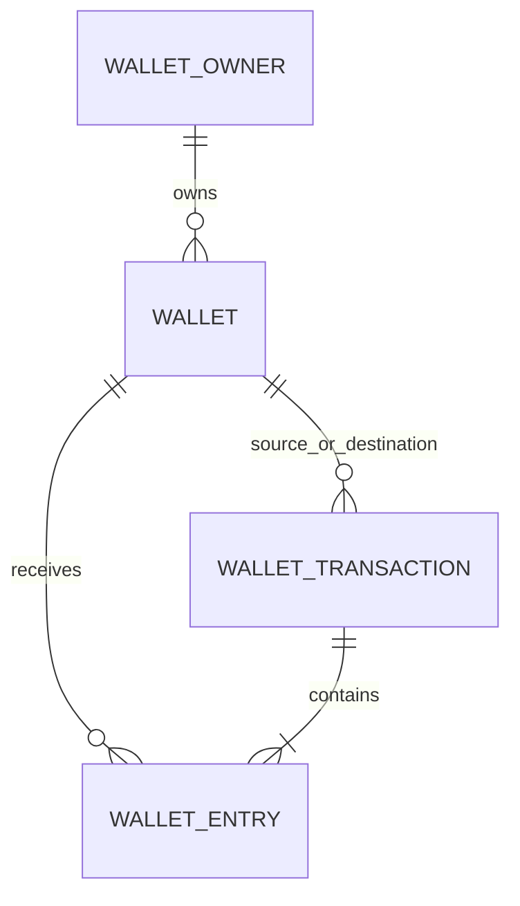

A transfer has one transaction header and at least two ledger entries. Each transaction's entries must sum to zero within the same currency; FX transfers need explicit conversion/clearing accounts or paired currency legs.

## 3. Core schema

```sql
CREATE TABLE wallet_owner (
  id uuid PRIMARY KEY,
  owner_type text NOT NULL CHECK (owner_type IN ('person','business')),
  status text NOT NULL CHECK (status IN ('active','frozen','closed'))
);
CREATE TABLE wallet (
  id uuid PRIMARY KEY,
  owner_id uuid NOT NULL REFERENCES wallet_owner(id),
  currency char(3) NOT NULL,
  balance_minor bigint NOT NULL DEFAULT 0 CHECK (balance_minor >= 0),
  version bigint NOT NULL DEFAULT 0,
  created_at timestamptz NOT NULL DEFAULT now(),
  UNIQUE (owner_id, currency)
);
CREATE TABLE wallet_transaction (
  id uuid PRIMARY KEY,
  idempotency_key text NOT NULL UNIQUE,
  transaction_type text NOT NULL CHECK (transaction_type IN ('transfer','topup','withdrawal','purchase','refund','adjustment')),
  status text NOT NULL CHECK (status IN ('pending','posted','failed','reversed')),
  reference text,
  created_at timestamptz NOT NULL DEFAULT now()
);
CREATE TABLE wallet_entry (
  id bigint GENERATED ALWAYS AS IDENTITY PRIMARY KEY,
  transaction_id uuid NOT NULL REFERENCES wallet_transaction(id),
  wallet_id uuid NOT NULL REFERENCES wallet(id),
  amount_minor bigint NOT NULL CHECK (amount_minor <> 0),
  currency char(3) NOT NULL,
  created_at timestamptz NOT NULL DEFAULT now()
);
CREATE INDEX wallet_entry_history_idx ON wallet_entry (wallet_id, created_at DESC, id DESC);
CREATE INDEX wallet_txn_status_idx ON wallet_transaction (status, created_at) WHERE status = 'pending';
```

Convention: positive entry credits a wallet, negative entry debits it. The wallet balance is a fast snapshot updated in the same transaction as the entries. Use app logic or a deferred constraint trigger to verify entries balance to zero per posted transaction; a normal row-level `CHECK` cannot enforce a cross-row sum.

## 4. Five important SQL queries

```sql
-- Q1: Read current balance.
SELECT id, currency, balance_minor, version FROM wallet WHERE id = :wallet_id;

-- Q2: Idempotent transfer header.
INSERT INTO wallet_transaction (id, idempotency_key, transaction_type, status, reference)
VALUES (:tx_id, :key, 'transfer', 'pending', :reference)
ON CONFLICT (idempotency_key) DO NOTHING;

-- Q3: Debit only if sufficient funds; use in a transaction after locking both wallets
-- in deterministic UUID order (or execute guarded updates in the same order).
UPDATE wallet
SET balance_minor = balance_minor - :amount, version = version + 1
WHERE id = :from_wallet AND currency = :currency AND balance_minor >= :amount
RETURNING balance_minor;

-- Q4: Credit destination in the same transaction.
UPDATE wallet
SET balance_minor = balance_minor + :amount, version = version + 1
WHERE id = :to_wallet AND currency = :currency
RETURNING balance_minor;

-- Q5: Transaction history for a wallet.
SELECT t.id, t.transaction_type, t.status, e.amount_minor, e.currency, e.created_at
FROM wallet_entry e JOIN wallet_transaction t ON t.id = e.transaction_id
WHERE e.wallet_id = :wallet_id
ORDER BY e.created_at DESC, e.id DESC LIMIT 50;

-- Q6: Reconcile snapshot against posted ledger.
SELECT w.id, w.balance_minor AS snapshot_balance,
       COALESCE(sum(e.amount_minor) FILTER (WHERE t.status = 'posted'), 0) AS ledger_balance
FROM wallet w
LEFT JOIN wallet_entry e ON e.wallet_id = w.id
LEFT JOIN wallet_transaction t ON t.id = e.transaction_id
WHERE w.id = :wallet_id
GROUP BY w.id, w.balance_minor;
```

## 5. Transaction boundaries and risks

A transfer is one DB transaction: claim idempotency key; lock source/destination wallets in a deterministic order; check both are active and currency-compatible; debit source conditionally; credit destination; insert two entries; mark header posted; commit. If any step fails, roll back all. Use `READ COMMITTED` with row locks and guarded updates or `SERIALIZABLE` plus retry. Do not call external payment rails inside this transaction. For withdrawals/top-ups, use a pending transaction plus external state machine/outbox and reconciliation.

Main risks: deadlocks from locking in different orders; double-spend from read-then-write; duplicate transfer submissions; snapshot drift; and treating a pending external transfer as posted funds. Posted ledger entries should be immutable; correct mistakes with reversal transactions, never edits.

## 6. At 100× scale

Partition ledger entries by time; maintain per-wallet balance snapshots and periodic checkpoints; asynchronously build statements/analytics from a CDC stream. Keep each wallet's writes strongly consistent, and shard by wallet/owner if required so one transfer's transaction semantics remain tractable. Cross-shard transfers may need a saga/reservation model rather than pretending they are a single local ACID transaction.

---

# 3. Warehouse Inventory

## 1. Business requirements and access patterns

**Requirements:** track stock by SKU and warehouse/bin; reserve stock for orders; receive and ship stock; transfer stock between locations; preserve movement history; prevent negative available stock; support cycle counts and low-stock alerts.

**Hot access patterns:** availability by SKU/location; reserve/release; find an order reservation; receive stock; audit quantity changes; list replenishment candidates.

## 2. ER diagram and cardinalities

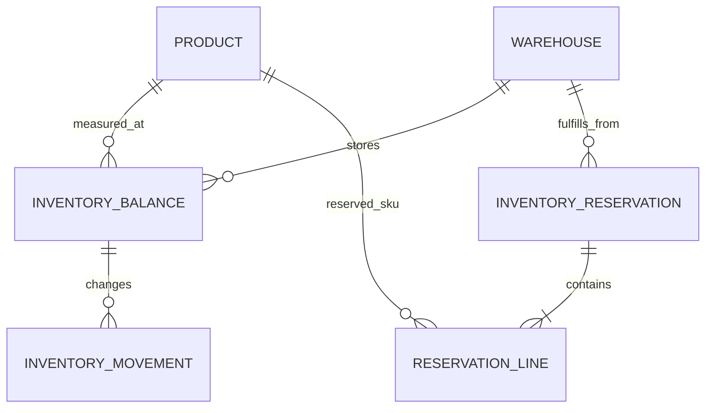

One balance row per `(product, warehouse, bin)`; a reservation can contain multiple SKU lines. Movements are append-only deltas.

## 3. Core schema

```sql
CREATE TABLE product (
  id uuid PRIMARY KEY,
  sku text NOT NULL UNIQUE,
  name text NOT NULL,
  active boolean NOT NULL DEFAULT true
);
CREATE TABLE warehouse (
  id uuid PRIMARY KEY,
  code text NOT NULL UNIQUE,
  name text NOT NULL
);
CREATE TABLE inventory_balance (
  product_id uuid NOT NULL REFERENCES product(id),
  warehouse_id uuid NOT NULL REFERENCES warehouse(id),
  bin_code text NOT NULL DEFAULT 'DEFAULT',
  on_hand bigint NOT NULL DEFAULT 0 CHECK (on_hand >= 0),
  reserved bigint NOT NULL DEFAULT 0 CHECK (reserved >= 0 AND reserved <= on_hand),
  version bigint NOT NULL DEFAULT 0,
  PRIMARY KEY (product_id, warehouse_id, bin_code)
);
CREATE INDEX inventory_available_idx ON inventory_balance (warehouse_id, product_id)
  WHERE on_hand > reserved;
CREATE TABLE inventory_reservation (
  id uuid PRIMARY KEY,
  order_ref text NOT NULL,
  warehouse_id uuid NOT NULL REFERENCES warehouse(id),
  status text NOT NULL CHECK (status IN ('active','released','fulfilled','expired')),
  expires_at timestamptz,
  created_at timestamptz NOT NULL DEFAULT now(),
  UNIQUE (order_ref, warehouse_id)
);
CREATE TABLE reservation_line (
  reservation_id uuid NOT NULL REFERENCES inventory_reservation(id),
  product_id uuid NOT NULL REFERENCES product(id),
  bin_code text NOT NULL DEFAULT 'DEFAULT',
  quantity bigint NOT NULL CHECK (quantity > 0),
  PRIMARY KEY (reservation_id, product_id, bin_code)
);
CREATE TABLE inventory_movement (
  id bigint GENERATED ALWAYS AS IDENTITY PRIMARY KEY,
  product_id uuid NOT NULL REFERENCES product(id),
  warehouse_id uuid NOT NULL REFERENCES warehouse(id),
  bin_code text NOT NULL DEFAULT 'DEFAULT',
  movement_type text NOT NULL CHECK (movement_type IN ('receipt','ship','adjustment','transfer_in','transfer_out','reservation_release')),
  quantity_delta bigint NOT NULL CHECK (quantity_delta <> 0),
  reference_type text,
  reference_id text,
  created_at timestamptz NOT NULL DEFAULT now()
);
CREATE INDEX inventory_movement_audit_idx ON inventory_movement (product_id, warehouse_id, created_at DESC, id DESC);
```

## 4. Five important SQL queries

```sql
-- Q1: Available stock.
SELECT product_id, warehouse_id, bin_code, on_hand - reserved AS available
FROM inventory_balance WHERE product_id = :product_id AND warehouse_id = :warehouse_id;

-- Q2: Reserve stock safely; fail if zero rows are returned.
UPDATE inventory_balance
SET reserved = reserved + :qty, version = version + 1
WHERE product_id = :product_id AND warehouse_id = :warehouse_id AND bin_code = :bin
  AND on_hand - reserved >= :qty
RETURNING on_hand, reserved;

-- Q3: Start a release exactly once. In the same transaction, decrement each matching
-- inventory_balance.reserved by reservation_line.quantity; verify every row count,
-- then commit. Roll the entire transaction back if any guard fails.
UPDATE inventory_reservation SET status = 'released'
WHERE id = :reservation_id AND status = 'active' RETURNING id;

-- Q4: Receive stock (balance plus movement must commit atomically).
UPDATE inventory_balance
SET on_hand = on_hand + :qty, version = version + 1
WHERE product_id = :product_id AND warehouse_id = :warehouse_id AND bin_code = :bin
RETURNING on_hand;

-- Q5: Low-stock list.
SELECT p.sku, p.name, b.warehouse_id, b.bin_code, b.on_hand - b.reserved AS available
FROM inventory_balance b JOIN product p ON p.id = b.product_id
WHERE p.active AND b.on_hand - b.reserved <= :reorder_threshold
ORDER BY available ASC LIMIT 500;

-- Q6: Audit movements over a period.
SELECT movement_type, quantity_delta, reference_type, reference_id, created_at
FROM inventory_movement
WHERE product_id = :product_id AND warehouse_id = :warehouse_id
  AND created_at >= :from_ts AND created_at < :to_ts
ORDER BY created_at, id;
```

## 5. Transaction boundaries and risks

Reserve all required lines in one transaction, in deterministic `(warehouse_id, product_id, bin_code)` order. Use conditional updates (`on_hand - reserved >= qty`) rather than checking availability and updating later. Insert reservation/header/lines and movements in the same transaction. Release and fulfill must be idempotent state transitions. At `READ COMMITTED`, guarded row updates are usually sufficient for a row-level stock invariant. For complex multi-bin allocation, lock candidate balances or use serializable transactions with retries.

Risks: overselling under concurrent orders, releasing twice, partial reservation across multi-SKU orders, stale stock counts, and inventory transfers that debit one warehouse but fail to credit another. Transfers should be one transaction when both balances live in one database; otherwise model in-transit stock explicitly.

## 6. At 100× scale

Partition movement history by time; retain balance rows in a compact operational store. Add reservation-expiry workers, an event stream for fulfillment/analytics, and a materialized replenishment view. If splitting by warehouse, route each reservation to a single fulfillment domain and model cross-warehouse transfers asynchronously with explicit in-transit states.

---

# 4. Subscription Billing

## 1. Business requirements and access patterns

**Requirements:** catalog plans/prices; start, renew, upgrade, downgrade, pause, and cancel subscriptions; calculate billing periods; issue immutable invoices and invoice lines; record payment attempts; support trials, tax, proration, and usage-based charges if needed.

**Hot access patterns:** subscriptions due for renewal; current subscription for a customer; invoice by ID/number; unpaid invoices; billing history; usage ingestion idempotently by external event ID.

## 2. ER diagram and cardinalities

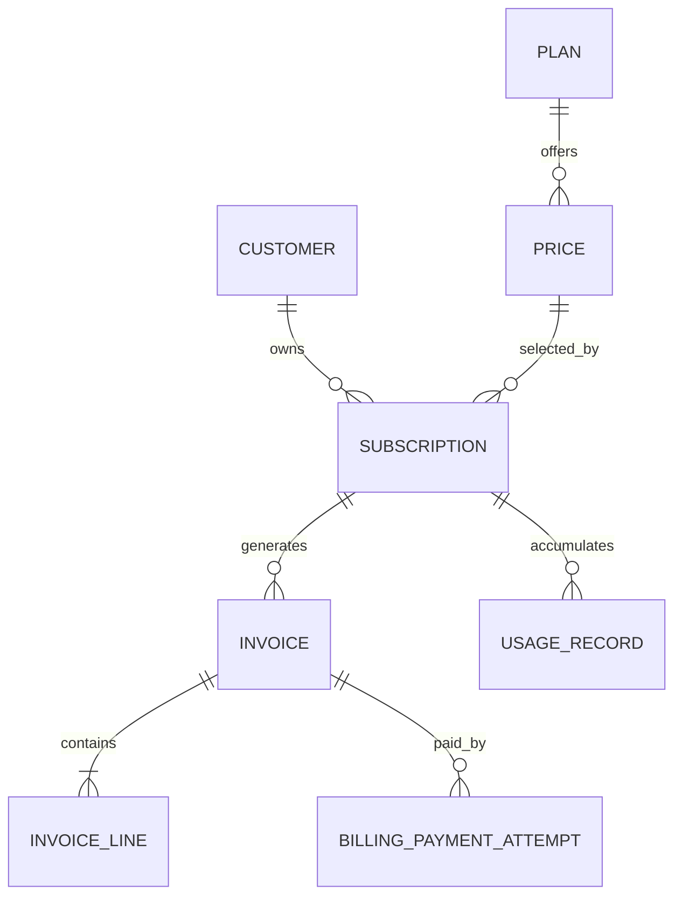

A plan can have multiple versioned prices; invoices snapshot amounts/tax/description so later catalog edits do not rewrite history.

## 3. Core schema

```sql
CREATE TABLE customer (
  id uuid PRIMARY KEY,
  email text NOT NULL,
  status text NOT NULL CHECK (status IN ('active','blocked','deleted'))
);
CREATE TABLE plan (
  id uuid PRIMARY KEY,
  code text NOT NULL UNIQUE,
  name text NOT NULL
);
CREATE TABLE plan_price (
  id uuid PRIMARY KEY,
  plan_id uuid NOT NULL REFERENCES plan(id),
  version integer NOT NULL,
  currency char(3) NOT NULL,
  amount_minor bigint NOT NULL CHECK (amount_minor >= 0),
  interval_unit text NOT NULL CHECK (interval_unit IN ('month','year','week','day')),
  interval_count integer NOT NULL CHECK (interval_count > 0),
  active boolean NOT NULL DEFAULT true,
  UNIQUE (plan_id, version)
);
CREATE TABLE subscription (
  id uuid PRIMARY KEY,
  customer_id uuid NOT NULL REFERENCES customer(id),
  price_id uuid NOT NULL REFERENCES plan_price(id),
  status text NOT NULL CHECK (status IN ('trialing','active','past_due','paused','cancelled','ended')),
  current_period_start timestamptz NOT NULL,
  current_period_end timestamptz NOT NULL,
  cancel_at_period_end boolean NOT NULL DEFAULT false,
  version bigint NOT NULL DEFAULT 0,
  CHECK (current_period_end > current_period_start)
);
CREATE INDEX subscription_due_idx ON subscription (current_period_end, id)
  WHERE status IN ('trialing','active','past_due');
CREATE INDEX subscription_customer_idx ON subscription (customer_id, status);
CREATE TABLE invoice (
  id uuid PRIMARY KEY,
  invoice_number text NOT NULL UNIQUE,
  customer_id uuid NOT NULL REFERENCES customer(id),
  subscription_id uuid REFERENCES subscription(id),
  period_start timestamptz,
  period_end timestamptz,
  currency char(3) NOT NULL,
  subtotal_minor bigint NOT NULL CHECK (subtotal_minor >= 0),
  tax_minor bigint NOT NULL CHECK (tax_minor >= 0),
  total_minor bigint NOT NULL CHECK (total_minor >= 0),
  status text NOT NULL CHECK (status IN ('draft','open','paid','void','uncollectible')),
  issued_at timestamptz,
  due_at timestamptz,
  UNIQUE (subscription_id, period_start, period_end)
);
CREATE TABLE invoice_line (
  id uuid PRIMARY KEY,
  invoice_id uuid NOT NULL REFERENCES invoice(id),
  description text NOT NULL,
  quantity numeric(18,6) NOT NULL CHECK (quantity > 0),
  unit_amount_minor bigint NOT NULL,
  line_total_minor bigint NOT NULL,
  tax_rate numeric(8,6) NOT NULL DEFAULT 0,
  price_snapshot jsonb NOT NULL DEFAULT '{}'
);
CREATE INDEX invoice_customer_history_idx ON invoice (customer_id, issued_at DESC, id DESC);
CREATE TABLE billing_payment_attempt (
  id uuid PRIMARY KEY,
  invoice_id uuid NOT NULL REFERENCES invoice(id),
  attempt_no integer NOT NULL CHECK (attempt_no > 0),
  status text NOT NULL CHECK (status IN ('started','succeeded','failed','unknown')),
  provider_reference text UNIQUE,
  attempted_at timestamptz NOT NULL DEFAULT now(),
  UNIQUE (invoice_id, attempt_no)
);
CREATE TABLE usage_record (
  id bigint GENERATED ALWAYS AS IDENTITY PRIMARY KEY,
  subscription_id uuid NOT NULL REFERENCES subscription(id),
  external_event_id text NOT NULL,
  metric text NOT NULL,
  quantity numeric(20,6) NOT NULL CHECK (quantity >= 0),
  occurred_at timestamptz NOT NULL,
  UNIQUE (subscription_id, external_event_id)
);
CREATE INDEX usage_period_idx ON usage_record (subscription_id, metric, occurred_at);
```

## 4. Five important SQL queries

```sql
-- Q1: Find subscriptions due to bill (claim batches with SKIP LOCKED in worker).
SELECT id, customer_id, price_id, current_period_end
FROM subscription
WHERE status IN ('trialing','active','past_due') AND current_period_end <= now()
ORDER BY current_period_end LIMIT 500 FOR UPDATE SKIP LOCKED;

-- Q2: Fetch current subscriptions for a customer.
SELECT s.*, p.code, pp.amount_minor, pp.currency, pp.interval_unit, pp.interval_count
FROM subscription s JOIN plan_price pp ON pp.id = s.price_id
JOIN plan p ON p.id = pp.plan_id
WHERE s.customer_id = :customer_id AND s.status IN ('trialing','active','past_due');

-- Q3: Insert invoice idempotently for a subscription period.
INSERT INTO invoice (id, invoice_number, customer_id, subscription_id,
  period_start, period_end, currency, subtotal_minor, tax_minor, total_minor, status)
VALUES (:id, :number, :customer_id, :subscription_id,
  :period_start, :period_end, :currency, :subtotal, :tax, :total, 'open')
ON CONFLICT (subscription_id, period_start, period_end) DO NOTHING;

-- Q4: List overdue invoices.
SELECT id, invoice_number, customer_id, total_minor, currency, due_at
FROM invoice WHERE status = 'open' AND due_at < now()
ORDER BY due_at LIMIT 500;

-- Q5: Aggregate metered usage within a billing period.
SELECT metric, sum(quantity) AS total_quantity
FROM usage_record
WHERE subscription_id = :subscription_id
  AND occurred_at >= :period_start AND occurred_at < :period_end
GROUP BY metric;

-- Q6: Invoice payment history.
SELECT attempt_no, status, provider_reference, attempted_at
FROM billing_payment_attempt WHERE invoice_id = :invoice_id ORDER BY attempt_no;
```

## 5. Transaction boundaries and risks

Invoice generation should be idempotent on `(subscription_id, period_start, period_end)`. Claim due subscriptions in small batches with `FOR UPDATE SKIP LOCKED`; calculate invoice lines and totals; commit the invoice and an outbox event together. Payment collection is external and must be a separate state machine. Use immutable issued invoice lines and credit notes for corrections. Race risks include two renewal workers, plan changes during invoicing, usage arriving late, duplicate metering events, proration rounding, and a provider timeout after collecting payment.

## 6. At 100× scale

Partition usage records by event date and/or tenant, roll up usage by `(subscription, metric, billing window)` for invoicing, and export invoice analytics to an OLAP store. Use a durable queue for renewal jobs, idempotent payment collection, and explicit late-arriving usage/correction policies. Consider separate write models for subscription state and invoice ledger if workload profiles diverge.

---

# 5. IAM / RBAC

## 1. Business requirements and access patterns

**Requirements:** authenticate principals; assign roles to users within tenants; map roles to permissions; optionally scope assignments to a resource; revoke access reliably; maintain an audit trail; support service identities. RBAC answers what permissions a principal has; authentication/session management is adjacent but separate.

**Hot access patterns:** effective permissions for `(user, tenant)`; users assigned a role; role-permission editing; authorization checks on every request; audit who granted/revoked access.

## 2. ER diagram and cardinalities

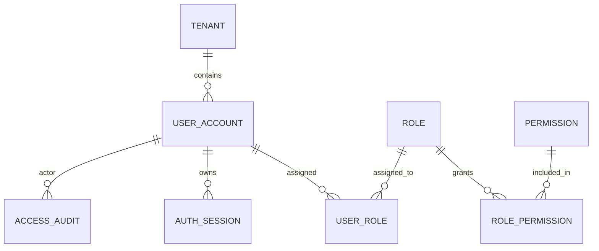

Many-to-many: users↔roles, roles↔permissions. Keep assignments tenant-scoped. Role hierarchy and deny rules require an explicit precedence model; do not add them casually.

## 3. Core schema

```sql
CREATE TABLE tenant (
  id uuid PRIMARY KEY,
  name text NOT NULL
);
CREATE TABLE user_account (
  id uuid PRIMARY KEY,
  email citext NOT NULL UNIQUE,
  status text NOT NULL CHECK (status IN ('active','disabled','deleted'))
);
CREATE TABLE role (
  id uuid PRIMARY KEY,
  tenant_id uuid NOT NULL REFERENCES tenant(id),
  name text NOT NULL,
  is_system boolean NOT NULL DEFAULT false,
  UNIQUE (tenant_id, name),
  UNIQUE (tenant_id, id)
);
CREATE TABLE permission (
  id uuid PRIMARY KEY,
  resource text NOT NULL,
  action text NOT NULL,
  UNIQUE (resource, action)
);
CREATE TABLE role_permission (
  role_id uuid NOT NULL REFERENCES role(id) ON DELETE CASCADE,
  permission_id uuid NOT NULL REFERENCES permission(id) ON DELETE CASCADE,
  PRIMARY KEY (role_id, permission_id)
);
CREATE TABLE user_role (
  tenant_id uuid NOT NULL REFERENCES tenant(id),
  user_id uuid NOT NULL REFERENCES user_account(id),
  role_id uuid NOT NULL,
  scope_type text NOT NULL DEFAULT 'tenant',
  scope_id text NOT NULL DEFAULT '*',
  granted_by uuid REFERENCES user_account(id),
  granted_at timestamptz NOT NULL DEFAULT now(),
  PRIMARY KEY (tenant_id, user_id, role_id, scope_type, scope_id),
  FOREIGN KEY (tenant_id, role_id) REFERENCES role(tenant_id, id) ON DELETE CASCADE
);
CREATE INDEX user_role_by_role_idx ON user_role (tenant_id, role_id, user_id);
CREATE INDEX user_role_by_user_idx ON user_role (tenant_id, user_id, role_id);
CREATE TABLE auth_session (
  id uuid PRIMARY KEY,
  user_id uuid NOT NULL REFERENCES user_account(id),
  token_hash bytea NOT NULL UNIQUE,
  expires_at timestamptz NOT NULL,
  revoked_at timestamptz,
  created_at timestamptz NOT NULL DEFAULT now()
);
CREATE INDEX session_active_user_idx ON auth_session (user_id, expires_at) WHERE revoked_at IS NULL;
CREATE TABLE access_audit (
  id bigint GENERATED ALWAYS AS IDENTITY PRIMARY KEY,
  tenant_id uuid NOT NULL REFERENCES tenant(id),
  actor_user_id uuid REFERENCES user_account(id),
  target_user_id uuid REFERENCES user_account(id),
  action text NOT NULL,
  details jsonb NOT NULL DEFAULT '{}',
  created_at timestamptz NOT NULL DEFAULT now()
);
CREATE INDEX access_audit_tenant_time_idx ON access_audit (tenant_id, created_at DESC, id DESC);
```

`citext` requires the PostgreSQL extension; alternatively store a normalized email column. Scope IDs are strings here to support multiple resource types; a more strongly typed domain can use separate scoped tables or resource foreign keys.

## 4. Five important SQL queries

```sql
-- Q1: Effective permissions for a tenant-scoped user.
SELECT DISTINCT p.resource, p.action
FROM user_role ur
JOIN role_permission rp ON rp.role_id = ur.role_id
JOIN permission p ON p.id = rp.permission_id
WHERE ur.tenant_id = :tenant_id AND ur.user_id = :user_id
  AND (ur.scope_type = 'tenant' OR (ur.scope_type = :resource_type AND ur.scope_id = :resource_id));

-- Q2: Users with a given role.
SELECT user_id, granted_by, granted_at
FROM user_role WHERE tenant_id = :tenant_id AND role_id = :role_id;

-- Q3: Grant a role idempotently.
INSERT INTO user_role (tenant_id, user_id, role_id, scope_type, scope_id, granted_by)
VALUES (:tenant_id, :user_id, :role_id, :scope_type, :scope_id, :actor_id)
ON CONFLICT DO NOTHING;

-- Q4: Revoke a role assignment.
DELETE FROM user_role
WHERE tenant_id = :tenant_id AND user_id = :user_id AND role_id = :role_id
  AND scope_type = :scope_type AND scope_id = :scope_id;

-- Q5: Revoke all active sessions after disabling a user.
UPDATE auth_session SET revoked_at = now()
WHERE user_id = :user_id AND revoked_at IS NULL;

-- Q6: Audit recent access changes.
SELECT actor_user_id, target_user_id, action, details, created_at
FROM access_audit WHERE tenant_id = :tenant_id
ORDER BY created_at DESC, id DESC LIMIT 100;
```

## 5. Transaction boundaries and risks

Role/permission changes and their audit records should commit together. Use row-level locking or a permission-version counter to invalidate authorization caches when roles change. Authentication/session revocation has a different consistency requirement from role lookup; define revocation SLA. Risks include cross-tenant leakage, stale cached permissions, privilege escalation by allowing users to grant roles they do not control, and role-deletion cascades deleting audit meaning. Keep immutable audit records independent of mutable assignment rows.

## 6. At 100× scale

Cache compiled permissions by `(tenant, principal, policy_version)` with short TTL or version-based invalidation. Separate audit event storage from the authorization OLTP path; partition audit by time. For complex attribute-based access control, introduce a policy evaluation service and policy/version model, but retain the relational source of truth for assignments. Make tenant isolation explicit in every query and test it.

---

# 6. Team Chat

## 1. Business requirements and access patterns

**Requirements:** workspaces, channels, members, messages, threads, reactions, attachments, and read cursors. Support message edits/deletes, authorization by channel membership, stable chronological pagination, and search.

**Hot access patterns:** newest messages in a channel; messages after a cursor; unread count/read cursor; workspace/channel list for a user; reactions on one message; search by term within allowed channels.

## 2. ER diagram and cardinalities

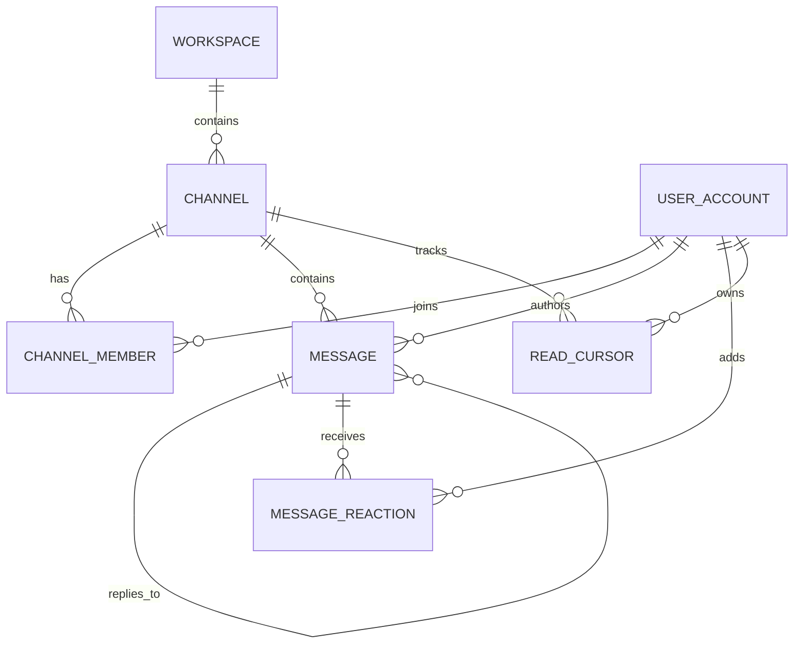

## 3. Core schema

```sql
CREATE TABLE workspace (
  id uuid PRIMARY KEY,
  name text NOT NULL
);
CREATE TABLE user_account (
  id uuid PRIMARY KEY,
  display_name text NOT NULL
);
CREATE TABLE channel (
  id uuid PRIMARY KEY,
  workspace_id uuid NOT NULL REFERENCES workspace(id),
  name text NOT NULL,
  visibility text NOT NULL CHECK (visibility IN ('public','private')),
  created_at timestamptz NOT NULL DEFAULT now(),
  UNIQUE (workspace_id, name)
);
CREATE TABLE channel_member (
  channel_id uuid NOT NULL REFERENCES channel(id) ON DELETE CASCADE,
  user_id uuid NOT NULL REFERENCES user_account(id),
  role text NOT NULL DEFAULT 'member' CHECK (role IN ('owner','moderator','member')),
  joined_at timestamptz NOT NULL DEFAULT now(),
  PRIMARY KEY (channel_id, user_id)
);
CREATE INDEX channel_member_user_idx ON channel_member (user_id, channel_id);
CREATE TABLE message (
  id bigint GENERATED ALWAYS AS IDENTITY PRIMARY KEY,
  channel_id uuid NOT NULL REFERENCES channel(id),
  author_id uuid NOT NULL REFERENCES user_account(id),
  parent_message_id bigint REFERENCES message(id),
  body text NOT NULL,
  created_at timestamptz NOT NULL DEFAULT now(),
  edited_at timestamptz,
  deleted_at timestamptz
);
CREATE INDEX message_channel_page_idx ON message (channel_id, created_at DESC, id DESC) WHERE deleted_at IS NULL;
CREATE INDEX message_thread_idx ON message (parent_message_id, created_at, id) WHERE parent_message_id IS NOT NULL;
CREATE TABLE message_reaction (
  message_id bigint NOT NULL REFERENCES message(id) ON DELETE CASCADE,
  user_id uuid NOT NULL REFERENCES user_account(id),
  emoji text NOT NULL,
  created_at timestamptz NOT NULL DEFAULT now(),
  PRIMARY KEY (message_id, user_id, emoji)
);
CREATE TABLE read_cursor (
  user_id uuid NOT NULL REFERENCES user_account(id),
  channel_id uuid NOT NULL REFERENCES channel(id) ON DELETE CASCADE,
  last_read_message_id bigint REFERENCES message(id),
  last_read_at timestamptz NOT NULL DEFAULT now(),
  PRIMARY KEY (user_id, channel_id)
);
```

Attachments are best stored as object-store references in a separate `message_attachment` table; do not store file bytes in the hot messages table.

## 4. Five important SQL queries

```sql
-- Q1: Latest messages in a channel.
SELECT id, author_id, body, created_at, parent_message_id
FROM message WHERE channel_id = :channel_id AND deleted_at IS NULL
ORDER BY created_at DESC, id DESC LIMIT 50;

-- Q2: Older messages using keyset pagination.
SELECT id, author_id, body, created_at
FROM message WHERE channel_id = :channel_id AND deleted_at IS NULL
  AND (created_at, id) < (:cursor_time, :cursor_id)
ORDER BY created_at DESC, id DESC LIMIT 50;

-- Q3: Channels a user belongs to in a workspace.
SELECT c.id, c.name, c.visibility, cm.role
FROM channel_member cm JOIN channel c ON c.id = cm.channel_id
WHERE cm.user_id = :user_id AND c.workspace_id = :workspace_id
ORDER BY c.name;

-- Q4: Upsert the read cursor; never move it backwards.
INSERT INTO read_cursor (user_id, channel_id, last_read_message_id, last_read_at)
VALUES (:user_id, :channel_id, :message_id, now())
ON CONFLICT (user_id, channel_id) DO UPDATE
SET last_read_message_id = EXCLUDED.last_read_message_id, last_read_at = now()
WHERE read_cursor.last_read_message_id IS NULL
   OR read_cursor.last_read_message_id < EXCLUDED.last_read_message_id;

-- Q5: Add a reaction idempotently.
INSERT INTO message_reaction (message_id, user_id, emoji)
VALUES (:message_id, :user_id, :emoji) ON CONFLICT DO NOTHING;

-- Q6: Full-text search (create a GIN index on to_tsvector('simple', body)).
SELECT id, channel_id, author_id, body, created_at
FROM message
WHERE channel_id = :channel_id AND deleted_at IS NULL
  AND to_tsvector('simple', body) @@ plainto_tsquery('simple', :query)
ORDER BY created_at DESC LIMIT 50;
```

## 5. Transaction boundaries and risks

Membership checks must occur before message reads/writes (or be enforced in the service/RLS policy). Message insert and outbox notification should commit together. Edits should verify author/moderator privileges and use optimistic versioning if concurrent edits matter. The `read_cursor` row should only move forward. Risks: hot channels, large unread-count scans, deleting users referenced by history, and search revealing private-channel messages. Use cursor pagination, soft-delete policies, and tenant/channel authorization on every path.

## 6. At 100× scale

Partition messages by time and/or channel hash; very large channels may have a dedicated partition/key. Use a search engine for large-scale search, object storage for attachments, and a fanout strategy chosen by channel size (fanout-on-write for small channels; fanout-on-read for very large ones). Cache recent messages but keep the database authoritative. Deliver notifications asynchronously through an outbox/stream.

---

# 7. Workflow Engine

## 1. Business requirements and access patterns

**Requirements:** versioned workflow definitions; durable workflow executions; steps/tasks with retries and timers; pause/resume/cancel; execution history; idempotent external side effects; and recovery after worker crashes.

**Hot access patterns:** create an execution; claim runnable steps; get execution state/history; find timers due; retry failed steps; find stalled executions.

## 2. ER diagram and cardinalities

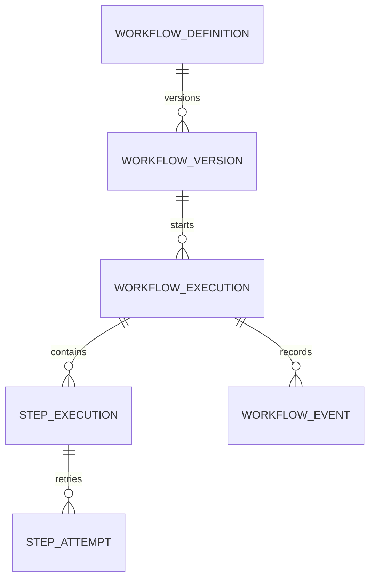

A workflow version is immutable. Each execution points to one version. A step can have multiple attempts; durable state must not live only in a worker's memory.

## 3. Core schema

```sql
CREATE TABLE workflow_definition (
  id uuid PRIMARY KEY,
  name text NOT NULL UNIQUE
);
CREATE TABLE workflow_version (
  id uuid PRIMARY KEY,
  workflow_id uuid NOT NULL REFERENCES workflow_definition(id),
  version integer NOT NULL,
  definition jsonb NOT NULL,
  created_at timestamptz NOT NULL DEFAULT now(),
  UNIQUE (workflow_id, version)
);
CREATE TABLE workflow_execution (
  id uuid PRIMARY KEY,
  workflow_version_id uuid NOT NULL REFERENCES workflow_version(id),
  business_key text,
  status text NOT NULL CHECK (status IN ('running','waiting','succeeded','failed','cancelled')),
  input jsonb NOT NULL DEFAULT '{}',
  output jsonb,
  state_version bigint NOT NULL DEFAULT 0,
  started_at timestamptz NOT NULL DEFAULT now(),
  finished_at timestamptz
);
CREATE UNIQUE INDEX workflow_business_key_idx ON workflow_execution (workflow_version_id, business_key)
  WHERE business_key IS NOT NULL;
CREATE INDEX workflow_stalled_idx ON workflow_execution (started_at)
  WHERE status IN ('running','waiting');
CREATE TABLE step_execution (
  id uuid PRIMARY KEY,
  execution_id uuid NOT NULL REFERENCES workflow_execution(id) ON DELETE CASCADE,
  step_key text NOT NULL,
  status text NOT NULL CHECK (status IN ('blocked','ready','running','waiting','succeeded','failed','skipped')),
  attempt_count integer NOT NULL DEFAULT 0 CHECK (attempt_count >= 0),
  available_at timestamptz NOT NULL DEFAULT now(),
  lease_owner text,
  lease_until timestamptz,
  state jsonb NOT NULL DEFAULT '{}',
  version bigint NOT NULL DEFAULT 0,
  UNIQUE (execution_id, step_key)
);
CREATE INDEX step_runnable_idx ON step_execution (available_at, id)
  WHERE status = 'ready';
CREATE INDEX step_expired_lease_idx ON step_execution (lease_until)
  WHERE status = 'running';
CREATE TABLE step_attempt (
  id bigint GENERATED ALWAYS AS IDENTITY PRIMARY KEY,
  step_execution_id uuid NOT NULL REFERENCES step_execution(id),
  attempt_no integer NOT NULL,
  status text NOT NULL CHECK (status IN ('started','succeeded','failed','timed_out','unknown')),
  input jsonb,
  output jsonb,
  error jsonb,
  started_at timestamptz NOT NULL DEFAULT now(),
  finished_at timestamptz,
  UNIQUE (step_execution_id, attempt_no)
);
CREATE TABLE workflow_event (
  id bigint GENERATED ALWAYS AS IDENTITY PRIMARY KEY,
  execution_id uuid NOT NULL REFERENCES workflow_execution(id),
  event_type text NOT NULL,
  payload jsonb NOT NULL DEFAULT '{}',
  created_at timestamptz NOT NULL DEFAULT now()
);
CREATE INDEX workflow_event_timeline_idx ON workflow_event (execution_id, created_at, id);
```

## 4. Five important SQL queries

```sql
-- Q1: Create execution idempotently by business key.
INSERT INTO workflow_execution (id, workflow_version_id, business_key, status, input)
VALUES (:id, :workflow_version_id, :business_key, 'running', :input)
ON CONFLICT (workflow_version_id, business_key) WHERE business_key IS NOT NULL DO NOTHING;

-- Q2: Claim runnable steps in a short transaction.
WITH candidates AS (
  SELECT id FROM step_execution
  WHERE status = 'ready' AND available_at <= now()
  ORDER BY available_at, id LIMIT 100 FOR UPDATE SKIP LOCKED
)
UPDATE step_execution s
SET status = 'running', lease_owner = :worker_id,
    lease_until = now() + interval '60 seconds', attempt_count = attempt_count + 1,
    version = version + 1
FROM candidates c WHERE s.id = c.id
RETURNING s.*;

-- Q3: Complete only if this worker still owns the lease/version.
UPDATE step_execution
SET status = 'succeeded', state = :new_state, lease_owner = NULL, lease_until = NULL,
    version = version + 1
WHERE id = :step_id AND status = 'running' AND lease_owner = :worker_id
  AND version = :claimed_version
RETURNING id;

-- Q4: Find expired running leases for recovery.
SELECT id, execution_id, lease_owner, lease_until
FROM step_execution WHERE status = 'running' AND lease_until < now()
ORDER BY lease_until LIMIT 500;

-- Q5: Read execution history.
SELECT event_type, payload, created_at
FROM workflow_event WHERE execution_id = :execution_id ORDER BY id;

-- Q6: Find failed steps awaiting retry.
SELECT id, execution_id, step_key, attempt_count, available_at
FROM step_execution WHERE status = 'ready' AND available_at <= now()
ORDER BY available_at LIMIT 100;
```

## 5. Transaction boundaries and risks

Claiming a step and updating its lease should be atomic and short; never hold DB locks while executing user code or calling a tool. Completion must include step output/state, event, and next-step scheduling in one transaction (or use an outbox). A lease prevents concurrent active workers, while a fencing token/version prevents a stale worker from committing after lease expiry. External side effects still need idempotency keys because a worker may crash after the side effect but before saving success. Choose at-least-once delivery plus idempotent activities rather than claiming exactly-once execution.

## 6. At 100× scale

Partition events by time and executions by tenant/hash; retain compact current-state rows and move old history to cheaper storage. Separate schedulers/work queues by task type/priority. Use a durable timer index or timing wheel for huge timer volumes, and implement quotas/backpressure. Keep workflow definition versions immutable and use snapshots/compaction to avoid replaying unbounded history on every read.

---

# 8. Shipment Tracking

## 1. Business requirements and access patterns

**Requirements:** create shipments, track carrier-specific events, show latest status/location, correlate carrier tracking numbers, estimate delivery, manage exceptions and proof of delivery, and reconcile duplicate/out-of-order carrier callbacks.

**Hot access patterns:** lookup by tracking number; timeline for one shipment; latest state; shipments delayed or stuck; ingest carrier webhook idempotently; track by customer/order.

## 2. ER diagram and cardinalities

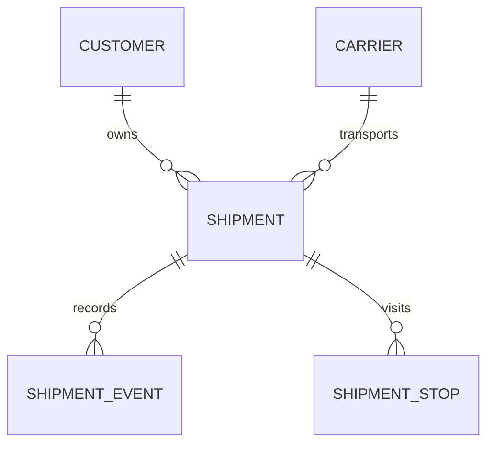

One shipment has many immutable tracking events. Current status is a projection/cache derived from events; a late event should not automatically overwrite a newer status.

## 3. Core schema

```sql
CREATE TABLE customer (
  id uuid PRIMARY KEY,
  name text NOT NULL
);
CREATE TABLE carrier (
  id uuid PRIMARY KEY,
  code text NOT NULL UNIQUE,
  name text NOT NULL
);
CREATE TABLE shipment (
  id uuid PRIMARY KEY,
  customer_id uuid NOT NULL REFERENCES customer(id),
  carrier_id uuid NOT NULL REFERENCES carrier(id),
  carrier_tracking_number text NOT NULL,
  order_ref text,
  status text NOT NULL CHECK (status IN ('label_created','picked_up','in_transit','out_for_delivery','delivered','exception','returned')),
  latest_event_at timestamptz,
  estimated_delivery_at timestamptz,
  delivered_at timestamptz,
  created_at timestamptz NOT NULL DEFAULT now(),
  UNIQUE (carrier_id, carrier_tracking_number)
);
CREATE INDEX shipment_customer_recent_idx ON shipment (customer_id, created_at DESC);
CREATE INDEX shipment_estimated_delivery_idx ON shipment (estimated_delivery_at)
  WHERE status NOT IN ('delivered','returned');
CREATE TABLE shipment_event (
  id bigint GENERATED ALWAYS AS IDENTITY PRIMARY KEY,
  shipment_id uuid NOT NULL REFERENCES shipment(id),
  carrier_event_id text,
  event_code text NOT NULL,
  status text NOT NULL,
  description text,
  location jsonb,
  carrier_occurred_at timestamptz NOT NULL,
  ingested_at timestamptz NOT NULL DEFAULT now(),
  raw_payload jsonb NOT NULL DEFAULT '{}'
);
CREATE UNIQUE INDEX shipment_event_dedupe_idx ON shipment_event (shipment_id, carrier_event_id)
  WHERE carrier_event_id IS NOT NULL;
CREATE INDEX shipment_event_timeline_idx ON shipment_event (shipment_id, carrier_occurred_at, id);
```

## 4. Five important SQL queries

```sql
-- Q1: Track by carrier and tracking number.
SELECT id, status, latest_event_at, estimated_delivery_at, delivered_at
FROM shipment WHERE carrier_id = :carrier_id AND carrier_tracking_number = :tracking_number;

-- Q2: Shipment timeline.
SELECT event_code, status, description, location, carrier_occurred_at
FROM shipment_event WHERE shipment_id = :shipment_id
ORDER BY carrier_occurred_at, id;

-- Q3: Idempotently ingest a carrier event.
INSERT INTO shipment_event (shipment_id, carrier_event_id, event_code, status,
  description, location, carrier_occurred_at, raw_payload)
VALUES (:shipment_id, :event_id, :event_code, :status, :description, :location, :occurred_at, :payload)
ON CONFLICT (shipment_id, carrier_event_id) WHERE carrier_event_id IS NOT NULL DO NOTHING;

-- Q4: Find likely-delayed shipments (business definition of late may vary).
SELECT id, customer_id, carrier_id, carrier_tracking_number, estimated_delivery_at, status
FROM shipment
WHERE estimated_delivery_at < now() AND status NOT IN ('delivered','returned')
ORDER BY estimated_delivery_at LIMIT 500;

-- Q5: Customer's recent shipments.
SELECT id, order_ref, carrier_tracking_number, status, estimated_delivery_at, created_at
FROM shipment WHERE customer_id = :customer_id
ORDER BY created_at DESC LIMIT 50;

-- Q6: Monitor shipments with no event recently.
SELECT id, carrier_id, carrier_tracking_number, status, latest_event_at
FROM shipment WHERE status IN ('picked_up','in_transit','out_for_delivery')
  AND latest_event_at < now() - interval '24 hours'
ORDER BY latest_event_at LIMIT 500;
```

## 5. Transaction boundaries and risks

Insert the event and update the shipment projection in the same transaction, but only advance projected state according to a carrier/status precedence policy and event time. Deduplicate by carrier event ID when possible; otherwise build a fingerprint from stable carrier fields. Carrier callbacks may be retried, delayed, and delivered out of order. Keep raw payloads for debugging with PII controls. An outbox is useful for customer notifications, which should not run in the ingestion transaction.

## 6. At 100× scale

Partition shipment events by event date and possibly carrier; route ingestion through a queue; use CDC/stream processing to build latest-state projections and exception feeds. Keep tracking-number lookup indexed, and use a search/geospatial service only if address/location search needs it. Retention and raw payload policies are important because event history grows far faster than shipments.

---

# 9. Distributed Job Scheduler

## 1. Business requirements and access patterns

**Requirements:** register recurring or one-off jobs; calculate next fire time; claim due work across multiple scheduler instances; lease a run to a worker; retry failures; prevent stale workers from overwriting newer results; support time zones, misfire policy, concurrency caps, and job history.

**Hot access patterns:** due schedules; claim due runs; job history; failed retries; expired leases; pause/resume schedule; inspect next scheduled time.

## 2. ER diagram and cardinalities

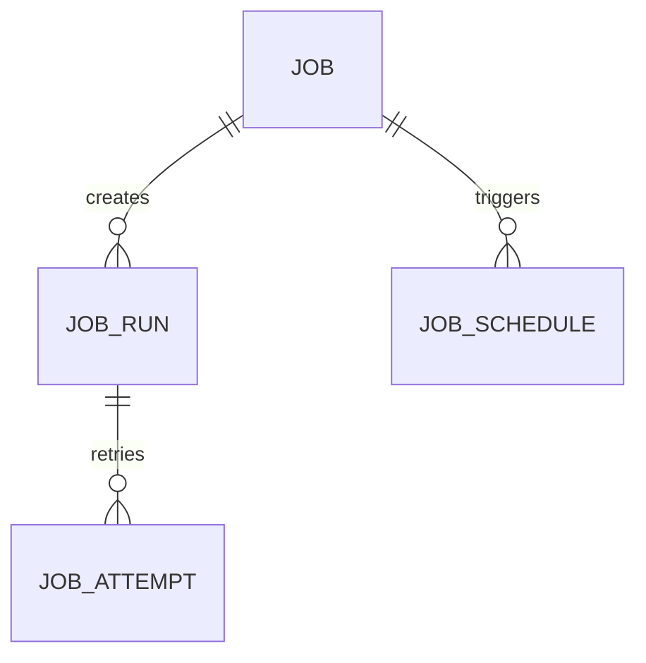

A schedule describes when work should be created; a run is one logical execution; an attempt is one try. Keep those concepts separate.

## 3. Core schema

```sql
CREATE TABLE job (
  id uuid PRIMARY KEY,
  name text NOT NULL,
  handler_key text NOT NULL,
  payload jsonb NOT NULL DEFAULT '{}',
  enabled boolean NOT NULL DEFAULT true,
  max_concurrency integer NOT NULL DEFAULT 1 CHECK (max_concurrency > 0),
  created_at timestamptz NOT NULL DEFAULT now()
);
CREATE TABLE job_schedule (
  id uuid PRIMARY KEY,
  job_id uuid NOT NULL REFERENCES job(id) ON DELETE CASCADE,
  schedule_type text NOT NULL CHECK (schedule_type IN ('once','cron','fixed_interval')),
  expression text NOT NULL,
  timezone text NOT NULL DEFAULT 'UTC',
  next_run_at timestamptz,
  misfire_policy text NOT NULL DEFAULT 'skip' CHECK (misfire_policy IN ('skip','catch_up','fire_once')),
  enabled boolean NOT NULL DEFAULT true
);
CREATE INDEX schedule_due_idx ON job_schedule (next_run_at, id) WHERE enabled;
CREATE TABLE job_run (
  id uuid PRIMARY KEY,
  job_id uuid NOT NULL REFERENCES job(id),
  schedule_id uuid REFERENCES job_schedule(id),
  scheduled_for timestamptz NOT NULL,
  idempotency_key text UNIQUE, -- required for externally submitted one-off jobs
  status text NOT NULL CHECK (status IN ('queued','running','succeeded','failed','cancelled')),
  available_at timestamptz NOT NULL DEFAULT now(),
  attempt_count integer NOT NULL DEFAULT 0,
  lease_owner text,
  lease_token uuid,
  lease_until timestamptz,
  result jsonb,
  created_at timestamptz NOT NULL DEFAULT now(),
  UNIQUE (schedule_id, scheduled_for)
);
CREATE INDEX job_run_ready_idx ON job_run (available_at, created_at, id) WHERE status = 'queued';
CREATE INDEX job_run_expired_lease_idx ON job_run (lease_until) WHERE status = 'running';
CREATE TABLE job_attempt (
  id bigint GENERATED ALWAYS AS IDENTITY PRIMARY KEY,
  run_id uuid NOT NULL REFERENCES job_run(id),
  attempt_no integer NOT NULL,
  worker_id text NOT NULL,
  status text NOT NULL CHECK (status IN ('started','succeeded','failed','timed_out','unknown')),
  error jsonb,
  started_at timestamptz NOT NULL DEFAULT now(),
  finished_at timestamptz,
  UNIQUE (run_id, attempt_no)
);
```

## 4. Five important SQL queries

```sql
-- Q1: Claim due schedules; the application computes next_run_at from cron/timezone rules.
SELECT id, job_id, expression, timezone, next_run_at, misfire_policy
FROM job_schedule WHERE enabled AND next_run_at <= now()
ORDER BY next_run_at LIMIT 100 FOR UPDATE SKIP LOCKED;

-- Q2: Insert exactly one logical run per schedule fire time.
INSERT INTO job_run (id, job_id, schedule_id, scheduled_for, status, available_at)
VALUES (:run_id, :job_id, :schedule_id, :scheduled_for, 'queued', now())
ON CONFLICT (schedule_id, scheduled_for) DO NOTHING;

-- Q3: Claim runnable jobs with a fresh fencing token.
WITH candidates AS (
  SELECT id FROM job_run WHERE status = 'queued' AND available_at <= now()
  ORDER BY available_at, created_at LIMIT 100 FOR UPDATE SKIP LOCKED
)
UPDATE job_run r SET status = 'running', lease_owner = :worker_id,
  lease_token = :new_token, lease_until = now() + interval '60 seconds',
  attempt_count = attempt_count + 1
FROM candidates c WHERE r.id = c.id RETURNING r.*;

-- Q4: Complete run only with the current lease token.
UPDATE job_run SET status = 'succeeded', result = :result,
  lease_owner = NULL, lease_until = NULL
WHERE id = :run_id AND status = 'running' AND lease_token = :lease_token
RETURNING id;

-- Q5: Failed runs for operations dashboard.
SELECT id, job_id, attempt_count, available_at, created_at
FROM job_run WHERE status = 'failed' ORDER BY created_at DESC LIMIT 100;

-- Q6: Recover expired worker leases; retry policy determines queued vs failed.
UPDATE job_run SET status = 'queued', available_at = now(), lease_owner = NULL,
  lease_token = NULL, lease_until = NULL
WHERE status = 'running' AND lease_until < now() RETURNING id;
```

## 5. Transaction boundaries and risks

Schedule claiming/run creation should be atomic; unique `(schedule_id, scheduled_for)` handles scheduler overlap. Workers claim a run with a lease and random fencing token; completion must present the token. Reaper logic should not reset a run a worker has renewed. Use `SKIP LOCKED` to distribute work across scheduler instances. Business side effects need their own idempotency keys: the scheduler cannot guarantee exactly-once external execution. Define misfire behavior and DST/time-zone semantics up front.

## 6. At 100× scale

Partition old run/attempt history, shard queue rows by tenant or queue, and separate schedule evaluation from execution workers. Use queue technology or a dedicated timer service if DB polling becomes the bottleneck, while retaining durable run state in a transactional store. Add per-tenant quotas, fairness, priorities, backpressure, and bounded retry policies.

---

# 10. Webhook Delivery

## 1. Business requirements and access patterns

**Requirements:** register endpoints and subscribed event types; create durable events; deliver asynchronously; retry with backoff; sign requests; record response codes/latency; support pause/replay; and guarantee safe deduplication. The realistic default is **at-least-once delivery**, not exactly-once.

**Hot access patterns:** pending deliveries; delivery attempts for an endpoint/event; endpoint configuration; failed deliveries by age; redrive a dead delivery; event lookup by ID.

## 2. ER diagram and cardinalities

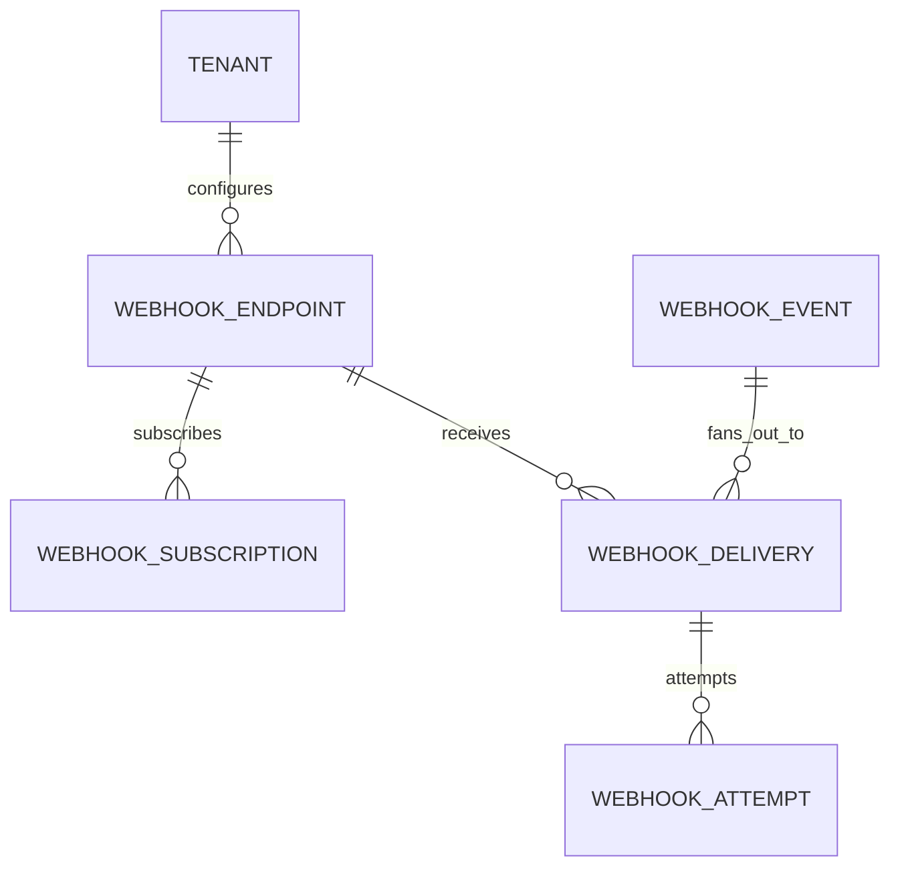

An event may fan out to many subscribed endpoints. Each `(endpoint, event)` delivery has many attempts but only one delivery record.

## 3. Core schema

```sql
CREATE TABLE webhook_endpoint (
  id uuid PRIMARY KEY,
  tenant_id uuid NOT NULL,
  url text NOT NULL,
  secret_ciphertext bytea NOT NULL,
  active boolean NOT NULL DEFAULT true,
  created_at timestamptz NOT NULL DEFAULT now()
);
CREATE INDEX webhook_endpoint_tenant_idx ON webhook_endpoint (tenant_id, active);
CREATE TABLE webhook_subscription (
  endpoint_id uuid NOT NULL REFERENCES webhook_endpoint(id) ON DELETE CASCADE,
  event_type text NOT NULL,
  PRIMARY KEY (endpoint_id, event_type)
);
CREATE TABLE webhook_event (
  id uuid PRIMARY KEY,
  tenant_id uuid NOT NULL,
  event_type text NOT NULL,
  payload jsonb NOT NULL,
  created_at timestamptz NOT NULL DEFAULT now()
);
CREATE INDEX webhook_event_tenant_recent_idx ON webhook_event (tenant_id, created_at DESC);
CREATE TABLE webhook_delivery (
  id uuid PRIMARY KEY,
  event_id uuid NOT NULL REFERENCES webhook_event(id),
  endpoint_id uuid NOT NULL REFERENCES webhook_endpoint(id),
  status text NOT NULL CHECK (status IN ('pending','delivering','succeeded','dead','cancelled')),
  attempts_count integer NOT NULL DEFAULT 0,
  next_attempt_at timestamptz NOT NULL DEFAULT now(),
  locked_by text,
  lease_until timestamptz,
  last_status_code integer,
  last_error text,
  created_at timestamptz NOT NULL DEFAULT now(),
  UNIQUE (event_id, endpoint_id)
);
CREATE INDEX webhook_delivery_ready_idx ON webhook_delivery (next_attempt_at, id) WHERE status = 'pending';
CREATE INDEX webhook_delivery_dead_idx ON webhook_delivery (created_at DESC) WHERE status = 'dead';
CREATE TABLE webhook_attempt (
  id bigint GENERATED ALWAYS AS IDENTITY PRIMARY KEY,
  delivery_id uuid NOT NULL REFERENCES webhook_delivery(id),
  attempt_no integer NOT NULL,
  status_code integer,
  duration_ms integer,
  error text,
  attempted_at timestamptz NOT NULL DEFAULT now(),
  UNIQUE (delivery_id, attempt_no)
);
```

## 4. Five important SQL queries

```sql
-- Q1: Create a delivery per endpoint/event (dedupe).
INSERT INTO webhook_delivery (id, event_id, endpoint_id, status, next_attempt_at)
VALUES (:id, :event_id, :endpoint_id, 'pending', now())
ON CONFLICT (event_id, endpoint_id) DO NOTHING;

-- Q2: Claim due deliveries.
WITH candidates AS (
  SELECT id FROM webhook_delivery
  WHERE status = 'pending' AND next_attempt_at <= now()
  ORDER BY next_attempt_at, id LIMIT 100 FOR UPDATE SKIP LOCKED
)
UPDATE webhook_delivery d SET status = 'delivering', locked_by = :worker_id,
  lease_until = now() + interval '60 seconds'
FROM candidates c WHERE d.id = c.id RETURNING d.*;

-- Q3: Record an attempt.
INSERT INTO webhook_attempt (delivery_id, attempt_no, status_code, duration_ms, error)
VALUES (:delivery_id, :attempt_no, :status_code, :duration_ms, :error);

-- Q4: Mark success only if the active worker still owns delivery.
UPDATE webhook_delivery SET status = 'succeeded', last_status_code = :code,
  attempts_count = attempts_count + 1, locked_by = NULL, lease_until = NULL
WHERE id = :delivery_id AND status = 'delivering' AND locked_by = :worker_id
RETURNING id;

-- Q5: Schedule retry or dead-letter based on attempt policy.
UPDATE webhook_delivery SET status = :next_status, next_attempt_at = :retry_at,
  attempts_count = attempts_count + 1, last_status_code = :code, last_error = :error,
  locked_by = NULL, lease_until = NULL
WHERE id = :delivery_id AND status = 'delivering' AND locked_by = :worker_id;

-- Q6: Find endpoints with repeated failures.
SELECT endpoint_id, count(*) AS dead_count, max(created_at) AS newest_failure
FROM webhook_delivery WHERE status = 'dead'
GROUP BY endpoint_id ORDER BY dead_count DESC LIMIT 100;
```

## 5. Transaction boundaries and risks

Persist the domain event and outbox record in the producer transaction; a relay creates event/delivery rows or publishes to a queue. Delivery claim and lease are transactional, but HTTP calls happen outside DB transactions. Record each attempt and use bounded exponential backoff with jitter, a max-attempt policy, and dead-letter/replay operations. Sign the exact body bytes and include event ID/timestamp to support receiver deduplication. Risks: endpoint timeouts, duplicate requests, SSRF, secret leakage, DNS rebinding, and retries amplifying an outage. Validate outbound destinations and re-check redirects/IP ranges.

## 6. At 100× scale

Use a durable queue for delivery dispatch, with Postgres storing delivery state and attempt history; partition event/attempt history by time. Apply per-endpoint concurrency limits, per-tenant rate limits, circuit breakers, and delivery fairness. Encrypt secrets with a managed KMS, rotate them, and keep request/response body retention bounded. Large payloads may live in object storage with immutable references.

---

# 11. Analytics Warehouse

## 1. Business requirements and access patterns

**Requirements:** answer high-volume aggregate questions over business events; preserve historical dimensions; support ingestion/reprocessing, late events, and dedupe; and isolate analytical queries from latency-sensitive OLTP. This is an OLAP model: optimize for scans, grouping, and time-based partition pruning, not frequent row-by-row updates.

**Hot access patterns:** revenue/orders by day/product/region; cohort and funnel analysis; customer lifetime value; incremental load by watermark; data quality counts; rerun a batch without double-counting.

## 2. ER diagram and grain

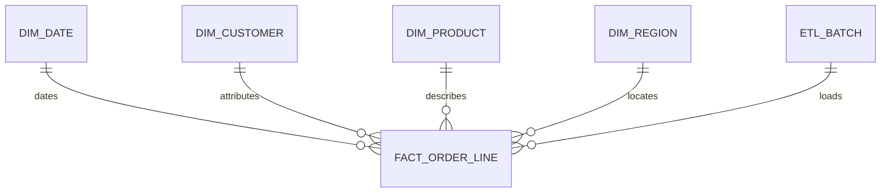

**Fact grain:** one row per order line at the time of purchase. Dimension tables describe business keys; use Type 2 history when attribute changes must be historically correct. A separate order-level fact may be needed for order-level measures to avoid summing them once per line.

## 3. Core schema (PostgreSQL-style dimensional baseline)

```sql
CREATE TABLE dim_date (
  date_key integer PRIMARY KEY, -- e.g. YYYYMMDD
  calendar_date date NOT NULL UNIQUE,
  year_num integer NOT NULL,
  quarter_num integer NOT NULL,
  month_num integer NOT NULL,
  day_num integer NOT NULL
);
CREATE TABLE dim_customer (
  customer_key bigint GENERATED ALWAYS AS IDENTITY PRIMARY KEY,
  customer_business_id text NOT NULL,
  effective_from timestamptz NOT NULL,
  effective_to timestamptz NOT NULL,
  is_current boolean NOT NULL,
  region text,
  segment text,
  UNIQUE (customer_business_id, effective_from),
  CHECK (effective_to > effective_from)
);
CREATE UNIQUE INDEX dim_customer_current_idx ON dim_customer (customer_business_id) WHERE is_current;
CREATE TABLE dim_product (
  product_key bigint GENERATED ALWAYS AS IDENTITY PRIMARY KEY,
  product_business_id text NOT NULL,
  product_name text NOT NULL,
  category text,
  effective_from timestamptz NOT NULL,
  effective_to timestamptz NOT NULL,
  is_current boolean NOT NULL,
  UNIQUE (product_business_id, effective_from)
);
CREATE UNIQUE INDEX dim_product_current_idx ON dim_product (product_business_id) WHERE is_current;
CREATE TABLE etl_batch (
  id bigint GENERATED ALWAYS AS IDENTITY PRIMARY KEY,
  source_name text NOT NULL,
  source_batch_key text NOT NULL,
  status text NOT NULL CHECK (status IN ('started','succeeded','failed')),
  started_at timestamptz NOT NULL DEFAULT now(),
  completed_at timestamptz,
  UNIQUE (source_name, source_batch_key)
);
CREATE TABLE fact_order_line (
  order_line_id text NOT NULL,
  order_id text NOT NULL,
  date_key integer NOT NULL REFERENCES dim_date(date_key),
  customer_key bigint NOT NULL REFERENCES dim_customer(customer_key),
  product_key bigint NOT NULL REFERENCES dim_product(product_key),
  etl_batch_id bigint NOT NULL REFERENCES etl_batch(id),
  quantity numeric(18,4) NOT NULL,
  gross_amount_minor bigint NOT NULL,
  discount_amount_minor bigint NOT NULL,
  net_amount_minor bigint NOT NULL,
  currency char(3) NOT NULL,
  PRIMARY KEY (order_line_id)
);
CREATE INDEX fact_order_date_product_idx ON fact_order_line (date_key, product_key);
CREATE INDEX fact_order_date_customer_idx ON fact_order_line (date_key, customer_key);
```

In a real warehouse, use the platform's native partitioning, clustering/sort keys, distribution keys, and columnar storage. The example is for dimensional modeling concepts rather than a universal physical layout.

## 4. Five important SQL queries

```sql
-- Q1: Net revenue by day for a date range.
SELECT d.calendar_date, sum(f.net_amount_minor) AS net_revenue_minor
FROM fact_order_line f JOIN dim_date d ON d.date_key = f.date_key
WHERE d.calendar_date >= :start_date AND d.calendar_date < :end_date
GROUP BY d.calendar_date ORDER BY d.calendar_date;

-- Q2: Revenue by product category.
SELECT p.category, sum(f.net_amount_minor) AS revenue_minor, sum(f.quantity) AS units
FROM fact_order_line f JOIN dim_product p ON p.product_key = f.product_key
JOIN dim_date d ON d.date_key = f.date_key
WHERE d.calendar_date >= :start_date AND d.calendar_date < :end_date
GROUP BY p.category ORDER BY revenue_minor DESC;

-- Q3: Monthly revenue by customer segment using the historical customer dimension row.
SELECT d.year_num, d.month_num, c.segment, sum(f.net_amount_minor) AS revenue_minor
FROM fact_order_line f JOIN dim_date d ON d.date_key = f.date_key
JOIN dim_customer c ON c.customer_key = f.customer_key
GROUP BY d.year_num, d.month_num, c.segment
ORDER BY d.year_num, d.month_num, c.segment;

-- Q4: Largest customers over a period.
SELECT c.customer_business_id, sum(f.net_amount_minor) AS lifetime_period_revenue
FROM fact_order_line f JOIN dim_customer c ON c.customer_key = f.customer_key
JOIN dim_date d ON d.date_key = f.date_key
WHERE d.calendar_date >= :start_date AND d.calendar_date < :end_date
GROUP BY c.customer_business_id ORDER BY lifetime_period_revenue DESC LIMIT 100;

-- Q5: Detect duplicate business events in a staging table before load.
SELECT order_line_id, count(*)
FROM staging_order_line GROUP BY order_line_id HAVING count(*) > 1;

-- Q6: Reconciliation by ETL batch.
SELECT b.id, b.status, count(f.order_line_id) AS loaded_rows,
       sum(f.net_amount_minor) AS loaded_net_minor
FROM etl_batch b LEFT JOIN fact_order_line f ON f.etl_batch_id = b.id
WHERE b.id = :batch_id GROUP BY b.id, b.status;
```

## 5. Transaction boundaries and risks

Load into staging, validate/dedupe, resolve dimension surrogate keys, then merge facts and mark the batch complete atomically where feasible. For large loads, use idempotent batch keys and staging-to-partition swaps or warehouse-native merge semantics. Late-arriving facts may need inferred dimension members and restatement. Risks: double-counting order-level amounts at line grain, incorrect Type 2 joins, currency mixing, duplicate replay, and mixing operational reporting with a slow scan-heavy workload.

## 6. At 100× scale

Move from a general-purpose row store to a columnar analytical warehouse/lakehouse; partition by event/date and cluster/sort on common filter columns. Use CDC or streaming ingestion, incremental transformations, materialized aggregates, data contracts, lineage, and quality checks. Keep raw immutable events, curated dimensional models, and serving aggregates as separate layers. Apply governance/PII minimization and access policies in the warehouse itself.

---

# 12. AI Agent Execution Platform

## 1. Business requirements and access patterns

**Requirements:** define agents and immutable versions; execute runs with model calls, tool calls, messages, artifacts, budgets, and human approvals; recover from worker crashes; enforce tenant isolation and tool permissions; measure latency/cost; and preserve a trace for audit/debugging. Prompts, tool outputs, and artifacts may contain secrets or sensitive data, so retention and access policies matter.

**Hot access patterns:** create/retrieve run by idempotency key; list runs by tenant/agent; read ordered trace; inspect tool calls and approvals; aggregate token/cost metrics; find running/stalled runs; resume a paused run after approval.

## 2. ER diagram and cardinalities

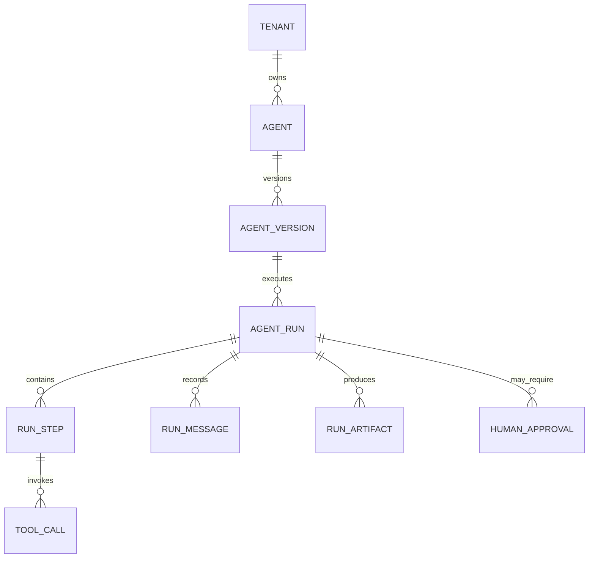

Agent configuration versions are immutable; a run points to the exact version and model/tool policy used. Steps and tool calls need stable sequence numbers and idempotency keys.

## 3. Core schema

```sql
CREATE TABLE tenant (
  id uuid PRIMARY KEY,
  name text NOT NULL
);
CREATE TABLE agent (
  id uuid PRIMARY KEY,
  tenant_id uuid NOT NULL REFERENCES tenant(id),
  name text NOT NULL,
  active boolean NOT NULL DEFAULT true,
  UNIQUE (tenant_id, name),
  UNIQUE (tenant_id, id)
);
CREATE TABLE agent_version (
  id uuid PRIMARY KEY,
  agent_id uuid NOT NULL REFERENCES agent(id),
  version integer NOT NULL,
  config jsonb NOT NULL,
  prompt_template text NOT NULL,
  created_at timestamptz NOT NULL DEFAULT now(),
  UNIQUE (agent_id, version)
);
CREATE TABLE agent_run (
  id uuid PRIMARY KEY,
  tenant_id uuid NOT NULL REFERENCES tenant(id),
  agent_version_id uuid NOT NULL REFERENCES agent_version(id),
  idempotency_key text NOT NULL,
  status text NOT NULL CHECK (status IN ('queued','running','waiting_approval','succeeded','failed','cancelled')),
  input_ref text,
  output_ref text,
  model_provider text,
  model_name text,
  budget_minor bigint CHECK (budget_minor >= 0),
  spent_minor bigint NOT NULL DEFAULT 0 CHECK (spent_minor >= 0),
  state_version bigint NOT NULL DEFAULT 0,
  started_at timestamptz NOT NULL DEFAULT now(),
  finished_at timestamptz,
  UNIQUE (tenant_id, idempotency_key)
);
CREATE INDEX agent_run_tenant_recent_idx ON agent_run (tenant_id, started_at DESC, id DESC);
CREATE INDEX agent_run_active_idx ON agent_run (started_at) WHERE status IN ('queued','running','waiting_approval');
CREATE TABLE run_step (
  id uuid PRIMARY KEY,
  run_id uuid NOT NULL REFERENCES agent_run(id) ON DELETE CASCADE,
  sequence_no integer NOT NULL,
  step_type text NOT NULL CHECK (step_type IN ('model','tool','router','guardrail','approval')),
  status text NOT NULL CHECK (status IN ('queued','running','succeeded','failed','skipped','waiting_approval')),
  input_ref text,
  output_ref text,
  started_at timestamptz,
  finished_at timestamptz,
  error jsonb,
  UNIQUE (run_id, sequence_no)
);
CREATE INDEX run_step_status_idx ON run_step (status, run_id);
CREATE TABLE tool_call (
  id uuid PRIMARY KEY,
  step_id uuid NOT NULL REFERENCES run_step(id),
  tool_name text NOT NULL,
  idempotency_key text NOT NULL,
  arguments_ref text,
  result_ref text,
  status text NOT NULL CHECK (status IN ('requested','running','succeeded','failed','unknown','denied')),
  duration_ms integer,
  UNIQUE (tool_name, idempotency_key)
);
CREATE TABLE run_message (
  id bigint GENERATED ALWAYS AS IDENTITY PRIMARY KEY,
  run_id uuid NOT NULL REFERENCES agent_run(id) ON DELETE CASCADE,
  sequence_no integer NOT NULL,
  role text NOT NULL CHECK (role IN ('system','user','assistant','tool')),
  content_ref text NOT NULL,
  token_count integer,
  created_at timestamptz NOT NULL DEFAULT now(),
  UNIQUE (run_id, sequence_no)
);
CREATE INDEX run_message_timeline_idx ON run_message (run_id, sequence_no);
CREATE TABLE run_artifact (
  id uuid PRIMARY KEY,
  run_id uuid NOT NULL REFERENCES agent_run(id) ON DELETE CASCADE,
  artifact_type text NOT NULL,
  object_uri text NOT NULL,
  checksum text,
  created_at timestamptz NOT NULL DEFAULT now()
);
CREATE TABLE model_usage (
  id bigint GENERATED ALWAYS AS IDENTITY PRIMARY KEY,
  tenant_id uuid NOT NULL REFERENCES tenant(id),
  run_id uuid NOT NULL REFERENCES agent_run(id),
  step_id uuid REFERENCES run_step(id),
  model_provider text NOT NULL,
  model_name text NOT NULL,
  provider_request_id text,
  input_tokens bigint NOT NULL DEFAULT 0 CHECK (input_tokens >= 0),
  output_tokens bigint NOT NULL DEFAULT 0 CHECK (output_tokens >= 0),
  cost_minor bigint NOT NULL DEFAULT 0 CHECK (cost_minor >= 0),
  latency_ms integer CHECK (latency_ms >= 0),
  measured_at timestamptz NOT NULL DEFAULT now(),
  UNIQUE (model_provider, provider_request_id)
);
CREATE INDEX model_usage_tenant_time_idx ON model_usage (tenant_id, measured_at DESC);
CREATE TABLE human_approval (
  id uuid PRIMARY KEY,
  run_id uuid NOT NULL REFERENCES agent_run(id) ON DELETE CASCADE,
  step_id uuid REFERENCES run_step(id),
  status text NOT NULL CHECK (status IN ('pending','approved','rejected','expired')),
  requested_action jsonb NOT NULL,
  decided_by text,
  decided_at timestamptz,
  expires_at timestamptz
);
CREATE INDEX approval_pending_idx ON human_approval (expires_at) WHERE status = 'pending';
```

Large prompts, model outputs, tool payloads, and documents should usually live in encrypted object storage or a governed blob store; keep references, checksums, and policy metadata in OLTP. Do not store API keys in `agent_version.config`; store secret references and resolve them through a secret manager.

## 4. Five important SQL queries

```sql
-- Q1: Idempotently create a run.
INSERT INTO agent_run (id, tenant_id, agent_version_id, idempotency_key, status, input_ref, budget_minor)
VALUES (:id, :tenant_id, :agent_version_id, :key, 'queued', :input_ref, :budget_minor)
ON CONFLICT (tenant_id, idempotency_key) DO NOTHING;

-- Q2: Recent runs for a tenant/agent.
SELECT r.id, r.status, r.started_at, r.finished_at, r.spent_minor, av.version
FROM agent_run r JOIN agent_version av ON av.id = r.agent_version_id
JOIN agent a ON a.id = av.agent_id
WHERE r.tenant_id = :tenant_id AND a.id = :agent_id
ORDER BY r.started_at DESC, r.id DESC LIMIT 50;

-- Q3: Ordered execution trace.
SELECT sequence_no, step_type, status, started_at, finished_at, error
FROM run_step WHERE run_id = :run_id ORDER BY sequence_no;

-- Q4: Tool calls for a run.
SELECT tc.tool_name, tc.status, tc.duration_ms, s.sequence_no
FROM tool_call tc JOIN run_step s ON s.id = tc.step_id
WHERE s.run_id = :run_id ORDER BY s.sequence_no;

-- Q5: Enforce a run budget before scheduling the next expensive operation.
UPDATE agent_run SET spent_minor = spent_minor + :estimated_cost,
  state_version = state_version + 1
WHERE id = :run_id AND status = 'running'
  AND spent_minor + :estimated_cost <= budget_minor
RETURNING spent_minor, budget_minor;

-- Q6: Cost and token usage by day/model (illustrative if usage table is added).
SELECT date_trunc('day', measured_at) AS day, model_provider, model_name,
       sum(input_tokens) AS input_tokens, sum(output_tokens) AS output_tokens,
       sum(cost_minor) AS cost_minor
FROM model_usage
WHERE tenant_id = :tenant_id AND measured_at >= :from_ts AND measured_at < :to_ts
GROUP BY 1, 2, 3 ORDER BY 1, 2, 3;
```

A practical implementation should add a `model_usage` table with one row per model invocation (tenant, run, step, provider/model, input/output tokens, latency, cost, measured_at) and unique provider/request IDs where available. The query above is the access pattern for that table.

## 5. Transaction boundaries and risks

Run creation, idempotency, and initial queued state are one transaction. Claiming a step/lease is another short transaction; model/tool calls happen outside DB transactions. On completion, persist output reference, usage/cost, status, and next-step state atomically. Tool calls require idempotency and an `unknown` state for timeout-after-side-effect. Budget checks must be atomic (guarded update); if parallel steps can spend concurrently, reserve estimated cost before dispatch and settle actual cost afterward. Human approval should be a durable state transition, not a blocked worker thread. Risks include duplicate tool effects, budget races, non-deterministic replay, secret/PII leakage, prompt injection reaching privileged tools, and tracing data retained longer than policy allows.

## 6. At 100× scale

Partition append-only traces and usage by time/tenant, move large contents to encrypted blob storage, and export usage to an analytical warehouse. Use a durable workflow queue for step execution; keep a small transactional state store for run/step status. Add per-tenant concurrency/token budgets, tool allowlists, approval gates for high-risk actions, redaction/retention policies, and trace sampling for high-volume low-risk runs. Separate raw sensitive payload access from general run metadata, with auditable access controls.

---

# Interview checklist: how to present any of these designs

For each system, talk through the design in this order:

1. **State the grain and invariants.** Example: “One inventory balance row per SKU/warehouse/bin; available stock can never be negative.”
2. **Name the top access patterns.** Start with the 3–5 queries that dominate latency and traffic.
3. **Draw cardinalities.** Identify one-to-many and many-to-many relations; show where a join table is needed.
4. **Choose keys and constraints.** Explain uniqueness scope, delete behavior, nullability, and immutable history.
5. **Write the hot SQL.** At least one read, one write, one idempotent retry, one paginated history query, and one operational/reconciliation query.
6. **Mark transaction boundaries.** Call out which state changes must commit together and which network calls must happen outside transactions.
7. **Explain concurrency.** Discuss guarded updates, locks, optimistic versions, `SKIP LOCKED`, idempotency, and deadlock ordering.
8. **Scale in the order justified by evidence.** First right-size indexes and queries; then add caching/read replicas/partitioning/queues; shard only when a clear access or ownership boundary exists.

## Frequent interview mistakes to avoid

- Using floating-point values for money.
- Relying on “check then update” without a lock or conditional write.
- Claiming exactly-once processing across a network boundary.
- Updating ledger/history rows in place instead of appending reversals/events.
- Using offset pagination for deep, high-volume history when keyset pagination is available.
- Adding indexes without naming the query they serve.
- Scaling the database before measuring query latency, write amplification, and contention.
- Mixing operational state and analytics facts without defining their grain.
- Forgetting idempotency, retries, reconciliation, retention, and access control.
